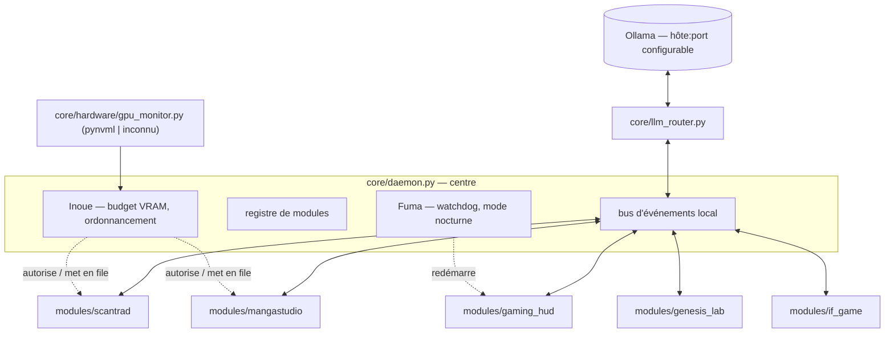
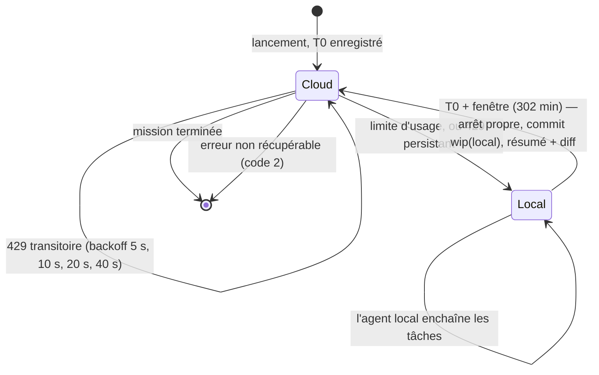
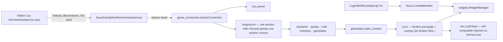

# ARCHITECTURE_MAP — AetherTwin (I&F Core)

Deux parties :

- **Flux et rôles** (ci-dessous) : rédigés à la main.
- **Arborescence et signatures publiques** (en bas) : générées par
  `scripts/gen_architecture_map.py` via `ast`. Ne les modifie pas à la main.
  Un test (`tests/test_architecture_map.py`) échoue si elles sont périmées.

État au 17/11/2026 : le centre (`core/`) et un premier module réel (`modules/gaming_hud/`) existent
et sont testés. Les modules `scantrad`, `mangastudio`, `genesis_lab` et `if_game` du schéma ci-dessous
n'existent pas encore : pour eux, le schéma décrit la cible.

## Vue d'ensemble



Chaque module tourne dans un **processus séparé** (`core/module_runner.py`) et ne parle au Hub que
par le bus local (`core/bus.py`, `127.0.0.1`, clé tirée au hasard à chaque lancement, messages JSON).

## Flux d'un module réel : gaming_hud (existant, testé en réel)

```mermaid
sequenceDiagram
    participant J as Jeu (fichiers, lecture seule)
    participant M as GamingHudModule (processus séparé)
    participant B as Bus du Hub
    participant D as Démon (Inoue, Fuma, API)
    participant R as LlmRouter
    participant O as Ollama (local)
    D->>M: lance le processus (Inoue a accordé la VRAM demandée : 0)
    loop toutes les 2 s
        M->>J: GameAdapter.read_state()
        M->>M: privacy_filter(état, "off" ou "showcase")
        M->>B: module.gaming_hud.state {state, context, omitted}
    end
    D->>B: process.started {obs64.exe}
    B->>M: événement
    M->>B: module.gaming_hud.showcase {on: true}
    Note over M,B: désormais tout ce qui est publié est filtré
    D->>R: /ask : question + contexte publié par les modules actifs
    R->>D: Inoue.plan_llm_load → modèles à décharger d'abord
    R->>O: keep_alive 0 (ancien gros modèle), puis /api/chat (num_ctx fixé)
    O->>R: réponse ; VRAM réelle relue dans /api/ps
```

| Sujet du bus | Émetteur | Contenu |
|---|---|---|
| `hub.started`, `hub.shutdown` | démon | démarrage et arrêt du Hub |
| `process.started`, `process.stopped` | démon | `{name}` d'un processus de la machine |
| `gpu.alert.temperature`, `gpu.alert.power` | Fuma | GPU au-dessus d'une limite |
| `module.<nom>.started`, `.health`, `.stopped`, `.error` | lanceur de module | cycle de vie |
| `module.<nom>.restarted` | Fuma | module relancé après un plantage |
| `module.<nom>.vram` | démon | décision d'Inoue quand elle n'accorde pas la VRAM |
| `module.<nom>.cmd.*` | démon ou API | ordres : `stop`, `showcase`, `refresh` |
| `module.gaming_hud.state`, `.showcase` | gaming_hud | état du jeu, bascule Showcase |

### Adaptateurs de jeu

`modules/gaming_hud/adapters/base.py` définit `GameAdapter` : `detect`, `read_state`, `schema`,
`widgets`, `privacy_filter`, `context_for_llm`. Trois implémentations :

| Adaptateur | Source | Statut |
|---|---|---|
| `wow_retail` | SavedVariables de l'addon HermesAssistant (via `app/game_connection.py`) | testé sur données réelles |
| `log_tail` | un journal texte + des règles regex en YAML | testé, aucun vrai jeu branché |
| `screen_ocr` | capture d'écran lue par le modèle de vision local | expérimental, testé sur image générée |

Le filtre commun est `adapters/privacy.py` : il parcourt tout l'état, supprime les clés au nom
sensible et nettoie chaque chaîne. Il ne suppose rien de la forme des données.

## Flux du relais Cloud ⇄ Local (existant, testé en simulation)

Fichier : `scripts/relay_orchestrator.py`.



Données échangées :

| Fichier | Écrit par | Lu par | Rôle |
|---|---|---|---|
| `logs/relay_state.json` | orchestrateur (écriture atomique) | orchestrateur au redémarrage | phase, T0, heure de retour, commit de base |
| `logs/relay.lock` | orchestrateur | autre instance | un seul orchestrateur actif |
| `logs/relay.log` | orchestrateur | Jérémy | journal horodaté |
| `logs/relay_mission.md` | Jérémy (facultatif) | agent cloud | prompt de mission |
| `logs/relay_tasks.md` | agent cloud | agent local | liste de tâches courante |
| `AGENT_HANDOFF.md`, `PROJECT_STATUS.md`, `ARCHITECTURE_MAP.md` | les deux agents | agent local (`--read`) | passation |
| `logs/CHANGELOG_DEV.md` | les deux agents | agent cloud à la reprise | ce qui a été fait |

Points de conception :

- Toutes les dépendances de `RelayOrchestrator` sont injectées (`CloudBackend`,
  `LocalAgent`, Git, `Clock`) : les tests utilisent une horloge virtuelle et des
  doublures, sans réseau externe ni attente réelle.
- Le prompt de Claude Code passe par l'entrée standard, jamais par un shell.
- À la reprise, Claude reçoit le **diff seulement** (tronqué à 20 000 caractères).

## Flux de données de WoW Assistant (application d'origine)

Emplacement : `modules/gaming_hud/app/` (imports à plat, lancée par `python -m modules.gaming_hud`).
Ses signatures ne sont pas listées dans la partie générée.



Fait en J3 : `adapters/wow_retail.py` enveloppe `GameConnection`, le parseur et la règle de fusion
du cache derrière `GameAdapter`, sans les modifier. `LLMClient` devient client du Hub en réglant son
serveur sur `http://127.0.0.1:5750` (API compatible OpenAI servie par `core/api.py`).

<!-- AUTO:BEGIN -->
## Arborescence (générée)

```
core/
  __init__.py
  api.py
  bus.py
  config.py
  daemon.py
  guardians/
    __init__.py
    fuma.py
    inoue.py
  hardware/
    __init__.py
    gpu_monitor.py
  knowledge/
    __init__.py
    fetcher.py
    service.py
    store.py
  llm_router.py
  module_api.py
  module_runner.py
  scheduler.py
  web/
    dashboard.css
    dashboard.html
    dashboard.js
    ether_scene.js
    logo.svg
modules/
  __init__.py
  gaming_hud/
    __init__.py
    __main__.py
    adapters/
      __init__.py
      base.py
      log_tail.py
      privacy.py
      screen_ocr.py
      wow_retail.py
    addon/
      HermesAssistant/
        HermesAssistant.lua
        HermesAssistant.toc
    app/
      character.py
      clipboard.py
      config.py
      craft.py
      focus.py
      game_connection.py
      gamedata.py
      history.py
      hotkeys.py
      icons_draw.py
      inventory.py
      Lancer WoW Assistant.bat
      llm.py
      lua_parser.py
      main.py
      mousepos.py
      overlay.py
      quests.py
      README.md
      recipes.json
      requirements.txt
      settings.py
      snapcache.py
      tabs.py
      tabs_collections.py
      tabs_data.py
      tabutil.py
      theme.py
      ui.py
      vision.py
      voice.py
      webhost.py
      webwidget.py
      widgets.py
      widgets_builtin.py
      wowhead.py
      wowhead_links.json
    manifest.json
    module.py
    obs_server.py
    rules/
      log_tail.example.yaml
    web/
      obs_hud.css
      obs_hud.html
      obs_hud.js
  genesis_lab/
    __init__.py
    astro.py
    bio.py
    chem.py
    manifest.json
    module.py
    tutor.py
  if_game/
    __init__.py
    manifest.json
    module.py
    world.py
  mangastudio/
    __init__.py
    comfyui_nodes/
      __init__.py
    manifest.json
    module.py
    README.md
    segment.py
    workflows/
      continuity.json
  scantrad/
    __init__.py
    __main__.py
    cli.py
    detect.py
    hub_stages.py
    manifest.json
    module.py
    pipeline.py
    README.md
    testpage.py
    typeset.py
scripts/
  __init__.py
  gen_architecture_map.py
  relay_orchestrator.py
  setup.ps1
config/
  allowlist.yaml
  hardware_profiles.yaml
  knowledge_sources.yaml
  local.example.yaml
tests/
  __init__.py
  core/
    __init__.py
    sleeper.py
    test_bus_scheduler.py
    test_daemon.py
    test_dashboard.py
    test_gpu_monitor.py
    test_guardians.py
    test_knowledge_fetcher.py
    test_knowledge_service.py
    test_knowledge_store.py
    test_llm_router.py
    test_module_api.py
  data/
    .gitkeep
    scantrad/
      page_test.json
      page_test.png
  gaming_hud/
    __init__.py
    conftest.py
    test_adapters.py
    test_module.py
    test_obs_hud.py
    test_ui_fixes.py
  genesis_lab/
    __init__.py
    test_calculs.py
    test_tutor_module.py
  if_game/
    __init__.py
    test_if_game.py
  mangastudio/
    __init__.py
    test_mangastudio.py
  scantrad/
    __init__.py
    test_scantrad.py
    test_scantrad_module.py
  test_architecture_map.py
  test_relay_orchestrator.py
  test_repo_hygiene.py
docs/
  .gitkeep
  captures/
    obs_hud.png
    scantrad_page_test_fr.png
research/
  .gitkeep
assets/
  .gitkeep
  logo_if_core.svg
  logo_if_core_mono.svg
logs/
  CHANGELOG_DEV.md
.github/
  workflows/
    tests.yml
```

## Signatures publiques (générées)

*Non listé : `modules/gaming_hud/app/` (code d'origine de WoW Assistant, voir la partie « flux »).*

### `core/api.py`

API HTTP locale du démon (FastAPI). Servie sur 127.0.0.1 uniquement par `core.daemon`.

- `async def save_upload(request: Request, folder: Path) -> Path` — Enregistre l'image envoyée (corps brut, PNG/JPEG/WebP, 25 Mo au plus) sous un nom horodaté.
- `def image_file(root: Path, kind: str, filename: str) -> Response` — Image servie seulement depuis `<root>/entrees` ou `<root>/sorties`, nom contrôlé.
- `def static(filename: str) -> Response` — Sert un fichier de `core/web/` (liste fermée d'extensions, aucun chemin hors du dossier).
- **`class AskRequest(BaseModel)`**
- **`class ChatRequest(BaseModel)`**
- `def create_app(daemon: Daemon) -> FastAPI`

### `core/bus.py`

Bus d'événements local du Hub : publication / abonnement entre processus, sur 127.0.0.1 uniquement.

- **`class EventBus`** — Centre du bus. `publish` sert les abonnés locaux puis les clients distants abonnés au sujet.
  - `def start(self) -> tuple[str, int]`
  - `def stop(self) -> None`
  - `def child_env(self) -> dict[str, str]` — Variables à donner à un processus de module pour qu'il rejoigne le bus.
  - `def subscribe(self, pattern: str, callback: Callable[[Event], None]) -> None`
  - `def publish(self, event: Event) -> None`
  - `def clients(self) -> list[str]`
- **`class BusClient`** — Client du bus, utilisé dans le processus d'un module.
  - `def from_env(cls, name: str, env: dict[str, str] | None=None) -> BusClient`
  - `def subscribe(self, *patterns: str, timeout: float=5.0) -> None` — S'abonne et attend la confirmation du bus : aucun événement publié ensuite n'est perdu.
  - `def publish(self, event: Event) -> None`
  - `def recv(self, timeout: float | None=None) -> Event | None`
  - `def close(self) -> None`

### `core/config.py`

Configuration locale du Hub : `config/local.yaml` (ignoré par Git), jamais de secret dans le dépôt.

- `def config_path() -> Path`
- `def load_config(path: Path | None=None) -> dict[str, Any]` — Configuration complète ; `{}` si le fichier est absent, illisible ou n'est pas un dictionnaire.
- `def section(name: str, path: Path | None=None) -> dict[str, Any]` — Une section de la configuration (ex. « ollama », « gaming_hud ») ; `{}` si elle n'existe pas.

### `core/daemon.py`

Le démon : centre de l'architecture en étoile.

- `def psutil_process_names() -> set[str] | None` — Noms (en minuscules) des processus en cours ; `None` si `psutil` est absent (mode dégradé).
- **`class ManagedModule`**
  - `def running(self) -> bool`
- **`class Daemon`** — Registre de modules + bus + gardiens. Toutes les sources externes sont injectables (tests).
  - `def start(self) -> None`
  - `def stop(self) -> None`
  - `def reload_modules(self) -> None` — (Re)lit les manifestes de `modules/`. Un manifeste invalide est signalé, pas fatal.
  - `def activate(self, name: str, auto: bool=False) -> Decision` — Demande la VRAM à Inoue puis lance le module dans son processus. Idempotent.
  - `def deactivate(self, name: str, timeout_s: float=8.0) -> None` — Arrêt propre (ordre sur le bus), puis arrêt forcé si le module ne répond pas. Rend la VRAM.
  - `def app_spec(self, name: str) -> dict[str, str] | None` — `"app": {"label": …, "module": …}` du manifeste : un module Python fixe (validé au chargement du
  - `def app_running(self, name: str) -> bool`
  - `def start_app(self, name: str) -> bool` — Lance l'application (`python -m <module>` depuis la racine du dépôt). `False` si elle tourne déjà.
  - `def stop_app(self, name: str, timeout_s: float=5.0) -> None`
  - `def notify(self, name: str, command: str, payload: dict[str, Any] | None=None) -> None` — Commande sans réponse attendue (ex. `showcase`).
  - `def command(self, name: str, command: str, payload: dict[str, Any] | None=None, timeout_s: float=240.0) -> dict[str, Any]` — Envoie `module.<nom>.cmd.<commande>` et attend la réponse portant le même `request_id`.
  - `def ask(self, prompt: str, model: str | None=None, with_context: bool=True) -> dict[str, Any]` — Question à l'assistant local, avec le contexte publié par les modules actifs (déjà filtré par eux).
  - `def tick(self) -> dict[str, Any]` — Un tour : processus, déclencheurs, watchdog, alertes GPU, tâches de nuit. Retourne ce qui a changé.
  - `def status(self) -> dict[str, Any]`
  - `def modules_status(self) -> list[dict[str, Any]]`
- `def port_in_use(port: int) -> bool`
- `def main(argv: list[str] | None=None) -> int`

### `core/guardians/fuma.py`

Fuma — gardien de la stabilité et du mode nocturne.

- **`class Alert`**
  - `def to_dict(self) -> dict[str, Any]`
- **`class Fuma`** — Watchdog, limites thermiques et mode nocturne du Hub.
  - `def watch(self, name: str, health: Callable[[], Health], restart: Callable[[], None]) -> None`
  - `def unwatch(self, name: str) -> None`
  - `def tick(self) -> list[str]` — Un tour de surveillance. Retourne les noms des modules redémarrés pendant ce tour.
  - `def revive(self, name: str) -> None` — Remet à zéro les essais d'un module mis au repos (action manuelle).
  - `def check_gpus(self, gpus: list[GpuInfo]) -> list[Alert]`
  - `def is_night(self) -> bool` — Vrai dans la plage de nuit. Une plage qui passe minuit (23 h → 7 h) est gérée.
  - `def schedule_night_task(self, name: str, run: Callable[[], Any], recurring: bool=False) -> None` — Planifie une tâche lourde pour la nuit (ingestion vectorielle, indexation…).
  - `def run_night_tasks(self, force: bool=False) -> list[str]` — Exécute les tâches en attente si c'est la nuit (ou si `force`). Retourne celles qui ont tourné.
  - `def state(self) -> dict[str, Any]`

### `core/guardians/inoue.py`

Inoue — gardienne de l'énergie et de la VRAM.

- **`class Verdict(StrEnum)`**
- **`class Decision`**
- **`class Inoue`** — Budget VRAM du Hub. Sans GPU détecté, le budget vaut 0 : seuls les modules sans besoin VRAM démarrent.
  - `def total_gb(self) -> float`
  - `def budget_gb(self) -> float` — VRAM attribuable : total moins la marge de sécurité.
  - `def allocated_gb(self) -> float`
  - `def available_gb(self) -> float`
  - `def request(self, name: str, min_gb: float, comfort_gb: float | None=None) -> Decision` — Demande de VRAM. Accorde le confortable s'il tient, sinon le minimum, sinon met en file.
  - `def release(self, name: str) -> list[tuple[str, Decision]]` — Libère l'attribution d'un module, puis sert la file d'attente dans l'ordre d'arrivée.
  - `def plan_llm_load(self, model: str, vram_gb: float) -> tuple[Decision, list[str]]` — Prépare le chargement d'un gros modèle de langage.
  - `def confirm_llm_unloaded(self, model: str) -> list[tuple[str, Decision]]`
  - `def state(self) -> dict[str, Any]`

### `core/hardware/gpu_monitor.py`

Moniteur GPU : mesure la topologie réelle au lieu de la présumer.

- **`class GpuInfo`** — État instantané d'un GPU. Une mesure indisponible vaut `None`, jamais une valeur inventée.
  - `def vram_free_mib(self) -> int`
  - `def to_dict(self) -> dict[str, Any]`
- **`class GpuBackend(Protocol)`**
  - `def read(self) -> list[GpuInfo]`
- `def parse_nvidia_smi_csv(output: str) -> list[GpuInfo]` — Analyse la sortie de `nvidia-smi --query-gpu=… --format=csv,noheader,nounits`.
- **`class NvidiaSmiBackend`** — Lit `nvidia-smi` (commande fixe, sans shell).
  - `def usable() -> bool`
  - `def read(self) -> list[GpuInfo]`
- **`class PynvmlBackend`** — Lit NVML via `pynvml`. L'import est différé : le paquet est optionnel.
  - `def read(self) -> list[GpuInfo]`
- **`class UnknownBackend`** — Repli : aucun GPU NVIDIA détectable. N'empêche jamais le démarrage.
  - `def read(self) -> list[GpuInfo]`
- `def detect_backend() -> GpuBackend` — Choisit le meilleur backend disponible, sans jamais lever d'exception.
- **`class GpuMonitor`** — Point d'entrée unique pour l'état des GPU (utilisé par Inoue, Fuma et l'API du daemon).
  - `def backend_name(self) -> str`
  - `def snapshot(self) -> list[GpuInfo]` — État de chaque GPU. En cas d'erreur de lecture : liste vide et `last_error` renseigné.
  - `def total_vram_mib(self) -> int`
  - `def report(self) -> dict[str, Any]` — Résumé sérialisable (API `/gpu`, overlay OBS).

### `core/knowledge/__init__.py`

Connaissances locales : base vectorielle (`store`) et collecte web polie (`fetcher`).

*(aucun symbole public)*

### `core/knowledge/fetcher.py`

Collecte web **polie** pour la base de connaissances.

- **`class FetchRefused(RuntimeError)`** — La page n'est pas récupérée, et c'est voulu (hors liste, robots.txt, type, taille).
- **`class Page`**
- `def urllib_opener(url: str, headers: dict[str, str], timeout: float) -> tuple[int, dict[str, str], bytes]`
- `def html_to_text(html: str) -> tuple[str, str]` — (titre, texte). Les espaces sont normalisés, les paragraphes séparés par une ligne vide.
- **`class PoliteFetcher`**
  - `def check_url(self, url: str) -> str` — Retourne l'hôte si l'URL est autorisée, sinon lève `FetchRefused`.
  - `def robots_allows(self, url: str) -> bool`
  - `def fetch(self, url: str, force: bool=False) -> Page`

### `core/knowledge/service.py`

Service de connaissances du Hub : base vectorielle + collecte polie + ingestion (la nuit, ou à la demande).

- `def load_sources(path: Path) -> list[dict[str, Any]]` — Sources déclarées : `url` (https), `license` (obligatoire), `tags`. Les entrées incomplètes sont ignorées.
- `def allowed_domains(path: Path | None=None) -> list[str]`
- `def ingest(store: KnowledgeStore, fetcher: PoliteFetcher, sources: list[dict[str, Any]], stop: threading.Event | None=None) -> dict[str, Any]` — Récupère chaque source et l'indexe. Une source en échec est notée, les suivantes continuent.
- **`class KnowledgeService`**
  - `def running(self) -> bool`
  - `def start_ingestion(self) -> bool` — Lance l'ingestion en arrière-plan. `False` si elle tourne déjà.
  - `def stop(self) -> None`
  - `def search(self, query: str, k: int=5, tag: str='') -> dict[str, Any]`
  - `def state(self) -> dict[str, Any]`

### `core/knowledge/store.py`

Base de connaissances locale : textes découpés, vecteurs d'embedding, recherche par similarité.

- **`class KnowledgeError(RuntimeError)`**
- **`class Hit`**
  - `def to_dict(self) -> dict[str, Any]`
- `def chunk_text(text: str, max_chars: int=900, overlap: int=150) -> list[str]` — Découpe par paragraphes, en morceaux d'au plus `max_chars`, avec un recouvrement pour garder le contexte.
- `def cosine(a: Iterable[float], b: Iterable[float]) -> float`
- `def lexical_score(query: str, text: str, idf: dict[str, float] | None=None, title: str='') -> float` — Part des mots de la requête présents dans le texte, pondérée par leur rareté (idf) ; bonus s'ils sont
- `def idf_table(query: str, texts: list[str]) -> dict[str, float]`
- `def ollama_embedder(host: str='127.0.0.1:11434', model: str='nomic-embed-text', timeout_s: float=120.0) -> Embedder` — Embeddings par le serveur Ollama local (`/api/embed`). Lève `KnowledgeError` si indisponible.
- **`class KnowledgeStore`**
  - `def close(self) -> None`
  - `def add_document(self, url: str, title: str, text: str, license: str, tags: Iterable[str]=(), fetched_at: float | None=None) -> dict[str, Any]` — Ajoute ou remplace un document. Sans changement de contenu, ne refait rien (`unchanged`).
  - `def remove(self, url: str) -> bool`
  - `def reindex(self) -> int` — Recalcule tous les vecteurs avec l'embedder courant (changement de modèle). Rend le nombre de passages.
  - `def search(self, query: str, k: int=5, tag: str='') -> list[Hit]` — Les `k` passages les plus proches. Retombe sur les mots communs si les vecteurs sont indisponibles.
  - `def sources_for(self, query: str, k: int=3) -> list[dict[str, str]]` — Format attendu par le Professeur (`Tutor(search=…)`) : titre, URL, licence, extrait.
  - `def stats(self) -> dict[str, Any]`

### `core/llm_router.py`

Routeur LLM du Hub : toutes les demandes de génération passent par ici, vers Ollama, en local.

- **`class LlmError(RuntimeError)`** — Ollama injoignable, modèle absent, réponse inattendue.
- **`class LlmRefused(LlmError)`** — Inoue refuse ou diffère le chargement : le modèle ne tient pas dans le budget VRAM.
- **`class LlmConfig`**
  - `def from_section(cls, raw: dict[str, Any]) -> LlmConfig` — Construit la configuration depuis la section `ollama` de `config/local.yaml`.
  - `def base_url(self) -> str`
- `def http_json(method: str, url: str, body: dict[str, Any] | None, timeout_s: float) -> dict[str, Any]` — Appel HTTP JSON vers Ollama. Lève `LlmError` avec un message lisible.
- **`class LlmRouter`** — Point d'entrée unique vers les modèles de langage locaux.
  - `def list_models(self) -> list[dict[str, Any]]` — Modèles installés : `[{"name", "size_gb", "parameters", "quantization"}]`.
  - `def loaded(self) -> list[dict[str, Any]]` — Modèles actuellement en mémoire : `[{"name", "vram_gb", "size_gb", "context"}]` (lu dans `/api/ps`).
  - `def estimate_vram_gb(self, model: str) -> float` — VRAM à prévoir : la dernière valeur **mesurée** si elle existe, sinon taille des poids x marge.
  - `def unload(self, model: str) -> None` — Décharge réellement un modèle de la VRAM (`keep_alive: 0`).
  - `def sync(self) -> list[str]` — Aligne la comptabilité d'Inoue sur ce qu'Ollama a vraiment en mémoire (les modèles expirent seuls).
  - `def chat(self, messages: list[dict[str, Any]], model: str | None=None, num_ctx: int | None=None, think: bool | None=None, options: dict[str, Any] | None=None) -> dict[str, Any]` — Envoie une conversation au modèle local. Retourne `{"content", "model", "num_ctx", "seconds", …}`.
  - `def state(self) -> dict[str, Any]` — État pour l'API du démon. Ne lève jamais : Ollama arrêté = mode dégradé.
- `def openai_to_ollama(messages: list[dict[str, Any]]) -> list[dict[str, Any]]` — Convertit des messages au format OpenAI (texte, ou parties texte + `image_url` en data URI) pour Ollama.

### `core/module_api.py`

Contrat de module du Hub : manifeste, événements, cycle de vie.

- **`class ManifestError(ValueError)`** — Manifeste absent, illisible ou invalide.
- **`class Triggers`** — Ce qui active le module : processus (ex. « obs64.exe »), titres de fenêtres, ports.
- **`class Manifest`** — Déclaration d'un module. Les besoins VRAM sont lus par Inoue avant tout démarrage.
  - `def to_dict(self) -> dict[str, Any]`
- `def parse_manifest(raw: Any) -> Manifest` — Valide un manifeste déjà décodé. Lève `ManifestError` avec un message précis.
- `def load_manifest(module_dir: Path) -> Manifest` — Lit et valide `<module_dir>/manifest.json`.
- `def discover_manifests(modules_root: Path) -> tuple[dict[str, Manifest], dict[str, str]]` — Parcourt `modules/`. Retourne (manifestes valides, erreurs par dossier). Un module cassé n'arrête rien.
- **`class Event`** — Message du bus. `topic` est hiérarchique : « process.started », « gpu.alert », « module.gaming_hud.state ».
  - `def to_dict(self) -> dict[str, Any]`
  - `def from_dict(cls, raw: dict[str, Any]) -> Event`
  - `def matches(self, pattern: str) -> bool` — « gpu.* » ou « gpu » couvre « gpu.alert » ; « * » couvre tout.
- **`class Health`** — Santé d'un module. `degraded` = démarré sans une dépendance optionnelle (GPU, jeu, OBS, poids…).
  - `def to_dict(self) -> dict[str, Any]`
- **`class ModuleBase(ABC)`** — Classe de base de tout module. `publish` est fourni par le lanceur (bus du Hub).
  - `def name(self) -> str`
  - `def start(self) -> None` — Démarre le module. Doit réussir en mode dégradé si une dépendance optionnelle manque.
  - `def stop(self) -> None` — Arrête proprement et libère les ressources (VRAM comprise).
  - `def health(self) -> Health` — État de santé, interrogé par Fuma.
  - `def handle_event(self, event: Event) -> None` — Reçoit un événement du bus.
  - `def widget_schema(self) -> dict[str, Any]` — Schéma JSON de l'interface générée à la volée par le daemon (titre, sections, boutons).

### `core/module_runner.py`

Lanceur d'un module dans son propre processus : `python -m core.module_runner <dossier_du_module>`.

- `def load_module_class(entry: str) -> type[ModuleBase]`
- `def run(module_dir: Path, client: BusClient | None=None, health_interval_s: float=HEALTH_INTERVAL_S) -> int`

### `core/scheduler.py`

File d'attente GPU unique pour les tâches de vision et de diffusion (scantrad, mangastudio).

- **`class VramRefused(RuntimeError)`** — La tâche demande plus de VRAM que le budget, ou n'a pas obtenu de place à temps.
- **`class GpuScheduler`** — Exécute les tâches GPU une par une, dans l'ordre d'arrivée.
  - `def submit(self, name: str, vram_gb: float, fn: Callable[[], Any]) -> Future[Any]` — Met une tâche en file. Le résultat (ou l'erreur) arrive par le `Future` retourné.
  - `def state(self) -> dict[str, Any]`
  - `def shutdown(self) -> None`

### `modules/gaming_hud/__init__.py`

gaming_hud — HUD de jeu du Hub (évolution de WoW Assistant).

- `def ensure_app_path() -> Path` — Rend importables les modules de l'application d'origine (imports à plat). Idempotent.
- `def run_app() -> None` — Lance WoW Assistant à l'identique (fenêtre Pygame, overlay, voix, vision).

### `modules/gaming_hud/__main__.py`

`python -m modules.gaming_hud` : lance l'application d'origine (exécution autonome, sans le Hub).

*(aucun symbole public)*

### `modules/gaming_hud/adapters/__init__.py`

Adaptateurs de jeu. Voir `base.GameAdapter`.

*(aucun symbole public)*

### `modules/gaming_hud/adapters/base.py`

Interface commune « adaptateur de jeu ».

- **`class GameAdapter(Protocol)`** — Contrat d'un adaptateur de jeu.
  - `def detect(self) -> bool` — Le jeu est-il installé ou en cours d'exécution ? Ne lève jamais d'exception.
  - `def read_state(self) -> dict[str, Any]` — État normalisé, en lecture seule. Un état partiel ou vide est un résultat valide.
  - `def schema(self) -> dict[str, Any]` — Description des sections de l'état (pour l'interface et pour le LLM).
  - `def widgets(self) -> list[dict[str, Any]]` — Widgets proposés par l'adaptateur : `[{"id", "title", "section", "note"}]`.
  - `def privacy_filter(self, state: dict[str, Any], mode: str) -> dict[str, Any]` — Copie de l'état sans données privées. `mode` : « off » ou « showcase ».
  - `def context_for_llm(self, state: dict[str, Any]) -> str` — Résumé textuel court de l'état, joint aux questions posées à l'assistant.
- `def check_mode(mode: str) -> str`

### `modules/gaming_hud/adapters/log_tail.py`

Adaptateur générique : suit un fichier journal texte et en tire un état, avec des règles regex en YAML.

- **`class RulesError(ValueError)`** — Fichier de règles invalide.
- **`class Rule`**
- `def parse_rules(raw: Any) -> tuple[dict[str, Any], list[Rule]]` — Valide le contenu d'un fichier de règles. Retourne (en-tête, règles).
- **`class LogTailAdapter`** — Construit un état à partir des lignes d'un journal texte.
  - `def from_file(cls, rules_path: Path, options: PrivacyOptions | None=None) -> LogTailAdapter`
  - `def detect(self) -> bool`
  - `def read_state(self) -> dict[str, Any]`
  - `def schema(self) -> dict[str, Any]`
  - `def widgets(self) -> list[dict[str, Any]]`
  - `def privacy_filter(self, state: dict[str, Any], mode: str) -> dict[str, Any]`
  - `def context_for_llm(self, state: dict[str, Any]) -> str`

### `modules/gaming_hud/adapters/privacy.py`

Filtre de confidentialité commun aux adaptateurs (mode Showcase / diffusion OBS).

- **`class PrivacyOptions`** — Réglages du mode Showcase.
- `def scrub_text(text: str) -> str` — Retire e-mails, chemins de fichiers et jetons d'une chaîne.
- `def round_amount(value: float, unit: int=1) -> int` — Arrondit à 1 chiffre significatif, dans l'unité donnée (ex. 10 000 cuivres = 1 pièce d'or).
- `def filter_state(state: Any, options: PrivacyOptions, *, money_keys: Iterable[str]=(), money_unit: int=1, name_keys: Iterable[str]=(), names: Iterable[str]=(), private_keys: Iterable[str]=()) -> Any` — Copie filtrée de `state`.
- `def leaks(filtered: Any, canaries: Iterable[str]) -> list[str]` — Canaris retrouvés dans la sortie filtrée (aide de test : la liste doit être vide).

### `modules/gaming_hud/adapters/screen_ocr.py`

Adaptateur EXPÉRIMENTAL : état dérivé d'une capture d'écran par un modèle de vision local.

- `def grab_screen_png(max_edge: int=1280) -> bytes` — Capture l'écran principal (Pillow) et le réduit. Lève `RuntimeError` si la capture est impossible.
- `def ollama_vision(host: str, model: str, prompt: str, image_png: bytes, num_ctx: int=4096, keep_alive: str='30s', timeout_s: float=180.0) -> str` — Question + image au modèle de vision local, réponse au format JSON (API native d'Ollama).
- `def extract_json(text: str) -> dict[str, Any]` — Extrait l'objet JSON d'une réponse de modèle (tolère les balises de code et le texte autour).
- **`class ScreenOcrAdapter`** — Lit des champs à l'écran avec un modèle de vision local.
  - `def prompt(self) -> str`
  - `def detect(self) -> bool`
  - `def read_state(self, force: bool=False) -> dict[str, Any]`
  - `def schema(self) -> dict[str, Any]`
  - `def widgets(self) -> list[dict[str, Any]]`
  - `def privacy_filter(self, state: dict[str, Any], mode: str) -> dict[str, Any]`
  - `def context_for_llm(self, state: dict[str, Any]) -> str`

### `modules/gaming_hud/adapters/wow_retail.py`

Adaptateur World of Warcraft (Retail) : l'implémentation d'origine derrière l'interface `GameAdapter`.

- **`class WowRetailAdapter`** — Lit l'état du personnage depuis les SavedVariables de l'addon HermesAssistant.
  - `def detect(self) -> bool`
  - `def read_state(self) -> dict[str, Any]`
  - `def schema(self) -> dict[str, Any]`
  - `def widgets(self) -> list[dict[str, Any]]`
  - `def privacy_filter(self, state: dict[str, Any], mode: str) -> dict[str, Any]`
  - `def context_for_llm(self, state: dict[str, Any]) -> str`
- `def context_from_state(state: dict[str, Any]) -> str` — Résumé court pour l'assistant : la phrase de l'application d'origine, bâtie sur l'état normalisé.

### `modules/gaming_hud/module.py`

Module du Hub : lit l'état du jeu par un `GameAdapter` et le publie sur le bus.

- `def build_adapter(config: dict[str, Any]) -> GameAdapter` — Construit l'adaptateur demandé par la configuration. Lève `ValueError` si elle est invalide.
- `def compact(state: dict[str, Any], limit: int=MAX_SECTION_BYTES) -> tuple[dict[str, Any], list[str]]` — Sépare les sections publiables des sections trop lourdes pour le bus. Retourne (état, sections omises).
- `def running_process_names() -> set[str]` — Noms des processus en cours (minuscules) ; ensemble vide si `psutil` est absent.
- **`class GamingHudModule(ModuleBase)`** — Publie l'état du jeu ; bascule en mode Showcase quand un logiciel de diffusion est lancé.
  - `def start(self) -> None`
  - `def stop(self) -> None`
  - `def overlay_snapshot(self) -> dict[str, Any]` — Ce que la page d'overlay affiche. TOUJOURS filtré en mode Showcase, quel que soit le mode du module :
  - `def health(self) -> Health`
  - `def handle_event(self, event: Event) -> None`
  - `def set_showcase(self, on: bool) -> None`
  - `def read(self) -> dict[str, Any]` — Lit l'état et rend ce qui a le droit de sortir du module dans le mode courant.
  - `def publish_state(self, force: bool=False) -> bool` — Publie l'état s'il a changé (ou si `force`). Retourne True si un événement est parti.

### `modules/gaming_hud/obs_server.py`

Overlay pour OBS : une page web locale à fond transparent, à ajouter comme « source navigateur ».

- **`class ObsServer`** — Sert la page d'overlay et son flux d'état.
  - `def url(self) -> str`
  - `def start(self) -> str` — Démarre le serveur. Lève `OSError` si le port est déjà pris.
  - `def stop(self) -> None`
  - `def payload(self) -> str` — État courant sérialisé. Une erreur de lecture donne un état vide, jamais une exception.
- `def overlay_view(visible: dict[str, Any], gpus: list[dict[str, Any]], showcase: bool, max_quests: int=4) -> dict[str, Any]` — Réduit un état DÉJÀ FILTRÉ à ce que la page affiche. Ne lit que des champs connus, rien d'autre.

### `modules/genesis_lab/__init__.py`

genesis_lab — laboratoire scientifique et Professeur Personnel Adaptatif.

*(aucun symbole public)*

### `modules/genesis_lab/astro.py`

Astrophysique : mécanique orbitale, magnitudes, conversions. Code déterministe, unités du SI.

- `def orbital_period_s(semi_major_axis_m: float, gm_m3_s2: float=GM_SUN) -> float` — Troisième loi de Kepler : T = 2π √(a³ / GM). `gm` = G × (masse centrale + masse du satellite).
- `def semi_major_axis_m(period_s: float, gm_m3_s2: float=GM_SUN) -> float` — Inverse de la troisième loi de Kepler : a = (GM T² / 4π²)^(1/3).
- `def circular_speed_m_s(radius_m: float, gm_m3_s2: float=GM_EARTH) -> float` — Vitesse sur une orbite circulaire : v = √(GM / r).
- `def vis_viva_speed_m_s(radius_m: float, semi_major_axis_m: float, gm_m3_s2: float=GM_SUN) -> float` — Équation de la vis-viva : v = √(GM (2/r − 1/a)), à la distance r sur une orbite de demi-grand axe a.
- `def escape_speed_m_s(radius_m: float, gm_m3_s2: float=GM_EARTH) -> float` — Vitesse de libération : v = √(2 GM / r).
- `def schwarzschild_radius_m(mass_kg: float) -> float` — Rayon de Schwarzschild : r = 2 G M / c².
- `def absolute_magnitude(apparent_magnitude: float, distance_pc: float) -> float` — M = m − 5 log10(d / 10 pc).
- `def distance_pc_from_magnitudes(apparent_magnitude: float, absolute_magnitude_value: float) -> float` — d = 10^((m − M + 5) / 5), en parsecs (module de distance, sans extinction).
- `def distance_pc_from_parallax(parallax_arcsec: float) -> float` — d (pc) = 1 / parallaxe (secondes d'arc).
- `def flux_ratio(magnitude_1: float, magnitude_2: float) -> float` — Rapport des flux F1/F2 = 10^(−0,4 (m1 − m2)) : 5 magnitudes d'écart = un facteur 100.
- `def au_to_m(value_au: float) -> float`
- `def m_to_au(value_m: float) -> float`
- `def pc_to_ly(value_pc: float) -> float`
- `def ly_to_pc(value_ly: float) -> float`
- `def seconds_to_days(value_s: float) -> float`

### `modules/genesis_lab/bio.py`

Bio-informatique : lecture et analyse de séquences FASTA. Code déterministe, sans dépendance.

- **`class SequenceError(ValueError)`** — Séquence ou fichier FASTA invalide.
- **`class FastaRecord`**
  - `def to_dict(self) -> dict[str, Any]`
- **`class Orf`**
  - `def to_dict(self) -> dict[str, Any]`
- `def parse_fasta(text: str) -> list[FastaRecord]` — Lit un texte FASTA (un ou plusieurs enregistrements). Lève `SequenceError` s'il est mal formé.
- `def base_counts(sequence: str) -> dict[str, int]`
- `def gc_percent(sequence: str) -> float` — Pourcentage de G et C parmi les bases déterminées (les N sont exclus du dénominateur).
- `def reverse_complement(sequence: str) -> str`
- `def transcribe(sequence: str) -> str` — ADN (brin codant) → ARN messager.
- `def translate(sequence: str, to_stop: bool=False) -> str` — Traduit en protéine depuis la première base. Codon contenant N : « X ». Bases en trop : ignorées.
- `def find_orfs(sequence: str, min_aa: int=30, both_strands: bool=True) -> list[Orf]` — Cadres de lecture ouverts ATG…stop, sur les 3 cadres (et les 2 brins). Triés du plus long au plus court.
- `def melting_temperature_wallace(sequence: str) -> float` — Tm d'un oligonucléotide court (règle de Wallace, valable jusqu'à ~14 bases) : 2(A+T) + 4(G+C), en °C.
- `def hamming_distance(a: str, b: str) -> int` — Nombre de positions différentes entre deux séquences de même longueur.
- `def global_alignment(a: str, b: str, match: int=1, mismatch: int=-1, gap: int=-1) -> dict[str, Any]` — Alignement global (Needleman-Wunsch) de deux séquences courtes. Coût en O(len(a) × len(b)).
- `def analyze_fasta(text: str, min_orf_aa: int=30) -> list[dict[str, Any]]` — Analyse complète de chaque enregistrement : longueur, composition, GC %, ORF, protéine du plus long ORF.

### `modules/genesis_lab/chem.py`

Génie chimique : masses molaires, gaz parfait, bilans de matière, équilibres. Code déterministe.

- **`class ChemistryError(ValueError)`** — Formule, composition ou grandeur invalide.
- `def parse_formula(formula: str) -> dict[str, int]` — Composition atomique d'une formule brute, parenthèses comprises : « Al2(SO4)3 » → {Al: 2, S: 3, O: 12}.
- `def molar_mass_g_mol(formula: str) -> float`
- `def moles_from_mass(mass_g: float, formula: str) -> float`
- `def mass_g_from_moles(amount_mol: float, formula: str) -> float`
- `def mass_fractions(formula: str) -> dict[str, float]` — Fraction massique de chaque élément dans le composé (la somme vaut 1).
- `def ideal_gas_volume_m3(amount_mol: float, temperature_k: float, pressure_pa: float) -> float` — V = n R T / P.
- `def ideal_gas_moles(pressure_pa: float, volume_m3: float, temperature_k: float) -> float` — n = P V / (R T).
- `def celsius_to_kelvin(temperature_c: float) -> float`
- `def mix_streams(streams: list[dict[str, Any]]) -> dict[str, Any]` — Mélangeur en régime permanent, sans réaction.
- `def dilution_volume(c1: float, v1: float, c2: float) -> float` — Dilution C1 V1 = C2 V2 : volume final V2, dans l'unité de V1. C2 doit être inférieure ou égale à C1.
- `def balance_closure(inputs_kg_h: list[float], outputs_kg_h: list[float]) -> dict[str, float]` — Fermeture d'un bilan global : écart entre entrées et sorties, en kg/h et en pourcentage des entrées.
- `def ph_strong_acid(concentration_mol_l: float) -> float` — pH d'un monoacide fort : −log10(C). Valable tant que C reste grand devant 10⁻⁷ mol/L.
- `def ph_strong_base(concentration_mol_l: float, pkw: float=14.0) -> float` — pH d'une monobase forte à 25 °C : pKe + log10(C).
- `def ph_weak_acid(concentration_mol_l: float, ka: float) -> float` — pH d'un monoacide faible : résolution exacte de Ka = x² / (C − x), sans l'approximation x ≪ C.
- `def ph_buffer(pka: float, base_mol_l: float, acid_mol_l: float) -> float` — Équation de Henderson-Hasselbalch : pH = pKa + log10([base] / [acide]).
- `def equilibrium_constant(delta_g_j_mol: float, temperature_k: float=298.15) -> float` — K = exp(−ΔG° / (R T)).

### `modules/genesis_lab/module.py`

Module du Hub : calculs scientifiques à la demande et Professeur adaptatif.

- `def compute(tool: str, args: dict[str, Any] | None=None) -> Any` — Appelle un outil de la liste blanche. Lève `ValueError` pour tout autre nom ou des arguments invalides.
- `def hub_llm(hub_api: str, model: str='', timeout_s: float=300.0) -> Callable[[list[dict[str, str]]], str]` — Fabrique un appel au modèle local **par le Hub** (API compatible OpenAI), jamais directement.
- `def hub_search(hub_api: str, k: int=3, timeout_s: float=60.0) -> Callable[[str], list[dict[str, str]]]` — Recherche de sources dans la base de connaissances **du Hub** (`/knowledge/search`).
- **`class GenesisLabModule(ModuleBase)`** — Calculs déterministes et Professeur adaptatif, pilotés par le bus.
  - `def start(self) -> None`
  - `def stop(self) -> None`
  - `def health(self) -> Health`
  - `def handle_event(self, event: Event) -> None`

### `modules/genesis_lab/tutor.py`

Professeur Personnel Adaptatif.

- **`class Exercise`**
  - `def to_dict(self, with_answer: bool=False) -> dict[str, Any]`
- `def make_exercise(domain: str, level: int, seed: int) -> Exercise` — Exercice reproductible : mêmes domaine, niveau et graine → même exercice.
- `def check_answer(exercise: Exercise, given: Any) -> bool` — Décide si la réponse est juste. Nombre : tolérance relative. Texte : comparaison sans casse ni espaces.
- **`class LearnerProfile`**
  - `def load(cls, path: Path) -> LearnerProfile`
  - `def save(self, path: Path) -> None`
- **`class Tutor`** — Évalue le niveau, propose des exercices, corrige, explique et mémorise la progression.
  - `def placement_questions(self, domain: str) -> list[Exercise]` — Trois questions de difficulté croissante pour situer l'élève.
  - `def submit_placement(self, domain: str, answers: list[Any]) -> int` — Niveau retenu = nombre de bonnes réponses consécutives depuis la plus facile (au moins 1).
  - `def level(self, domain: str) -> int`
  - `def next_exercise(self, domain: str) -> Exercise`
  - `def answer(self, exercise: Exercise, given: Any) -> dict[str, Any]` — Corrige une réponse, adapte le niveau, mémorise, et rend l'explication avec ses sources.
  - `def progress(self) -> dict[str, Any]`
- `def numbers_in(text: str) -> list[float]` — Nombres écrits dans un texte (virgule ou point décimal).
- `def foreign_numbers(text: str, allowed: list[float], tolerance: float=0.005) -> list[str]` — Nombres du texte absents de la liste admise (à 0,5 % près). Les petits entiers sont toujours admis.

### `modules/if_game/__init__.py`

« Fuma & Inoue : Les Gardiens de l'Éther » : exploration calme ; le modèle propose, le code valide.

*(aucun symbole public)*

### `modules/if_game/module.py`

Module du Hub : le jeu « Fuma & Inoue : Les Gardiens de l'Éther ».

- `def hub_text(hub_api: str, model: str='', temperature: float=0.8, timeout_s: float=120.0)`
- **`class IfGameModule(ModuleBase)`**
  - `def start(self) -> None`
  - `def stop(self) -> None`
  - `def health(self) -> Health`
  - `def handle_event(self, event: Event) -> None`

### `modules/if_game/world.py`

« Fuma & Inoue : Les Gardiens de l'Éther » — monde, règles et narration.

- `def plain(text: str) -> str`
- **`class Place`**
- **`class World`**
  - `def new(cls, seed: int) -> World`
  - `def to_dict(self) -> dict[str, Any]`
  - `def from_dict(cls, data: dict[str, Any]) -> World`
  - `def save(self, path: Path) -> None`
  - `def load(cls, path: Path) -> World`
  - `def validate(self) -> None` — Invariants du monde ; lève `ValueError` si une sauvegarde est incohérente.
  - `def place(self) -> Place`
  - `def rng(self, salt: str) -> random.Random`
  - `def log(self, text: str) -> str`
- `def procedural_place(world: World, place_id: str, came_from: str) -> Place`
- `def place_prompt(world: World, direction: str) -> str`
- `def validate_proposal(text: str, known_names: set[str]) -> dict[str, str] | None` — Ce que le code accepte d'un lieu proposé par le modèle ; `None` = refus (le procédural prend le relais).
- `def create_place(world: World, direction: str, propose: Propose | None) -> Place`
- `def parse_action(text: str) -> tuple[str, str]` — (verbe, argument) reconnus par le code. Tout le reste est « inconnu ».
- `def describe(world: World) -> str`
- `def act(world: World, text: str, propose: Propose | None=None, talk: Propose | None=None) -> str` — Applique une action du joueur et rend la narration. Seul point qui modifie le monde.
- `def talk_prompt(world: World, who: str) -> str`
- `def view(world: World) -> dict[str, Any]` — Ce que l'interface affiche.

### `modules/mangastudio/__init__.py`

Studio de retouche anime : segmentation main/pied (HandSegNet, FootSegNet), nœuds ComfyUI, continuité.

*(aucun symbole public)*

### `modules/mangastudio/comfyui_nodes/__init__.py`

Nœuds ComfyUI d'AetherTwin : masque de main (HandSegNet) et de pied (FootSegNet).

- `def segment_batch(image: Any, box: tuple[int, int, int, int], target: str, weights: str='') -> Any` — Masque pour chaque image du lot. `box` en pixels (x1, y1, x2, y2), bornée à l'image.
- **`class HandSegNetMask(_SegNetNode)`** — Masque d'une main dans la boîte (HandSegNet, SAM ViT-B affiné, Apache 2.0).
- **`class FootSegNetMask(_SegNetNode)`** — Masque d'un pied ou d'une chaussure dans la boîte (FootSegNet, SAM ViT-B affiné, Apache 2.0).

### `modules/mangastudio/module.py`

Module du Hub : segmentation main/pied à la demande (retouche locale).

- `def read_rgb(path: Path) -> np.ndarray`
- `def write_png(path: Path, image: np.ndarray) -> None`
- `def status(settings: dict[str, Any]) -> dict[str, Any]`
- **`class MangaStudioModule(ModuleBase)`**
  - `def start(self) -> None`
  - `def stop(self) -> None`
  - `def health(self) -> Health`
  - `def handle_event(self, event: Event) -> None`

### `modules/mangastudio/segment.py`

Segmentation des mains et des pieds : HandSegNet et FootSegNet (modèles de Jérémy, Apache 2.0).

- **`class Segmentation`**
- `def missing_dependencies() -> list[str]`
- `def weights_path(target: str, settings: dict[str, Any]) -> Path`
- `def check_box(box: Any, width: int, height: int) -> tuple[int, int, int, int]` — Valide et borne une boîte (x1, y1, x2, y2) à l'image. Lève `ValueError` si elle est vide ou mal formée.
- `def grabcut_segment(image_rgb: np.ndarray, box: tuple[int, int, int, int], iterations: int=4) -> np.ndarray` — Simulation : GrabCut d'OpenCV initialisé par la boîte. Déterministe, sans GPU.
- **`class SamSegmenter`** — HandSegNet / FootSegNet : SAM ViT-B chargé avec les poids affinés. Chargé à la première demande.
  - `def unload(self) -> None`
- **`class SimulatedSegmenter`**
  - `def unload(self) -> None`
- `def make_segmenter(target: str, settings: dict[str, Any]) -> SamSegmenter | SimulatedSegmenter` — Le vrai modèle si tout est là ; sinon la simulation, avec la raison précise.
- `def combine(masks: list[np.ndarray]) -> np.ndarray` — Plusieurs mains (ou pieds) : réunion des masques.
- `def overlay(image_rgb: np.ndarray, mask: np.ndarray, color: tuple[int, int, int]=(255, 64, 160), alpha: float=0.45) -> np.ndarray` — Image avec le masque teinté et son contour : pour voir d'un coup d'œil ce qui sera retouché.

### `modules/scantrad/__init__.py`

*Erreur de syntaxe : invalid non-printable character U+FEFF (ligne 1)*

### `modules/scantrad/__main__.py`

`python -m modules.scantrad` : voir `modules/scantrad/cli.py`.

*(aucun symbole public)*

### `modules/scantrad/cli.py`

Construction de la chaîne et ligne de commande.

- `def series_slug(name: str) -> str` — Nom de fichier sûr pour une série (« Ma Série ! » → « ma-serie ») : aucun chemin ne peut en sortir.
- `def glossary_for(series: str, data_dir: Path=DEFAULT_DATA) -> Glossary`
- `def vram_reader()`
- `def build(settings: dict[str, Any], series: str='', use_llm: bool=True) -> Scantrad`
- `def read_image(path: Path) -> np.ndarray`
- `def write_image(path: Path, image: np.ndarray) -> None`
- `def capture_screen(region: str) -> np.ndarray`
- `def main(argv: list[str] | None=None) -> int`

### `modules/scantrad/detect.py`

Détection heuristique des bulles (OpenCV) et effacement du texte d'origine (inpainting OpenCV).

- `def detect_bubbles(page: np.ndarray, white_level: int=200, min_area_ratio: float=0.002, max_area_ratio: float=0.25, min_fill: float=0.5, text_ratio: tuple[float, float]=(0.005, 0.45)) -> list[Bubble]`
- `def detect_text_blocks(page: np.ndarray, char_min: float=0.011, char_max: float=0.075, bright_drop: int=45, min_chars: int=2) -> list[Bubble]` — Détection **par le texte** (pages réelles : papier gris, bulles ouvertes, texte vertical).
- `def union_box(a: tuple[int, int, int, int], b: tuple[int, int, int, int]) -> tuple[int, int, int, int]`
- `def upscale_small_page(page: np.ndarray, min_height: int=1100) -> np.ndarray` — Agrandit une page trop petite (capture, vignette) : les caractères de 12 px se fondent en taches.
- `def merge_same_bubble(blocks: list[Bubble], char: float=0.0, paper_id: np.ndarray | None=None) -> list[Bubble]` — Réunit les colonnes d'une même bulle (voir `_same_bubble`), ou deux blocs dont chacun tient dans la zone
- `def writing_area(bright: np.ndarray, labels: np.ndarray, small: np.ndarray, box: tuple[int, int, int, int], grow: float=0.9, margin: float=0.1) -> tuple[int, int, int, int]` — Plage claire qui entoure le bloc (la bulle), bornée à une fenêtre autour du bloc. Rend (x, y, l, h).
- `def clean_text(page: np.ndarray, blocks: list[Bubble], grow: int=0, radius: int=3) -> np.ndarray` — Efface l'encre fine de chaque bloc (caractères, ponctuation, furigana) par inpainting ; les contours
- `def reading_key(box: tuple[int, int, int, int], page_height: int) -> tuple[int, int]` — Ordre de lecture du manga : de haut en bas par bandes, et de droite à gauche dans une bande.
- `def clean_bubbles(page: np.ndarray, bubbles: list[Bubble], radius: int=3, grow: int=2) -> np.ndarray` — Efface le texte de chaque bulle par inpainting (OpenCV, Telea), sans toucher au contour de la bulle.

### `modules/scantrad/hub_stages.py`

OCR et traduction par les modèles locaux, **via le Hub** (API compatible OpenAI sur 127.0.0.1).

- `def accept_ocr(text: str) -> str` — Texte lu, ou "" si le modèle dit qu'il n'y a rien, ou s'il ne rend aucun caractère japonais.
- `def hub_chat(hub_api: str='http://127.0.0.1:5750', timeout_s: float=300.0) -> Chat`
- `def strip_thinking(text: str) -> str`
- `def bubble_png(page: np.ndarray, bubble: Bubble, pad: int=0, min_side: int=224) -> bytes` — Découpe le texte avec une marge (30 % de sa taille : un mot court, découpé au ras, n'est pas reconnu),
- `def make_vision_ocr(chat: Chat, model: str='qwen2.5vl:7b', num_ctx: int=4096) -> Callable[..., str]`
- **`class Glossary`** — Glossaire persistant d'une série : personnages et termes (japonais → français), ton, notes.
  - `def load(cls, path: Path) -> Glossary`
  - `def save(self) -> None`
  - `def relevant(self, texts: list[str]) -> dict[str, str]` — Entrées présentes dans la page (on n'encombre pas le prompt avec tout le glossaire).
- `def translation_prompt(texts: list[str], glossary: Glossary | None, target: str='français') -> str`
- `def parse_translations(answer: str, count: int) -> list[str] | None`
- `def make_translator(chat: Chat, glossary: Glossary | None=None, model: str='', target: str='français') -> Callable[[list[str]], list[str]]`

### `modules/scantrad/module.py`

Module du Hub : traduit une page sur commande.

- **`class ScantradModule(ModuleBase)`**
  - `def start(self) -> None`
  - `def stop(self) -> None`
  - `def health(self) -> Health`
  - `def handle_event(self, event: Event) -> None`

### `modules/scantrad/pipeline.py`

Chaîne de traduction d'une page : détection → OCR → effacement → traduction → réincrustation.

- **`class Bubble`** — Une bulle : boîte (x, y, l, h) dans la page, masque plein de la bulle et masque du texte (même taille que
  - `def to_dict(self) -> dict[str, Any]`
- **`class Detector(Protocol)`**
- **`class Ocr(Protocol)`**
- **`class Cleaner(Protocol)`**
- **`class Translator(Protocol)`**
- **`class Typesetter(Protocol)`**
- **`class PageResult`**
  - `def summary(self) -> dict[str, Any]`
- **`class Scantrad`**
  - `def run(self, page: np.ndarray) -> PageResult` — Traduit une page (image BGR, uint8). Sans OCR ou sans traducteur : détection et effacement seuls.

### `modules/scantrad/testpage.py`

Génère la page de test de `tests/data/scantrad/` : dessin simple et répliques **écrites pour le projet**.

- `def jp_font(size: int) -> ImageFont.FreeTypeFont`
- `def generate(out_dir: Path=OUT_DIR) -> Path`

### `modules/scantrad/typeset.py`

Réincrustation : texte traduit centré dans la bulle, taille ajustée, retours à la ligne automatiques.

- `def font_loader(path: str='') -> FontLoader` — Police choisie (chemin), sinon une police courante du système, sinon celle fournie avec Pillow.
- `def text_area(bubble: Bubble) -> tuple[int, int, int, int]` — Rectangle d'écriture dans la bulle (coordonnées de la page) : la zone où la bulle est la plus large,
- `def writing_rect(bubble: Bubble, side_margin: float=0.1) -> tuple[int, int, int, int]` — Rectangle d'écriture quand la bulle est connue par sa plage claire (`area`) : toute sa largeur (moins une
- `def wrap(text: str, font: ImageFont.FreeTypeFont | ImageFont.ImageFont, width: int, draw: ImageDraw.ImageDraw) -> list[str] | None` — Coupe aux espaces pour tenir dans `width`. `None` si un mot seul est trop large.
- `def fit(text: str, width: int, height: int, load: FontLoader, draw: ImageDraw.ImageDraw, max_size: int=30, min_size: int=8) -> tuple[int, list[str], int]` — Plus grande taille de police qui fait tenir le texte : (taille, lignes, hauteur de ligne).
- `def make_typesetter(font_path: str='', color: tuple[int, int, int]=(0, 0, 0)) -> Callable[..., np.ndarray]`

### `scripts/gen_architecture_map.py`

Génère la partie automatique de ARCHITECTURE_MAP.md (arborescence + signatures publiques) via `ast`.

- `def first_line(doc: str | None) -> str`
- `def signature(node: ast.FunctionDef | ast.AsyncFunctionDef) -> str`
- `def describe_module(path: Path) -> list[str]`
- `def git_ignored(paths: list[Path]) -> set[Path]` — Chemins ignorés par Git (réglages locaux, caches…) : la carte doit être la même sur tous les postes.
- `def tree_lines() -> list[str]`
- `def generate() -> str`
- `def render(current: str) -> str`
- `def main(argv: list[str] | None=None) -> int`

### `scripts/relay_orchestrator.py`

Relais Cloud <-> Local : continuer à développer pendant les coupures de quota.

- **`class Clock`** — Horloge réelle. Remplaçable par `VirtualClock` (tests, --dry-run).
  - `def now(self) -> float`
  - `def sleep(self, seconds: float) -> None`
- **`class VirtualClock(Clock)`** — Horloge simulée : `sleep` avance le temps sans attendre.
  - `def now(self) -> float`
  - `def sleep(self, seconds: float) -> None`
- `def fmt_time(ts: float | None) -> str`
- **`class RelayState`** — État du relais, écrit de façon atomique dans `logs/relay_state.json`.
  - `def save(self, path: Path) -> None` — Écriture atomique : fichier temporaire, fsync, puis remplacement.
  - `def load(cls, path: Path) -> RelayState | None` — Charge l'état ; un fichier absent ou illisible donne `None` (le fichier abîmé est mis de côté).
- **`class LockError(RuntimeError)`** — Un autre orchestrateur est déjà actif.
- `def pid_is_alive(pid: int) -> bool` — Vrai si le processus existe. N'envoie jamais de signal sous Windows (os.kill y tuerait le processus).
- **`class SingleInstanceLock`** — Fichier verrou créé de façon exclusive. Un verrou laissé par un processus mort est repris.
  - `def acquire(self) -> None`
  - `def release(self) -> None`
- **`class Status(StrEnum)`**
- **`class CloudResult`**
- `def classify_text(text: str) -> Status | None` — Reconnaît un message de limite d'usage (QUOTA) ou une erreur de débit (TRANSIENT).
- `def parse_retry_after(value: str | None) -> float | None`
- `def resolve_command(cmd: Sequence[str]) -> list[str]` — Résout l'exécutable via le PATH (sous Windows : .cmd/.exe ; un .ps1 passe par PowerShell).
- **`class CloudBackend(Protocol)`**
  - `def run(self, prompt: str) -> CloudResult`
- **`class ClaudeCodeBackend`** — Lance Claude Code en mode non interactif. Le prompt passe par l'entrée standard (jamais par un shell).
  - `def run(self, prompt: str) -> CloudResult`
  - `def classify(returncode: int, stdout: str, stderr: str) -> CloudResult` — Une sortie réussie peut contenir « 429 » dans son texte : on ne cherche les motifs que sur un échec.
- **`class ApiBackend`** — Appel direct de l'API Anthropic via le SDK officiel (paquet `anthropic`, optionnel).
  - `def run(self, prompt: str) -> CloudResult`
- **`class LocalAgent(Protocol)`**
  - `def available(self) -> tuple[bool, str]`
  - `def start(self, prompt: str) -> None`
  - `def is_running(self) -> bool`
  - `def exit_code(self) -> int | None`
  - `def stop(self) -> None`
- `def ollama_base_url(host: str) -> str`
- `def ollama_has_model(host: str, model: str, timeout_s: float=5.0) -> tuple[bool, str]` — Interroge /api/tags du serveur Ollama configuré (machine locale ou réseau local).
- `def router_is_up(router_url: str, timeout_s: float=5.0) -> tuple[bool, str]` — Vérifie que le routeur local (OmniRoute) répond sur /models.
- **`class SubprocessLocalAgent`** — Agent local branché sur Ollama : Claude Code via un routeur local, Aider, ou OpenCode.
  - `def prompt_file(self) -> Path`
  - `def build_env(self) -> dict[str, str]` — Environnement de l'agent local. Aucune vraie clé : le routeur local n'en demande pas.
  - `def build_command(self, prompt: str) -> list[str]`
  - `def available(self) -> tuple[bool, str]`
  - `def start(self, prompt: str) -> None`
  - `def is_running(self) -> bool`
  - `def exit_code(self) -> int | None`
  - `def stop(self) -> None`
- **`class GitRepo`** — Sous-ensemble de Git utile au relais : point de reprise et diff de revue.
  - `def head(self) -> str | None`
  - `def has_changes(self) -> bool`
  - `def wip_commit(self, message: str) -> str | None` — Commit intermédiaire de tout le travail en cours. Retourne le nouveau HEAD, ou None s'il n'y a rien.
  - `def log_since(self, base: str | None, limit: int=40) -> str`
  - `def diff_stat(self, base: str | None) -> str`
  - `def diff(self, base: str | None, max_chars: int) -> str`
- `def build_local_prompt(tasks: str) -> str`
- `def tail_text(path: Path, max_chars: int) -> str`
- `def build_resume_prompt(mission: str, changelog_tail: str, git_log: str, diff_stat: str, diff: str) -> str`
- **`class RelayConfig`**
- **`class RelayOrchestrator`** — Machine à états du relais. Toutes les dépendances sont injectées (tests sans réseau ni processus).
  - `def window_s(self) -> float`
  - `def run(self) -> int` — Codes de sortie : 0 terminé · 2 erreur · 3 autre instance active · 130 interrompu.
- **`class SimulatedCloud`** — Agent cloud factice : quota atteint au premier passage, succès au second. Aucun appel de service.
  - `def run(self, prompt: str) -> CloudResult`
- **`class SimulatedLocal`** — Agent local factice : chaque passage dure `run_s` secondes d'horloge simulée.
  - `def available(self) -> tuple[bool, str]`
  - `def start(self, prompt: str) -> None`
  - `def is_running(self) -> bool`
  - `def exit_code(self) -> int | None`
  - `def stop(self) -> None`
- **`class NullGit`** — Git factice pour la simulation : ne lit ni n'écrit rien.
  - `def head(self) -> str | None`
  - `def wip_commit(self, message: str) -> str | None`
  - `def log_since(self, base: str | None, limit: int=40) -> str`
  - `def diff_stat(self, base: str | None) -> str`
  - `def diff(self, base: str | None, max_chars: int) -> str`
- `def build_parser() -> argparse.ArgumentParser`
- `def setup_logging(log_path: Path) -> None`
- `def read_optional(path: Path) -> str`
- `def main(argv: Sequence[str] | None=None) -> int`
<!-- AUTO:END -->
