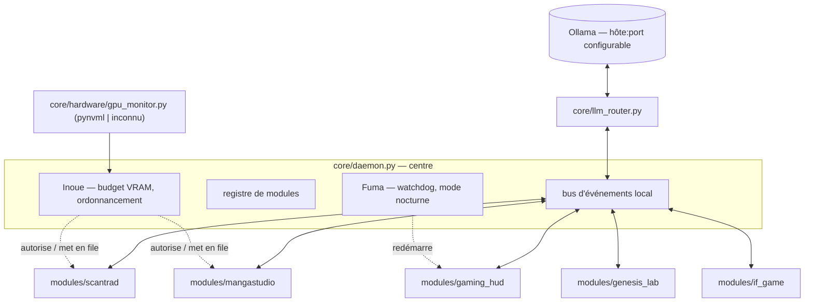
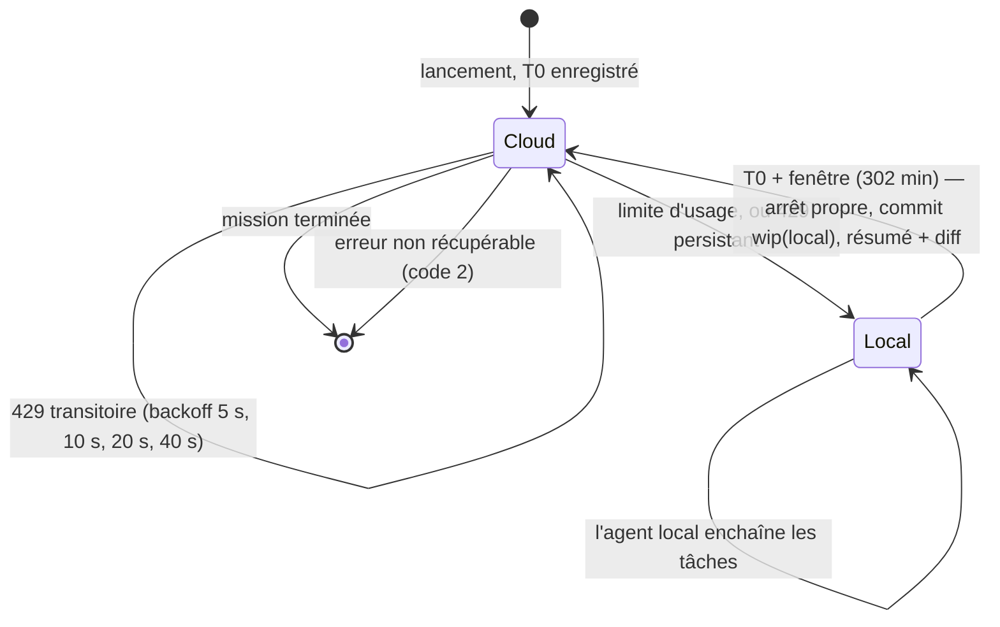
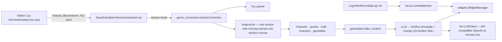

# ARCHITECTURE_MAP — AetherTwin (I&F Core)

Deux parties :

- **Flux et rôles** (ci-dessous) : rédigés à la main.
- **Arborescence et signatures publiques** (en bas) : générées par
  `scripts/gen_architecture_map.py` via `ast`. Ne les modifie pas à la main.
  Un test (`tests/test_architecture_map.py`) échoue si elles sont périmées.

État au 16/11/2026 : seuls `scripts/` et `tests/` contiennent du code. `core/` et
`modules/` sont des paquets vides (jalons J2 et J3). Les schémas marqués
« cible » décrivent ce qui est prévu, pas ce qui existe.

## Vue d'ensemble (cible)



Chaque module tourne dans un **processus séparé** et ne parle au Hub que par le bus
local (`127.0.0.1`). Statut : **À FAIRE** (J2).

## Flux du relais Cloud ⇄ Local (existant, testé en simulation)

Fichier : `scripts/relay_orchestrator.py`.



Données échangées :

| Fichier | Écrit par | Lu par | Rôle |
|---|---|---|---|
| `logs/relay_state.json` | orchestrateur (écriture atomique) | orchestrateur au redémarrage | phase, T0, heure de retour, commit de base |
| `logs/relay.lock` | orchestrateur | autre instance | un seul orchestrateur actif |
| `logs/relay.log` | orchestrateur | Jérémy | journal horodaté |
| `logs/relay_mission.md` | Jérémy (facultatif) | agent cloud | prompt de mission |
| `logs/relay_tasks.md` | agent cloud | agent local | liste de tâches courante |
| `AGENT_HANDOFF.md`, `PROJECT_STATUS.md`, `ARCHITECTURE_MAP.md` | les deux agents | agent local (`--read`) | passation |
| `logs/CHANGELOG_DEV.md` | les deux agents | agent cloud à la reprise | ce qui a été fait |

Points de conception :

- Toutes les dépendances de `RelayOrchestrator` sont injectées (`CloudBackend`,
  `LocalAgent`, Git, `Clock`) : les tests utilisent une horloge virtuelle et des
  doublures, sans réseau externe ni attente réelle.
- Le prompt de Claude Code passe par l'entrée standard, jamais par un shell.
- À la reprise, Claude reçoit le **diff seulement** (tronqué à 20 000 caractères).

## Flux de données de WoW Assistant (code d'origine, à porter en J3)

Référence figée : `_import/wow_assistant_v9/`.



Cible J3 : `GameConnection` + parseur + cache deviennent `adapters/wow_retail.py`
derrière l'interface `GameAdapter` ; `LLMClient` devient client de `core/llm_router.py`.

<!-- AUTO:BEGIN -->
## Arborescence (générée)

```
core/
  __init__.py
  guardians/
    __init__.py
  hardware/
    __init__.py
modules/
  __init__.py
scripts/
  __init__.py
  gen_architecture_map.py
  relay_orchestrator.py
  setup.ps1
config/
  allowlist.yaml
  hardware_profiles.yaml
  local.example.yaml
tests/
  __init__.py
  data/
    .gitkeep
  test_architecture_map.py
  test_relay_orchestrator.py
  test_repo_hygiene.py
docs/
  .gitkeep
research/
  .gitkeep
assets/
  .gitkeep
logs/
  CHANGELOG_DEV.md
.github/
  workflows/
    tests.yml
```

## Signatures publiques (générées)

### `scripts/gen_architecture_map.py`

Génère la partie automatique de ARCHITECTURE_MAP.md (arborescence + signatures publiques) via `ast`.

- `def first_line(doc: str | None) -> str`
- `def signature(node: ast.FunctionDef | ast.AsyncFunctionDef) -> str`
- `def describe_module(path: Path) -> list[str]`
- `def tree_lines() -> list[str]`
- `def generate() -> str`
- `def render(current: str) -> str`
- `def main(argv: list[str] | None=None) -> int`

### `scripts/relay_orchestrator.py`

Relais Cloud <-> Local : continuer à développer pendant les coupures de quota.

- **`class Clock`** — Horloge réelle. Remplaçable par `VirtualClock` (tests, --dry-run).
  - `def now(self) -> float`
  - `def sleep(self, seconds: float) -> None`
- **`class VirtualClock(Clock)`** — Horloge simulée : `sleep` avance le temps sans attendre.
  - `def now(self) -> float`
  - `def sleep(self, seconds: float) -> None`
- `def fmt_time(ts: float | None) -> str`
- **`class RelayState`** — État du relais, écrit de façon atomique dans `logs/relay_state.json`.
  - `def save(self, path: Path) -> None` — Écriture atomique : fichier temporaire, fsync, puis remplacement.
  - `def load(cls, path: Path) -> RelayState | None` — Charge l'état ; un fichier absent ou illisible donne `None` (le fichier abîmé est mis de côté).
- **`class LockError(RuntimeError)`** — Un autre orchestrateur est déjà actif.
- `def pid_is_alive(pid: int) -> bool` — Vrai si le processus existe. N'envoie jamais de signal sous Windows (os.kill y tuerait le processus).
- **`class SingleInstanceLock`** — Fichier verrou créé de façon exclusive. Un verrou laissé par un processus mort est repris.
  - `def acquire(self) -> None`
  - `def release(self) -> None`
- **`class Status(StrEnum)`**
- **`class CloudResult`**
- `def classify_text(text: str) -> Status | None` — Reconnaît un message de limite d'usage (QUOTA) ou une erreur de débit (TRANSIENT).
- `def parse_retry_after(value: str | None) -> float | None`
- `def resolve_command(cmd: Sequence[str]) -> list[str]` — Résout l'exécutable via le PATH (sous Windows : .cmd/.exe ; un .ps1 passe par PowerShell).
- **`class CloudBackend(Protocol)`**
  - `def run(self, prompt: str) -> CloudResult`
- **`class ClaudeCodeBackend`** — Lance Claude Code en mode non interactif. Le prompt passe par l'entrée standard (jamais par un shell).
  - `def run(self, prompt: str) -> CloudResult`
  - `def classify(returncode: int, stdout: str, stderr: str) -> CloudResult` — Une sortie réussie peut contenir « 429 » dans son texte : on ne cherche les motifs que sur un échec.
- **`class ApiBackend`** — Appel direct de l'API Anthropic via le SDK officiel (paquet `anthropic`, optionnel).
  - `def run(self, prompt: str) -> CloudResult`
- **`class LocalAgent(Protocol)`**
  - `def available(self) -> tuple[bool, str]`
  - `def start(self, prompt: str) -> None`
  - `def is_running(self) -> bool`
  - `def exit_code(self) -> int | None`
  - `def stop(self) -> None`
- `def ollama_base_url(host: str) -> str`
- `def ollama_has_model(host: str, model: str, timeout_s: float=5.0) -> tuple[bool, str]` — Interroge /api/tags du serveur Ollama configuré (machine locale ou réseau local).
- **`class SubprocessLocalAgent`** — Aider ou OpenCode, branché sur Ollama. Sortie redirigée vers un journal (peu fiable sous Git Bash).
  - `def build_command(self, prompt: str) -> list[str]`
  - `def available(self) -> tuple[bool, str]`
  - `def start(self, prompt: str) -> None`
  - `def is_running(self) -> bool`
  - `def exit_code(self) -> int | None`
  - `def stop(self) -> None`
- **`class GitRepo`** — Sous-ensemble de Git utile au relais : point de reprise et diff de revue.
  - `def head(self) -> str | None`
  - `def has_changes(self) -> bool`
  - `def wip_commit(self, message: str) -> str | None` — Commit intermédiaire de tout le travail en cours. Retourne le nouveau HEAD, ou None s'il n'y a rien.
  - `def log_since(self, base: str | None, limit: int=40) -> str`
  - `def diff_stat(self, base: str | None) -> str`
  - `def diff(self, base: str | None, max_chars: int) -> str`
- `def build_local_prompt(tasks: str) -> str`
- `def tail_text(path: Path, max_chars: int) -> str`
- `def build_resume_prompt(mission: str, changelog_tail: str, git_log: str, diff_stat: str, diff: str) -> str`
- **`class RelayConfig`**
- **`class RelayOrchestrator`** — Machine à états du relais. Toutes les dépendances sont injectées (tests sans réseau ni processus).
  - `def window_s(self) -> float`
  - `def run(self) -> int` — Codes de sortie : 0 terminé · 2 erreur · 3 autre instance active · 130 interrompu.
- **`class SimulatedCloud`** — Agent cloud factice : quota atteint au premier passage, succès au second. Aucun appel de service.
  - `def run(self, prompt: str) -> CloudResult`
- **`class SimulatedLocal`** — Agent local factice : chaque passage dure `run_s` secondes d'horloge simulée.
  - `def available(self) -> tuple[bool, str]`
  - `def start(self, prompt: str) -> None`
  - `def is_running(self) -> bool`
  - `def exit_code(self) -> int | None`
  - `def stop(self) -> None`
- **`class NullGit`** — Git factice pour la simulation : ne lit ni n'écrit rien.
  - `def head(self) -> str | None`
  - `def wip_commit(self, message: str) -> str | None`
  - `def log_since(self, base: str | None, limit: int=40) -> str`
  - `def diff_stat(self, base: str | None) -> str`
  - `def diff(self, base: str | None, max_chars: int) -> str`
- `def build_parser() -> argparse.ArgumentParser`
- `def setup_logging(log_path: Path) -> None`
- `def read_optional(path: Path) -> str`
- `def main(argv: Sequence[str] | None=None) -> int`
<!-- AUTO:END -->
