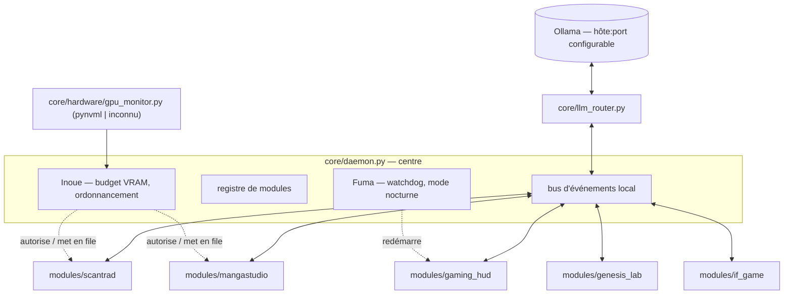
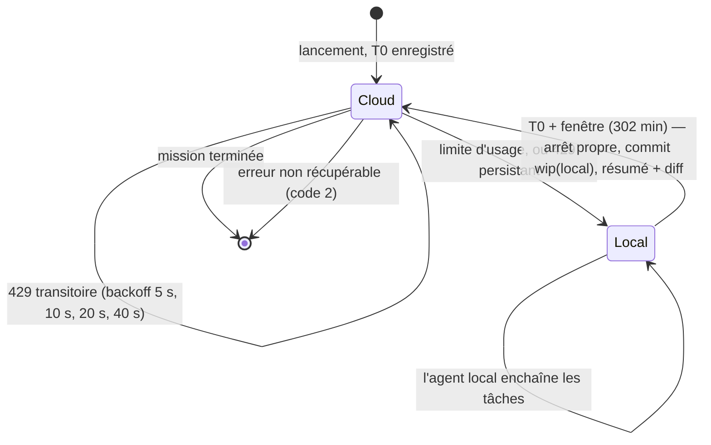
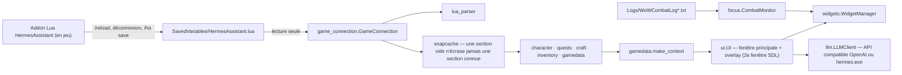

# ARCHITECTURE_MAP — AetherTwin (I&F Core)

Deux parties :

- **Flux et rôles** (ci-dessous) : rédigés à la main.
- **Arborescence et signatures publiques** (en bas) : générées par
  `scripts/gen_architecture_map.py` via `ast`. Ne les modifie pas à la main.
  Un test (`tests/test_architecture_map.py`) échoue si elles sont périmées.

État au 17/11/2026 : le centre (`core/`) et un premier module réel (`modules/gaming_hud/`) existent
et sont testés. Les modules `scantrad`, `mangastudio`, `genesis_lab` et `if_game` du schéma ci-dessous
n'existent pas encore : pour eux, le schéma décrit la cible.

## Vue d'ensemble



Chaque module tourne dans un **processus séparé** (`core/module_runner.py`) et ne parle au Hub que
par le bus local (`core/bus.py`, `127.0.0.1`, clé tirée au hasard à chaque lancement, messages JSON).

## Flux d'un module réel : gaming_hud (existant, testé en réel)

```mermaid
sequenceDiagram
    participant J as Jeu (fichiers, lecture seule)
    participant M as GamingHudModule (processus séparé)
    participant B as Bus du Hub
    participant D as Démon (Inoue, Fuma, API)
    participant R as LlmRouter
    participant O as Ollama (local)
    D->>M: lance le processus (Inoue a accordé la VRAM demandée : 0)
    loop toutes les 2 s
        M->>J: GameAdapter.read_state()
        M->>M: privacy_filter(état, "off" ou "showcase")
        M->>B: module.gaming_hud.state {state, context, omitted}
    end
    D->>B: process.started {obs64.exe}
    B->>M: événement
    M->>B: module.gaming_hud.showcase {on: true}
    Note over M,B: désormais tout ce qui est publié est filtré
    D->>R: /ask : question + contexte publié par les modules actifs
    R->>D: Inoue.plan_llm_load → modèles à décharger d'abord
    R->>O: keep_alive 0 (ancien gros modèle), puis /api/chat (num_ctx fixé)
    O->>R: réponse ; VRAM réelle relue dans /api/ps
```

| Sujet du bus | Émetteur | Contenu |
|---|---|---|
| `hub.started`, `hub.shutdown` | démon | démarrage et arrêt du Hub |
| `process.started`, `process.stopped` | démon | `{name}` d'un processus de la machine |
| `gpu.alert.temperature`, `gpu.alert.power` | Fuma | GPU au-dessus d'une limite |
| `module.<nom>.started`, `.health`, `.stopped`, `.error` | lanceur de module | cycle de vie |
| `module.<nom>.restarted` | Fuma | module relancé après un plantage |
| `module.<nom>.vram` | démon | décision d'Inoue quand elle n'accorde pas la VRAM |
| `module.<nom>.cmd.*` | démon ou API | ordres : `stop`, `showcase`, `refresh` |
| `module.gaming_hud.state`, `.showcase` | gaming_hud | état du jeu, bascule Showcase |

### Adaptateurs de jeu

`modules/gaming_hud/adapters/base.py` définit `GameAdapter` : `detect`, `read_state`, `schema`,
`widgets`, `privacy_filter`, `context_for_llm`. Trois implémentations :

| Adaptateur | Source | Statut |
|---|---|---|
| `wow_retail` | SavedVariables de l'addon HermesAssistant (via `app/game_connection.py`) | testé sur données réelles |
| `log_tail` | un journal texte + des règles regex en YAML | testé, aucun vrai jeu branché |
| `screen_ocr` | capture d'écran lue par le modèle de vision local | expérimental, testé sur image générée |

Le filtre commun est `adapters/privacy.py` : il parcourt tout l'état, supprime les clés au nom
sensible et nettoie chaque chaîne. Il ne suppose rien de la forme des données.

## Flux du relais Cloud ⇄ Local (existant, testé en simulation)

Fichier : `scripts/relay_orchestrator.py`.



Données échangées :

| Fichier | Écrit par | Lu par | Rôle |
|---|---|---|---|
| `logs/relay_state.json` | orchestrateur (écriture atomique) | orchestrateur au redémarrage | phase, T0, heure de retour, commit de base |
| `logs/relay.lock` | orchestrateur | autre instance | un seul orchestrateur actif |
| `logs/relay.log` | orchestrateur | Jérémy | journal horodaté |
| `logs/relay_mission.md` | Jérémy (facultatif) | agent cloud | prompt de mission |
| `logs/relay_tasks.md` | agent cloud | agent local | liste de tâches courante |
| `AGENT_HANDOFF.md`, `PROJECT_STATUS.md`, `ARCHITECTURE_MAP.md` | les deux agents | agent local (`--read`) | passation |
| `logs/CHANGELOG_DEV.md` | les deux agents | agent cloud à la reprise | ce qui a été fait |

Points de conception :

- Toutes les dépendances de `RelayOrchestrator` sont injectées (`CloudBackend`,
  `LocalAgent`, Git, `Clock`) : les tests utilisent une horloge virtuelle et des
  doublures, sans réseau externe ni attente réelle.
- Le prompt de Claude Code passe par l'entrée standard, jamais par un shell.
- À la reprise, Claude reçoit le **diff seulement** (tronqué à 20 000 caractères).

## Flux de données de WoW Assistant (application d'origine)

Emplacement : `modules/gaming_hud/app/` (imports à plat, lancée par `python -m modules.gaming_hud`).
Ses signatures ne sont pas listées dans la partie générée.



Fait en J3 : `adapters/wow_retail.py` enveloppe `GameConnection`, le parseur et la règle de fusion
du cache derrière `GameAdapter`, sans les modifier. `LLMClient` devient client du Hub en réglant son
serveur sur `http://127.0.0.1:5750` (API compatible OpenAI servie par `core/api.py`).

<!-- AUTO:BEGIN -->
## Arborescence (générée)

```
core/
  __init__.py
  api.py
  bus.py
  config.py
  daemon.py
  guardians/
    __init__.py
    fuma.py
    inoue.py
  hardware/
    __init__.py
    asus_fan_probe.ps1
    gpu_monitor.py
    system_info.py
  knowledge/
    __init__.py
    fetcher.py
    service.py
    store.py
  llm_router.py
  mcp_stdio.py
  module_api.py
  module_runner.py
  scheduler.py
  strata.py
  terminals.py
  translate.py
  web/
    artcraft_tool.css
    artcraft_tool.js
    asm6502.js
    asm65816.js
    audio_app.css
    audio_app.html
    audio_app.js
    audio_tool.js
    audio_worklet.js
    c16_apu.js
    c16_cpu.js
    c16_machine.js
    c16_ppu.js
    calc_app.css
    calc_app.html
    calc_app.js
    calc_cas.css
    calc_cas.js
    calc_geo.js
    chem_app.css
    chem_app.html
    chem_app.js
    circuit_app.css
    circuit_app.html
    circuit_app.js
    circuit_audio.js
    circuit_tool.js
    crt.css
    crt.html
    crt.js
    crt_tv.js
    dashboard.css
    dashboard.html
    dashboard.js
    data_app.css
    data_app.html
    data_app.js
    dev.css
    dev.js
    ether_scene.js
    guide.css
    guide.html
    guide.js
    labs_tool.js
    LICENSE.xterm-addon-fit.txt
    LICENSE.xterm.txt
    logo.svg
    nes_cpu.js
    nes_machine.js
    nes_ppu.js
    pixel_app.css
    pixel_app.html
    pixel_app.js
    pixel_tool.css
    pixel_tool.js
    professeur.js
    system.css
    system.js
    terminal.css
    terminal.html
    terminal.js
    voice.css
    voice.js
    xterm-addon-fit.js
    xterm.css
    xterm.js
modules/
  __init__.py
  artcraft/
    __init__.py
    manifest.json
    module.py
    README.md
    suite.py
  calc_cas/
    __init__.py
    agent.py
    app.py
    demos.py
    emulators.py
    engine.py
    games.py
    games_examples.py
    geometry.py
    graph.py
    manifest.json
    mcp_server.py
    module.py
    README.md
    render.py
    sandbox.py
    stats.py
    worker.py
  chem_lab/
    __init__.py
    agent.py
    app.py
    chemistry.py
    elements.py
    manifest.json
    mcp_server.py
    module.py
    README.md
    solutions.py
  circuit_lab/
    __init__.py
    app.py
    examples/
      etoiles.asm
      lune16.asm
    lab.py
    manifest.json
    module.py
    README.md
  data_lab/
    __init__.py
    agent.py
    analysis.py
    app.py
    formula.py
    manifest.json
    mcp_server.py
    module.py
    README.md
    workbooks.py
  dev_launcher/
    __init__.py
    bridge_mcp.py
    catalog.py
    hermes_link.py
    launch.py
    manifest.json
    module.py
    quota_watch.py
    relay_check.py
    tasks.py
  gaming_hud/
    __init__.py
    __main__.py
    adapters/
      __init__.py
      base.py
      log_tail.py
      privacy.py
      screen_ocr.py
      wow_retail.py
    addon/
      HermesAssistant/
        HermesAssistant.lua
        HermesAssistant.toc
    app/
      addon_data.py
      bestiary.py
      bnet.py
      character.py
      chatview.py
      clipboard.py
      coach_knowledge.py
      combat_report.py
      config.py
      craft.py
      features.py
      focus.py
      game_connection.py
      gamedata.py
      gameversion.py
      hermes_bridge.py
      hermes_mcp.py
      hermes_skill/
        wow-coach/
          SKILL.md
      history.py
      hotkeys.py
      i18n.py
      i18n_en.json
      icons_draw.py
      inventory.py
      Lancer WoW Assistant.bat
      llm.py
      lua_parser.py
      main.py
      media.py
      model3d.py
      mousepos.py
      overlay.py
      profit.py
      quests.py
      README.md
      recipes.json
      requirements.txt
      routine.py
      settings.py
      simc.py
      snapcache.py
      tabs.py
      tabs_bestiary.py
      tabs_collections.py
      tabs_data.py
      tabs_hermes.py
      tabs_market.py
      tabs_reports.py
      tabs_routine.py
      tabutil.py
      theme.py
      ui.py
      vision.py
      voice.py
      waypoints.py
      web3d/
        viewer.html
      webhost.py
      webwidget.py
      widgets.py
      widgets_builtin.py
      wowhead.py
      wowhead_links.json
    manifest.json
    module.py
    obs_server.py
    rules/
      log_tail.example.yaml
    web/
      obs_hud.css
      obs_hud.html
      obs_hud.js
  genesis_lab/
    __init__.py
    astro.py
    bio.py
    chem.py
    curriculum.py
    manifest.json
    module.py
    programmes.yaml
    sim_tools.js
    sims/
      circuit.html
      coeur.html
      fluides.html
      fonctions.html
      fractions.html
      gaz_parfait.html
      neurone.html
      ondes.html
      projectile.html
      systeme_solaire.html
    sims.py
    sources.py
    teacher.py
    tutor.py
  if_game/
    __init__.py
    manifest.json
    module.py
    world.py
  mangastudio/
    __init__.py
    comfyui_nodes/
      __init__.py
    grounding.py
    manifest.json
    module.py
    README.md
    segment.py
    workflows/
      continuity.json
  pixel_studio/
    __init__.py
    agent.py
    app.py
    manifest.json
    mcp_server.py
    module.py
    palettes.py
    project.py
    README.md
    studio.py
  scantrad/
    __init__.py
    __main__.py
    cli.py
    detect.py
    hub_stages.py
    lama.py
    languages.py
    manifest.json
    manual.py
    module.py
    pipeline.py
    README.md
    testpage.py
    typeset.py
  voice/
    __init__.py
    agent.py
    app.py
    convert.py
    effects.py
    engines.py
    installer.py
    manifest.json
    mcp_server.py
    module.py
    profiles.py
    README.md
    service.py
    stt.py
    vc/
      __init__.py
      hifigan.py
      hifigan_config.json
      LICENSE-knn-vc
      wavlm.py
      wavlm_modules.py
scripts/
  __init__.py
  extract_ui_strings.py
  gen_architecture_map.py
  relay_orchestrator.py
  setup.ps1
config/
  allowlist.yaml
  hardware_profiles.yaml
  knowledge_sources.yaml
  local.example.yaml
tests/
  __init__.py
  artcraft/
    __init__.py
    test_suite.py
  calc_cas/
    __init__.py
    test_agent.py
    test_app.py
    test_emulators.py
    test_engine.py
    test_games.py
    test_geometry.py
    test_graph.py
    test_module.py
    test_render.py
    test_sandbox.py
    test_stats.py
    test_worker.py
  chem_lab/
    __init__.py
    test_chem.py
  circuit_lab/
    __init__.py
    asm_check.js
    c16_check.js
    demo_check.js
    machine_check.js
    nestest_run.js
    test_module.py
  core/
    __init__.py
    sleeper.py
    test_bus_scheduler.py
    test_daemon.py
    test_dashboard.py
    test_gpu_monitor.py
    test_guardians.py
    test_knowledge_fetcher.py
    test_knowledge_service.py
    test_knowledge_store.py
    test_llm_router.py
    test_module_api.py
    test_strata.py
    test_system_info.py
    test_translate.py
  data/
    .gitkeep
    scantrad/
      page_test.json
      page_test.png
  data_lab/
    __init__.py
    test_data.py
  dev_launcher/
    __init__.py
    test_dev_launcher.py
    test_quota_watch.py
  gaming_hud/
    __init__.py
    conftest.py
    test_adapters.py
    test_addon_lua.py
    test_bestiary.py
    test_collections_media.py
    test_combat_report.py
    test_config_refs.py
    test_forever.py
    test_gameversion.py
    test_hermes.py
    test_i18n.py
    test_market.py
    test_model3d.py
    test_module.py
    test_obs_hud.py
    test_profit.py
    test_routine.py
    test_settings_bnet.py
    test_simc.py
    test_ui_fixes.py
    test_waypoints.py
  genesis_lab/
    __init__.py
    test_calculs.py
    test_professeur.py
    test_tutor_module.py
  if_game/
    __init__.py
    test_if_game.py
  mangastudio/
    __init__.py
    test_mangastudio.py
  pixel_studio/
    __init__.py
    test_module.py
    test_project.py
  scantrad/
    __init__.py
    test_manual.py
    test_scantrad.py
    test_scantrad_module.py
  test_architecture_map.py
  test_relay_orchestrator.py
  test_repo_hygiene.py
  voice/
    __init__.py
    test_convert.py
    test_voice.py
docs/
  .gitkeep
  captures/
    ether_hd2d_jardin.png
    ether_hd2d_lac.png
    obs_hud.png
    scantrad_page_test_fr.png
research/
  .gitkeep
assets/
  .gitkeep
  logo_if_core.svg
  logo_if_core_mono.svg
logs/
  CHANGELOG_DEV.md
.github/
  workflows/
    tests.yml
```

## Signatures publiques (générées)

*Non listé : `modules/gaming_hud/app/` (code d'origine de WoW Assistant, voir la partie « flux »).*

### `core/api.py`

API HTTP locale du démon (FastAPI). Servie sur 127.0.0.1 uniquement par `core.daemon`.

- `def guide_catalog() -> dict[str, tuple[str, Path]]` — Guides lisibles depuis l'interface : le README du dépôt, celui de WoW Assistant et ceux des modules.
- `def audio_suffix(content_type: str, filename: str='') -> str`
- `def multipart_fields(content_type: str, body: bytes) -> dict[str, tuple[bytes, str, str]]` — Champs d'un formulaire multipart : nom → (contenu, type, nom de fichier). Sans python-multipart.
- `async def save_upload(request: Request, folder: Path) -> Path` — Enregistre l'image envoyée (corps brut, PNG/JPEG/WebP, 25 Mo au plus) sous un nom horodaté.
- `def image_file(root: Path, kind: str, filename: str) -> Response` — Image servie seulement depuis `<root>/entrees` ou `<root>/sorties`, nom contrôlé.
- `def static(filename: str) -> Response` — Sert un fichier de `core/web/` (liste fermée d'extensions, aucun chemin hors du dossier).
- **`class AskRequest(BaseModel)`**
- **`class ChatRequest(BaseModel)`**
- `def create_app(daemon: Daemon) -> FastAPI`

### `core/bus.py`

Bus d'événements local du Hub : publication / abonnement entre processus, sur 127.0.0.1 uniquement.

- **`class EventBus`** — Centre du bus. `publish` sert les abonnés locaux puis les clients distants abonnés au sujet.
  - `def start(self) -> tuple[str, int]`
  - `def stop(self) -> None`
  - `def child_env(self) -> dict[str, str]` — Variables à donner à un processus de module pour qu'il rejoigne le bus.
  - `def subscribe(self, pattern: str, callback: Callable[[Event], None]) -> None`
  - `def publish(self, event: Event) -> None`
  - `def clients(self) -> list[str]`
- **`class BusClient`** — Client du bus, utilisé dans le processus d'un module.
  - `def from_env(cls, name: str, env: dict[str, str] | None=None) -> BusClient`
  - `def subscribe(self, *patterns: str, timeout: float=5.0) -> None` — S'abonne et attend la confirmation du bus : aucun événement publié ensuite n'est perdu.
  - `def publish(self, event: Event) -> None`
  - `def recv(self, timeout: float | None=None) -> Event | None`
  - `def close(self) -> None`

### `core/config.py`

Configuration locale du Hub : `config/local.yaml` (ignoré par Git), jamais de secret dans le dépôt.

- `def config_path() -> Path`
- `def load_config(path: Path | None=None) -> dict[str, Any]` — Configuration complète ; `{}` si le fichier est absent, illisible ou n'est pas un dictionnaire.
- `def section(name: str, path: Path | None=None) -> dict[str, Any]` — Une section de la configuration (ex. « ollama », « gaming_hud ») ; `{}` si elle n'existe pas.

### `core/daemon.py`

Le démon : centre de l'architecture en étoile.

- `def psutil_process_names() -> set[str] | None` — Noms (en minuscules) des processus en cours ; `None` si `psutil` est absent (mode dégradé).
- **`class ManagedModule`**
  - `def running(self) -> bool`
- **`class Daemon`** — Registre de modules + bus + gardiens. Toutes les sources externes sont injectables (tests).
  - `def start(self) -> None`
  - `def stop(self) -> None`
  - `def reload_modules(self) -> None` — (Re)lit les manifestes de `modules/`. Un manifeste invalide est signalé, pas fatal.
  - `def activate(self, name: str, auto: bool=False) -> Decision` — Demande la VRAM à Inoue puis lance le module dans son processus. Idempotent.
  - `def deactivate(self, name: str, timeout_s: float=8.0) -> None` — Arrêt propre (ordre sur le bus), puis arrêt forcé si le module ne répond pas. Rend la VRAM.
  - `def app_spec(self, name: str) -> dict[str, str] | None` — `"app": {"label": …, "module": …}` du manifeste : un module Python fixe (validé au chargement du
  - `def app_running(self, name: str) -> bool`
  - `def start_app(self, name: str) -> bool` — Lance l'application (`python -m <module>` depuis la racine du dépôt). `False` si elle tourne déjà.
  - `def stop_app(self, name: str, timeout_s: float=6.0) -> str` — Ferme l'application **doucement** (demande de fermeture de fenêtre : elle enregistre ce qu'elle doit),
  - `def notify(self, name: str, command: str, payload: dict[str, Any] | None=None) -> None` — Commande sans réponse attendue (ex. `showcase`).
  - `def hung(self, name: str) -> str` — Raison pour laquelle un module lancé est considéré bloqué (vide s'il va bien).
  - `def command(self, name: str, command: str, payload: dict[str, Any] | None=None, timeout_s: float=240.0) -> dict[str, Any]` — Envoie `module.<nom>.cmd.<commande>` et attend la réponse portant le même `request_id`.
  - `def ask_messages(self, prompt: str, with_context: bool=True, history: list[dict[str, Any]] | None=None, passages: list[dict[str, Any]] | None=None) -> tuple[list[dict[str, Any]], str]` — Messages pour l'assistant : le contexte publié par les modules actifs (déjà filtré par eux), les
  - `def ask(self, prompt: str, model: str | None=None, with_context: bool=True) -> dict[str, Any]` — Question à l'assistant local, avec le contexte publié par les modules actifs (déjà filtré par eux).
  - `def tick(self) -> dict[str, Any]` — Un tour : processus, déclencheurs, watchdog, alertes GPU, tâches de nuit. Retourne ce qui a changé.
  - `def status(self) -> dict[str, Any]`
  - `def modules_status(self) -> list[dict[str, Any]]`
- `def setup_journal(daemon: Daemon, path: Path=REPO_ROOT / 'logs' / 'hub.log') -> logging.Logger` — Journal du Hub (`logs/hub.log`, 1 Mo × 3 fichiers, ignoré par Git) : démarrages, arrêts, erreurs, alertes
- `def port_in_use(port: int) -> bool`
- `def main(argv: list[str] | None=None) -> int`

### `core/guardians/fuma.py`

Fuma — gardien de la stabilité et du mode nocturne.

- **`class Alert`**
  - `def to_dict(self) -> dict[str, Any]`
- **`class Fuma`** — Watchdog, limites thermiques et mode nocturne du Hub.
  - `def watch(self, name: str, health: Callable[[], Health], restart: Callable[[], None]) -> None`
  - `def unwatch(self, name: str) -> None`
  - `def tick(self) -> list[str]` — Un tour de surveillance. Retourne les noms des modules redémarrés pendant ce tour.
  - `def revive(self, name: str) -> None` — Remet à zéro les essais d'un module mis au repos (action manuelle).
  - `def check_gpus(self, gpus: list[GpuInfo]) -> list[Alert]`
  - `def is_night(self) -> bool` — Vrai dans la plage de nuit. Une plage qui passe minuit (23 h → 7 h) est gérée.
  - `def schedule_night_task(self, name: str, run: Callable[[], Any], recurring: bool=False) -> None` — Planifie une tâche lourde pour la nuit (ingestion vectorielle, indexation…).
  - `def run_night_tasks(self, force: bool=False) -> list[str]` — Exécute les tâches en attente si c'est la nuit (ou si `force`). Retourne celles qui ont tourné.
  - `def state(self) -> dict[str, Any]`

### `core/guardians/inoue.py`

Inoue — gardienne de l'énergie et de la VRAM.

- **`class Verdict(StrEnum)`**
- **`class Decision`**
- **`class Inoue`** — Budget VRAM du Hub. Sans GPU détecté, le budget vaut 0 : seuls les modules sans besoin VRAM démarrent.
  - `def total_gb(self) -> float`
  - `def budget_gb(self) -> float` — VRAM attribuable : total moins la marge de sécurité.
  - `def allocated_gb(self) -> float`
  - `def measured_gb(self) -> float` — VRAM occupée d'après les cartes (0 sans mesure).
  - `def available_gb(self) -> float` — Place libre : budget moins le plus grand du prévu (attributions) et du réel (mesure).
  - `def request(self, name: str, min_gb: float, comfort_gb: float | None=None) -> Decision` — Demande de VRAM. Accorde le confortable s'il tient, sinon le minimum, sinon met en file.
  - `def adopt(self, name: str, gb: float, llm: str | None=None) -> Decision` — Enregistre ce qui est **déjà** en VRAM (un modèle chargé par un autre programme sur le même Ollama) :
  - `def release(self, name: str) -> list[tuple[str, Decision]]` — Libère l'attribution d'un module, puis sert la file d'attente dans l'ordre d'arrivée.
  - `def plan_llm_load(self, model: str, vram_gb: float) -> tuple[Decision, list[str]]` — Prépare le chargement d'un gros modèle de langage.
  - `def confirm_llm_unloaded(self, model: str) -> list[tuple[str, Decision]]`
  - `def state(self) -> dict[str, Any]`

### `core/hardware/gpu_monitor.py`

Moniteur GPU : mesure la topologie réelle au lieu de la présumer.

- **`class GpuInfo`** — État instantané d'un GPU. Une mesure indisponible vaut `None`, jamais une valeur inventée.
  - `def vram_free_mib(self) -> int`
  - `def to_dict(self) -> dict[str, Any]`
- **`class GpuBackend(Protocol)`**
  - `def read(self) -> list[GpuInfo]`
- `def parse_nvidia_smi_csv(output: str) -> list[GpuInfo]` — Analyse la sortie de `nvidia-smi --query-gpu=… --format=csv,noheader,nounits`.
- **`class NvidiaSmiBackend`** — Lit `nvidia-smi` (commande fixe, sans shell).
  - `def usable() -> bool`
  - `def read(self) -> list[GpuInfo]`
- **`class PynvmlBackend`** — Lit NVML via `pynvml`. L'import est différé : le paquet est optionnel.
  - `def read(self) -> list[GpuInfo]`
- **`class UnknownBackend`** — Repli : aucun GPU NVIDIA détectable. N'empêche jamais le démarrage.
  - `def read(self) -> list[GpuInfo]`
- `def detect_backend() -> GpuBackend` — Choisit le meilleur backend disponible, sans jamais lever d'exception.
- **`class GpuMonitor`** — Point d'entrée unique pour l'état des GPU (utilisé par Inoue, Fuma et l'API du daemon).
  - `def backend_name(self) -> str`
  - `def snapshot(self) -> list[GpuInfo]` — État de chaque GPU. En cas d'erreur de lecture : liste vide et `last_error` renseigné.
  - `def total_vram_mib(self) -> int`
  - `def report(self) -> dict[str, Any]` — Résumé sérialisable (API `/gpu`, overlay OBS).

### `core/hardware/system_info.py`

État du PC pour l'Accueil (façon Gestionnaire des tâches) et pour Inoue : performance, stockage, périphériques,

- **`class SystemSampler`** — Mesure le PC une fois par seconde (seulement pendant qu'on le regarde) et garde 60 points d'historique.
  - `def read(self) -> dict[str, Any]` — Dernière mesure + historique ; démarre la mesure si besoin.
  - `def sample(self) -> dict[str, Any]`
- `def process_counts() -> dict[str, int]`
- `def nvml_details() -> list[dict[str, Any]]` — Détails des cartes NVIDIA (fréquences, ventilateur, consommation, températures) ; liste vide sans NVML.
- **`class SystemInfo`** — Fiche système et périphériques (requêtes lentes : en cache).
  - `def info(self, refresh: bool=False) -> dict[str, Any]`
  - `def devices(self, refresh: bool=False) -> dict[str, Any]`
- `def volume_label(root: str) -> str`
- `def volumes(disks: list[dict[str, Any]] | None=None) -> list[dict[str, Any]]` — Lecteurs comme dans « Ce PC » : nom, lettre, espace libre, disque physique.
- `def heavy_processes(limit: int=15, interval: float=0.5) -> list[dict[str, Any]]` — Processus les plus gourmands (processeur et mémoire), sans les processus système.
- `def stop_process(pid: int, name: str) -> dict[str, Any]` — Ferme un processus sur demande (clic), si son nom correspond toujours et s'il n'est pas protégé.
- `def power_plans(runner: Callable[..., Any]=subprocess.run) -> list[dict[str, Any]]`
- `def set_power_plan(guid: str, runner: Callable[..., Any]=subprocess.run) -> list[dict[str, Any]]`
- `def open_windows(target: str, drive: str='', starter: Callable[[str], Any] | None=None) -> str`
- `def tools_state() -> list[dict[str, Any]]`
- `def appx_installed(family: str) -> bool`
- `def launch_tool(key: str, starter: Callable[[str], Any] | None=None) -> str`
- `def lhm_sensors(url: str='http://127.0.0.1:8085/data.json', timeout: float=2.0) -> dict[str, Any]` — Capteurs de LibreHardwareMonitor (serveur web local activé). Vide s'il ne tourne pas.
- `def read_bios_fans(out: Path) -> dict[str, Any]` — Lance la lecture des courbes du BIOS avec élévation (Windows demande l'autorisation). Lecture seule.
- `def bios_fans(out: Path) -> dict[str, Any] | None`

### `core/knowledge/__init__.py`

Connaissances locales : base vectorielle (`store`) et collecte web polie (`fetcher`).

*(aucun symbole public)*

### `core/knowledge/fetcher.py`

Collecte web **polie** pour la base de connaissances.

- **`class FetchRefused(RuntimeError)`** — La page n'est pas récupérée, et c'est voulu (hors liste, robots.txt, type, taille).
- **`class Page`**
- `def urllib_opener(url: str, headers: dict[str, str], timeout: float) -> tuple[int, dict[str, str], bytes]`
- `def html_to_text(html: str) -> tuple[str, str]` — (titre, texte). Les espaces sont normalisés, les paragraphes séparés par une ligne vide.
- **`class PoliteFetcher`**
  - `def check_url(self, url: str) -> str` — Retourne l'hôte si l'URL est autorisée, sinon lève `FetchRefused`.
  - `def robots_allows(self, url: str) -> bool`
  - `def fetch(self, url: str, force: bool=False) -> Page`

### `core/knowledge/service.py`

Service de connaissances du Hub : base vectorielle + collecte polie + ingestion (la nuit, ou à la demande).

- `def load_sources(path: Path) -> list[dict[str, Any]]` — Sources déclarées : `url` (https), `license` (obligatoire), `tags`. Les entrées incomplètes sont ignorées.
- `def allowed_domains(path: Path | None=None) -> list[str]`
- `def ingest(store: KnowledgeStore, fetcher: PoliteFetcher, sources: list[dict[str, Any]], stop: threading.Event | None=None) -> dict[str, Any]` — Récupère chaque source et l'indexe. Une source en échec est notée, les suivantes continuent.
- **`class KnowledgeService`**
  - `def running(self) -> bool`
  - `def start_ingestion(self) -> bool` — Lance l'ingestion en arrière-plan. `False` si elle tourne déjà.
  - `def stop(self) -> None`
  - `def search(self, query: str, k: int=5, tag: str='') -> dict[str, Any]`
  - `def state(self) -> dict[str, Any]`

### `core/knowledge/store.py`

Base de connaissances locale : textes découpés, vecteurs d'embedding, recherche par similarité.

- **`class KnowledgeError(RuntimeError)`**
- **`class Hit`**
  - `def to_dict(self) -> dict[str, Any]`
- `def chunk_text(text: str, max_chars: int=900, overlap: int=150) -> list[str]` — Découpe par paragraphes, en morceaux d'au plus `max_chars`, avec un recouvrement pour garder le contexte.
- `def cosine(a: Iterable[float], b: Iterable[float]) -> float`
- `def lexical_score(query: str, text: str, idf: dict[str, float] | None=None, title: str='') -> float` — Part des mots de la requête présents dans le texte, pondérée par leur rareté (idf) ; bonus s'ils sont
- `def idf_table(query: str, texts: list[str]) -> dict[str, float]`
- `def ollama_embedder(host: str='127.0.0.1:11434', model: str='nomic-embed-text', timeout_s: float=120.0) -> Embedder` — Embeddings par le serveur Ollama local (`/api/embed`). Lève `KnowledgeError` si indisponible.
- **`class KnowledgeStore`**
  - `def close(self) -> None`
  - `def add_document(self, url: str, title: str, text: str, license: str, tags: Iterable[str]=(), fetched_at: float | None=None) -> dict[str, Any]` — Ajoute ou remplace un document. Sans changement de contenu, ne refait rien (`unchanged`).
  - `def remove(self, url: str) -> bool`
  - `def reindex(self) -> int` — Recalcule tous les vecteurs avec l'embedder courant (changement de modèle). Rend le nombre de passages.
  - `def search(self, query: str, k: int=5, tag: str='') -> list[Hit]` — Les `k` passages les plus proches. Retombe sur les mots communs si les vecteurs sont indisponibles.
  - `def sources_for(self, query: str, k: int=3) -> list[dict[str, str]]` — Format attendu par le Professeur (`Tutor(search=…)`) : titre, URL, licence, extrait.
  - `def stats(self) -> dict[str, Any]`

### `core/llm_router.py`

Routeur LLM du Hub : toutes les demandes de génération passent par ici, vers Ollama, en local.

- **`class LlmError(RuntimeError)`** — Ollama injoignable, modèle absent, réponse inattendue.
- **`class LlmRefused(LlmError)`** — Inoue refuse ou diffère le chargement : le modèle ne tient pas dans le budget VRAM.
- **`class LlmConfig`**
  - `def from_section(cls, raw: dict[str, Any]) -> LlmConfig` — Construit la configuration depuis la section `ollama` de `config/local.yaml`.
  - `def base_url(self) -> str`
- `def http_json(method: str, url: str, body: dict[str, Any] | None, timeout_s: float) -> dict[str, Any]` — Appel HTTP JSON vers Ollama. Lève `LlmError` avec un message lisible.
- `def http_stream(url: str, body: dict[str, Any], timeout_s: float) -> Iterator[dict[str, Any]]` — Réponse d'Ollama morceau par morceau (une ligne JSON par morceau).
- **`class LlmRouter`** — Point d'entrée unique vers les modèles de langage locaux.
  - `def list_models(self) -> list[dict[str, Any]]` — Modèles installés : `[{"name", "size_gb", "parameters", "quantization"}]`.
  - `def strata_models(self) -> list[dict[str, Any]]` — Modèles servis par Strata (`strata/<id>`) ; liste vide s'il est désactivé ou arrêté.
  - `def loaded(self) -> list[dict[str, Any]]` — Modèles actuellement en mémoire : `[{"name", "vram_gb", "size_gb", "context"}]` (lu dans `/api/ps`).
  - `def estimate_vram_gb(self, model: str) -> float` — VRAM à prévoir : la dernière valeur **mesurée** si elle existe, sinon taille des poids x marge.
  - `def unload(self, model: str) -> None` — Décharge réellement un modèle de la VRAM (`keep_alive: 0`).
  - `def sync(self) -> list[str]` — Aligne la comptabilité d'Inoue sur ce qu'Ollama a vraiment en mémoire (les modèles expirent seuls).
  - `def chat(self, messages: list[dict[str, Any]], model: str | None=None, num_ctx: int | None=None, think: bool | None=None, options: dict[str, Any] | None=None) -> dict[str, Any]` — Envoie une conversation au modèle local. Retourne `{"content", "model", "num_ctx", "seconds", …}`.
  - `def chat_stream(self, messages: list[dict[str, Any]], model: str | None=None, num_ctx: int | None=None, think: bool | None=None, options: dict[str, Any] | None=None) -> Iterator[str]` — Comme `chat`, mais rend le texte au fil de la génération. Mêmes règles VRAM, même verrou.
  - `def state(self) -> dict[str, Any]` — État pour l'API du démon. Ne lève jamais : Ollama arrêté = mode dégradé.
- `def openai_to_ollama(messages: list[dict[str, Any]]) -> list[dict[str, Any]]` — Convertit des messages au format OpenAI (texte, ou parties texte + `image_url` en data URI) pour Ollama.

### `core/mcp_stdio.py`

Serveur MCP minimal (stdio, JSON-RPC ligne par ligne) pour les outils des modules du Hub.

- **`class ToolServer`**
  - `def tool_list(self) -> list[dict[str, Any]]`
  - `def handle(self, message: Any) -> dict[str, Any] | None`
  - `def serve(self, stdin: TextIO, stdout: TextIO) -> None`
  - `def main(self) -> None`

### `core/module_api.py`

Contrat de module du Hub : manifeste, événements, cycle de vie.

- **`class ManifestError(ValueError)`** — Manifeste absent, illisible ou invalide.
- **`class Triggers`** — Ce qui active le module : processus (ex. « obs64.exe »), titres de fenêtres, ports.
- **`class Manifest`** — Déclaration d'un module. Les besoins VRAM sont lus par Inoue avant tout démarrage.
  - `def to_dict(self) -> dict[str, Any]`
- `def parse_manifest(raw: Any) -> Manifest` — Valide un manifeste déjà décodé. Lève `ManifestError` avec un message précis.
- `def load_manifest(module_dir: Path) -> Manifest` — Lit et valide `<module_dir>/manifest.json`.
- `def discover_manifests(modules_root: Path) -> tuple[dict[str, Manifest], dict[str, str]]` — Parcourt `modules/`. Retourne (manifestes valides, erreurs par dossier). Un module cassé n'arrête rien.
- **`class Event`** — Message du bus. `topic` est hiérarchique : « process.started », « gpu.alert », « module.gaming_hud.state ».
  - `def to_dict(self) -> dict[str, Any]`
  - `def from_dict(cls, raw: dict[str, Any]) -> Event`
  - `def matches(self, pattern: str) -> bool` — « gpu.* » ou « gpu » couvre « gpu.alert » ; « * » couvre tout.
- **`class Health`** — Santé d'un module. `degraded` = démarré sans une dépendance optionnelle (GPU, jeu, OBS, poids…).
  - `def to_dict(self) -> dict[str, Any]`
- **`class ModuleBase(ABC)`** — Classe de base de tout module. `publish` est fourni par le lanceur (bus du Hub).
  - `def name(self) -> str`
  - `def start(self) -> None` — Démarre le module. Doit réussir en mode dégradé si une dépendance optionnelle manque.
  - `def stop(self) -> None` — Arrête proprement et libère les ressources (VRAM comprise).
  - `def health(self) -> Health` — État de santé, interrogé par Fuma.
  - `def handle_event(self, event: Event) -> None` — Reçoit un événement du bus.
  - `def widget_schema(self) -> dict[str, Any]` — Schéma JSON de l'interface générée à la volée par le daemon (titre, sections, boutons).

### `core/module_runner.py`

Lanceur d'un module dans son propre processus : `python -m core.module_runner <dossier_du_module>`.

- `def load_module_class(entry: str) -> type[ModuleBase]`
- `def run(module_dir: Path, client: BusClient | None=None, health_interval_s: float=HEALTH_INTERVAL_S) -> int`

### `core/scheduler.py`

File d'attente GPU unique pour les tâches de vision et de diffusion (scantrad, mangastudio).

- **`class VramRefused(RuntimeError)`** — La tâche demande plus de VRAM que le budget, ou n'a pas obtenu de place à temps.
- **`class GpuScheduler`** — Exécute les tâches GPU une par une, dans l'ordre d'arrivée.
  - `def submit(self, name: str, vram_gb: float, fn: Callable[[], Any]) -> Future[Any]` — Met une tâche en file. Le résultat (ou l'erreur) arrive par le `Future` retourné.
  - `def state(self) -> dict[str, Any]`
  - `def shutdown(self) -> None`

### `core/strata.py`

Strata : moteur d'inférence secondaire, pour les modèles de langage « mélange d'experts » (MoE).

- **`class StrataError(RuntimeError)`** — Strata injoignable, refus ou réponse illisible.
- `def is_strata(model: str | None) -> bool`
- **`class StrataConfig`**
  - `def from_section(cls, raw: dict[str, Any]) -> StrataConfig` — Depuis la section `strata` de `config/local.yaml` (absente = désactivé).
  - `def base_url(self) -> str`
  - `def local(self) -> bool` — Seule une adresse de cette machine est acceptée (règle du projet : 127.0.0.1).
- `def http_json(method: str, url: str, body: dict[str, Any] | None, timeout_s: float, headers: dict[str, str]) -> dict[str, Any]`
- `def http_sse(url: str, body: dict[str, Any], timeout_s: float, headers: dict[str, str]) -> Iterator[dict[str, Any]]` — Réponse diffusée au format OpenAI : lignes `data: {...}`, puis `data: [DONE]`.
- `def ollama_to_openai(messages: list[dict[str, Any]]) -> list[dict[str, Any]]` — Messages du routeur (format Ollama, images en base64 à part) vers le format OpenAI attendu par Strata.
- **`class StrataBackend`** — Client du serveur Strata local, plus son démarrage et son arrêt (sur demande de l'utilisateur).
  - `def models(self) -> list[str]` — Ids servis par Strata (sans le préfixe `strata/`).
  - `def resolve(self, model: str | None) -> str` — `strata/<id>` ou `strata/` → id réel ; vide = celui de la configuration, sinon le premier servi.
  - `def chat(self, messages: list[dict[str, Any]], model: str | None=None, options: dict[str, Any] | None=None, max_tokens: int | None=None) -> dict[str, Any]`
  - `def chat_stream(self, messages: list[dict[str, Any]], model: str | None=None, options: dict[str, Any] | None=None) -> Iterator[str]`
  - `def launcher(self) -> Path | None`
  - `def start(self) -> dict[str, Any]` — Démarre le préréglage en arrière-plan (`--no-tui`) ; le chargement du modèle prend du temps.
  - `def stop(self) -> dict[str, Any]` — Arrête le modèle servi : Strata rend toute sa VRAM et sa RAM (essai du 23/11 : 24 Go de RAM).
  - `def starting(self) -> bool`
  - `def state(self) -> dict[str, Any]` — Ne lève jamais. `status` : désactivé | non installé | arrêté | démarrage | actif.

### `core/terminals.py`

Terminaux du Hub : une console Windows (pseudo-terminal) affichée dans le tableau de bord.

- `def child_env() -> dict[str, str]` — Environnement d'un terminal : sans le bus du Hub ni les variables d'une session Claude Code qui aurait
- **`class TerminalError(ValueError)`** — Session inconnue, lancement refusé ou pseudo-terminal indisponible.
- **`class Session`** — Un pseudo-terminal, sa sortie récente et ses abonnés (les pages ouvertes).
  - `def feed(self, text: str) -> None`
  - `def subscribe(self, listener: Callable[[str], None]) -> str`
  - `def unsubscribe(self, listener: Callable[[str], None]) -> None`
  - `def alive(self) -> bool`
  - `def view(self) -> dict[str, Any]`
- **`class TerminalManager`** — Sessions ouvertes. `launches_dir` : seul dossier d'où un fichier de lancement peut être exécuté.
  - `def open(self, launch: str='', cwd: str='', title: str='', rows: int=30, cols: int=110) -> dict[str, Any]` — Ouvre `cmd.exe` (dans `cwd`), ou exécute un fichier de lancement du module dev_launcher.
  - `def get(self, sid: str) -> Session`
  - `def write(self, sid: str, data: str) -> None`
  - `def resize(self, sid: str, rows: int, cols: int) -> None`
  - `def close(self, sid: str) -> dict[str, Any]`
  - `def list(self) -> list[dict[str, Any]]`
  - `def close_all(self) -> None`

### `core/translate.py`

Traduction générale vers le français : texte, image (capture, photo) ou message vocal.

- `def detect_language(text: str) -> str` — Langue devinée à l'écriture : hangul → coréen, kana → japonais, idéogrammes seuls → chinois, latin →
- `def translation_messages(text: str, lang: str) -> list[dict[str, str]]` — Consigne de traduction. `IDIOMS` : mesuré le 22/11 avec `qwen3-27b` ; sans elle, « ジェルミ » donnait
- `def translate_text(chat: Chat, text: str, lang: str='auto', model: str | None=None) -> dict[str, Any]`
- `def image_prompt(lang: str) -> str`
- `def read_image(chat: Chat, image: bytes, lang: str='auto', model: str='qwen2.5vl:7b') -> str` — Texte d'une image (PNG, JPEG ou WebP), lu par le modèle de vision. L'image est réduite à ~1,3 Mpx : au-delà,
- `def voice_available() -> bool`
- `def transcribe(audio: bytes, lang: str='auto', model_name: str='small') -> dict[str, str]` — Message vocal → texte, sur cette machine (faster-whisper, sur le processeur en int8 : la VRAM reste aux

### `modules/artcraft/__init__.py`

Intégration externe des logiciels libres ArtCraft (installation, lancement, serveurs MCP).

*(aucun symbole public)*

### `modules/artcraft/module.py`

Module du Hub : intégration externe de la suite libre ArtCraft (équipe ArtCraft, github.com/storytold).

- **`class ArtCraftModule(ModuleBase)`**
  - `def start(self) -> None`
  - `def stop(self) -> None`
  - `def health(self) -> Health`
  - `def handle_event(self, event: Event) -> None`
  - `def run(self, command: str, payload: dict[str, Any]) -> Any` — Exécute une commande (aussi appelée directement par les tests).

### `modules/artcraft/suite.py`

Suite ArtCraft : catalogue, installation depuis les publications GitHub officielles, lancement, MCP.

- `def check_app(app: Any) -> str`
- `def fetch(url: str, limit: int=20000000, timeout: float=60) -> bytes` — GET limité aux adresses ArtCraft connues.
- `def pick_asset(assets: list[dict[str, Any]]) -> dict[str, Any] | None` — Le zip portable Windows x64 d'abord, sinon l'installateur .msi x64.
- `def parse_sums(text: str) -> dict[str, str]`
- `def safe_extract(archive: Path, target: Path) -> None` — Extrait un zip sans laisser un nom de fichier sortir de `target`.
- **`class Suite`**
  - `def find_exe(self, app: str) -> tuple[str, str]` — (programme, outil en ligne de commande) : version portable d'abord, puis installation .msi.
  - `def catalog(self) -> list[dict[str, Any]]`
  - `def fetch_icons(self) -> dict[str, Any]` — Télécharge les icônes officielles (kit presse) et les réduit à 128 px pour l'interface.
  - `def icon(self, app: Any) -> bytes`
  - `def install_async(self, app: Any) -> dict[str, Any]`
  - `def uninstall(self, app: Any) -> dict[str, Any]`
  - `def launch(self, app: Any) -> dict[str, Any]`
  - `def mcp(self, app: Any) -> dict[str, Any]` — Commandes pour brancher le serveur MCP de l'appli (stdio : `<appli>-cli mcp`).
  - `def supports_roots(self, cli: str) -> bool`
  - `def hermes(self, app: Any, register: bool=False) -> dict[str, Any]`

### `modules/calc_cas/__init__.py`

calc_cas : calculatrice à calcul formel (SymPy), graphes, statistiques, outil de calcul exact pour les agents.

*(aucun symbole public)*

### `modules/calc_cas/agent.py`

Le CAS comme outil des agents locaux : un modèle délègue un calcul exact au lieu de l'inventer.

- `def call_tool(runner: Any, name: str, arguments: dict[str, Any] | None, sandbox: Any=None, out_dir: Path | None=None) -> dict[str, Any]` — Exécute un outil. Ne lève jamais : toute erreur devient `{"ok": False, "error": …}`.
- `def ask(question: str, llm: Callable[[list[dict[str, str]]], str], runner: Any, max_rounds: int=MAX_ROUNDS) -> dict[str, Any]` — Pose une question au modèle local ; chaque ligne `CAS:` est calculée par le moteur et rendue au modèle.

### `modules/calc_cas/app.py`

Fenêtre de bureau de la calculatrice : `python -m modules.calc_cas.app` (lancée par le Hub).

- `def hub_url() -> str` — Adresse de la page, d'après le port du démon dans la configuration (5750 par défaut).
- `def find_browser(candidates: tuple[str, ...]=CANDIDATES) -> str | None` — Premier navigateur Chromium installé (Edge, puis Chrome), ou `None`.
- `def browser_args(browser: str, url: str, profile: Path=PROFILE, size: tuple[int, int]=WINDOW_SIZE) -> list[str]` — Ligne de commande (liste, jamais de shell) d'une fenêtre d'application isolée.
- `def tie_children_to_this_process() -> bool` — Windows : place ce processus dans un objet de tâche « tuer à la fermeture ». Le navigateur lancé ensuite
- `def main() -> int`

### `modules/calc_cas/demos.py`

Exemples de démonstration (interface, vidéo du concours, tests). Chacun est vérifié par `tests/calc_cas`.

- `def catalog() -> dict[str, Any]`

### `modules/calc_cas/emulators.py`

Lanceur d'émulateurs externes pour l'application Programmes.

- `def find_exe(candidates: tuple[str, ...], which: Callable[[str], str | None]=shutil.which) -> str | None`
- `def detect(configured: dict[str, Any] | None=None, which: Callable[[str], str | None]=shutil.which) -> dict[str, dict[str, Any]]` — Émulateurs connus et leur exécutable (None s'il n'est pas installé). La configuration est prioritaire.
- `def system_of(name: str) -> list[str]`
- `def list_roms(folder: Path) -> list[dict[str, Any]]`
- `def rom_path(folder: Path, name: str) -> Path` — Fichier du dossier des ROM ; refuse tout chemin qui en sortirait.
- `def command(emulator: str, rom: Path, found: dict[str, dict[str, Any]]) -> list[str]`
- `def launch(args: list[str], popen: Callable[..., Any]=subprocess.Popen) -> int`
- `def catalog(folder: Path, configured: dict[str, Any] | None=None) -> dict[str, Any]`

### `modules/calc_cas/engine.py`

Moteur de calcul formel du module calc_cas (SymPy).

- **`class CasError(ValueError)`** — Erreur lisible destinée à l'utilisateur (saisie invalide, calcul impossible).
- `def cas_diff(f: Any, x: Any=None, n: Any=1) -> Any`
- `def cas_integrate(f: Any, x: Any=None, a: Any=None, b: Any=None) -> Any`
- `def cas_limit(f: Any, x: Any=None, a: Any=0, direction: str='+-') -> Any`
- `def cas_solve(eq: Any, *variables: Any) -> list[Any]` — Équation ou système. Retourne une liste de solutions, chacune sous forme d'égalités `x = valeur`.
- `def cas_nsolve(eq: Any, x: Any=None, x0: Any=0) -> Any`
- `def cas_sum(f: Any, k: Any=None, a: Any=None, b: Any=None) -> Any`
- `def cas_product(f: Any, k: Any=None, a: Any=None, b: Any=None) -> Any`
- `def cas_taylor(f: Any, x: Any=None, a: Any=0, n: Any=6) -> Any`
- `def cas_det(m: Any) -> Any`
- `def cas_inv(m: Any) -> Any`
- `def cas_eigenvals(m: Any) -> dict[Any, Any]`
- `def cas_eigenvects(m: Any) -> list[Any]`
- `def cas_mean(data: Any) -> Any`
- `def cas_median(data: Any) -> Any`
- `def cas_variance(data: Any) -> Any`
- `def cas_stdev(data: Any) -> Any`
- `def cas_polar(z: Any) -> list[Any]`
- `def cas_approx(expr: Any, digits: Any=15) -> Any`
- `def cas_rref(m: Any) -> Any`
- `def check_code(code: str) -> str` — Refuse tout code Python qui sortirait du calcul : attributs, noms « _… », appels non nommés…
- `def wrap_equations(text: str) -> str` — `x^2 = 2` -> `Eq(x^2, 2)`, y compris dans les arguments : `solve(x+y=3, x)` -> `solve(Eq(x+y, 3), x)`.
- `def normalize(text: str) -> str`
- **`class Session`** — Variables et fonctions définies par l'utilisateur (`a := 3`, `f(x) := x^2`) et dernier résultat (`ans`).
  - `def locals(self, exclude: Iterable[str]=()) -> dict[str, Any]`
  - `def delete(self, name: str) -> bool`
  - `def listing(self) -> list[dict[str, str]]`
- `def parse(text: str, session: Session | None=None, extra: dict[str, Any] | None=None, exclude: Iterable[str]=()) -> Any` — Texte -> objet SymPy évalué (aucune simplification forcée).
- `def text_of(obj: Any) -> str`
- `def latex_of(obj: Any) -> str`
- `def mathml_of(obj: Any) -> str` — MathML de présentation (affiché nativement par les navigateurs, sans bibliothèque externe).
- `def trim_zeros(text: str) -> str` — « 0.500000000000 » -> « 0.5 », « 4.00000 » -> « 4 » (texte, LaTeX et MathML).
- `def pretty_of(obj: Any) -> str` — Repli texte de l'affichage en image : dessin unicode de SymPy (fractions, racines, matrices sur plusieurs
- `def present(obj: Any) -> dict[str, Any]` — Résultat exact + approché, en texte, LaTeX et MathML. L'approché est omis s'il n'apporte rien.
- `def define(text: str, session: Session) -> dict[str, Any]`
- `def evaluate(text: str, session: Session | None=None) -> dict[str, Any]` — Évalue une saisie. Ne lève jamais : retourne `{"ok": False, "error": …}` en cas de problème.
- `def to_float(value: Any, session: Session | None=None) -> float` — Valeur d'une cellule (nombre ou texte « 1/3 », « sqrt(2) ») -> flottant.

### `modules/calc_cas/games.py`

Mode jeu des Programmes : un programme Python du bac à sable dessine dans sa propre fenêtre, en temps réel.

- **`class GameClosed(BaseException)`**
- `def color_of(value: Any) -> tuple[int, int, int]` — « rouge », (r, g, b) ou « #rrggbb ».
- **`class Game`** — État d'une partie (fenêtre, clavier, souris), derrière les fonctions du module `jeu`.
  - `def fenetre(self, largeur: Any=480, hauteur: Any=360, titre: Any='Jeu') -> None`
  - `def image(self, fps: Any=30) -> bool` — Affiche l'image dessinée, attend la suivante, lit le clavier. False quand la fenêtre est fermée.
  - `def effacer(self, couleur: Any='noir') -> None`
  - `def rect(self, x: Any, y: Any, largeur: Any, hauteur: Any, couleur: Any='blanc', plein: Any=True) -> None`
  - `def cercle(self, x: Any, y: Any, rayon: Any, couleur: Any='blanc', plein: Any=True) -> None`
  - `def ligne(self, x1: Any, y1: Any, x2: Any, y2: Any, couleur: Any='blanc', epaisseur: Any=1) -> None`
  - `def polygone(self, points: Any, couleur: Any='blanc', plein: Any=True) -> None`
  - `def texte(self, x: Any, y: Any, message: Any, couleur: Any='blanc', taille: Any=20) -> None`
  - `def sprite(self, nom: Any, x: Any, y: Any, echelle: Any=1, image: Any=0) -> None` — Dessine l'image `image` (0 = première, prise modulo le nombre d'images) du sprite `nom`.
  - `def carte(self, nom: Any, x: Any=0, y: Any=0, echelle: Any=1) -> None` — Dessine la carte en tuiles du projet `nom` (sol puis décor), coin haut-gauche en (x, y).
  - `def bloque(self, nom: Any, px: Any, py: Any, x: Any=0, y: Any=0, echelle: Any=1) -> bool` — True si le point (px, py) de l'écran tombe sur une case bloquante de la carte dessinée en (x, y).
  - `def touche(self, nom: Any) -> bool` — Touche maintenue : « gauche », « droite », « haut », « bas », « espace », « entree », lettres, chiffres.
  - `def appuyee(self, nom: Any) -> bool` — Touche enfoncée pendant la dernière image (une seule fois par appui).
  - `def souris(self) -> tuple[int, int, int]` — (x, y, bouton enfoncé 0/1).
  - `def temps(self) -> float`
  - `def largeur(self) -> int`
  - `def hauteur(self) -> int`
  - `def print(self, *values: Any, sep: Any=' ', end: Any='\n') -> None`
  - `def module(self) -> SimpleNamespace`
- `def no_input(prompt: Any='') -> str`
- `def play(code: str, pygame: Any=None, sprites_dir: Path=SPRITES_DIR) -> int` — Joue un programme. Rend le code de sortie (0 : fin normale, 1 : erreur, affichée sur la sortie d'erreur).
- `def main(argv: list[str]) -> int`

### `modules/calc_cas/games_examples.py`

Jeux de démonstration du mode jeu (module `jeu`), écrits dans le Python du bac à sable : pas de classe, pas de

*(aucun symbole public)*

### `modules/calc_cas/geometry.py`

Mesures exactes de géométrie plane pour l'application Géométrie de la fenêtre.

- `def measure(args: dict[str, Any], session: Session | None=None) -> dict[str, Any]` — Mesure exacte : `what` parmi distance, midpoint, slope, line, angle, area, perimeter, circle (centre, point),
- `def solve_figure(objs: list[dict[str, Any]], session: Session, param: dict[str, Any] | None=None) -> dict[int, Any]`
- `def figure_measure(args: dict[str, Any], session: Session) -> dict[str, Any]` — Valeur exacte d'une mesure de la construction : `measure` = {"m": len|angle|area|pt|eq, "refs"|"c"}.

### `modules/calc_cas/graph.py`

Graphes : échantillonnage des courbes (y = f(x), paramétriques, polaires) et analyse (zéros, extrema,

- `def plot(curves: list[dict[str, Any]], window: dict[str, Any], session: Session, samples: int=600) -> dict[str, Any]` — Points de chaque courbe. Une courbe invalide reçoit `error` sans empêcher les autres.
- `def exact_guess(value: float, expr: Any) -> Any` — Forme exacte d'une racine numérique (√2, π/4, 1/3…) si elle annule vraiment `expr` à 50 chiffres.
- `def analyze(args: dict[str, Any], session: Session) -> dict[str, Any]` — `what` : « zeros », « extrema » ou « intersections » (avec `other`) sur [xmin, xmax].
- `def table(args: dict[str, Any], session: Session) -> dict[str, Any]` — Tableau de valeurs : `expr`, `start`, `step`, `count` (100 lignes au plus).

### `modules/calc_cas/mcp_server.py`

Serveur MCP (stdio, JSON-RPC ligne par ligne) : les outils du CAS pour Hermes Agent ou tout client MCP local.

- `def tool_list() -> list[dict[str, Any]]`
- `def handle(runner: Any, message: Any, sandbox: Any=None) -> dict[str, Any] | None`
- `def serve(stdin: TextIO, stdout: TextIO, runner: Any, sandbox: Any=None) -> None`
- `def main() -> None`

### `modules/calc_cas/module.py`

Module du Hub : calculatrice à calcul formel (CAS), graphes, statistiques, outil pour les agents locaux.

- `def hub_llm(hub_api: str, model: str='', timeout_s: float=180.0) -> Callable[[list[dict[str, str]]], str]` — Appel du modèle local **par le Hub** (API compatible OpenAI), jamais directement.
- `def pixel_sprites_dir() -> Path` — Dossier des sprites du studio pixel (`pixel_studio.data_dir` de la configuration, sinon celui par défaut).
- **`class CalcCasModule(ModuleBase)`**
  - `def start(self) -> None`
  - `def stop(self) -> None`
  - `def health(self) -> Health`
  - `def game_running(self) -> bool`
  - `def game_stop(self) -> bool`
  - `def game_run(self, code: str) -> dict[str, Any]`
  - `def game_status(self) -> dict[str, Any]`
  - `def hermes(self, register: bool=False) -> dict[str, Any]` — État du branchement MCP chez Hermes Agent ; `register` le déclare (config.yaml sauvegardée avant).
  - `def handle_event(self, event: Event) -> None`
  - `def run(self, command: str, payload: dict[str, Any]) -> Any` — Exécute une commande (aussi appelée directement par les tests).

### `modules/calc_cas/render.py`

Rendu des résultats en image : LaTeX de SymPy dessiné par matplotlib (mathtext), PNG transparent.

- `def mathtext_of(latex: str) -> str` — Adapte le LaTeX de SymPy au sous-ensemble mathtext de matplotlib.
- `def png_of(latex: str) -> bytes | None` — PNG transparent de la formule, ou `None` si mathtext ne sait pas la dessiner.
- `def drawings_png(drawings: list[dict[str, Any]], title: str='') -> bytes | None` — Dessins d'un programme du bac à sable (`plot`, `scatter`, `fplot`, `text`) en graphique PNG (fond blanc).
- `def png_base64(latex: str) -> str | None`

### `modules/calc_cas/sandbox.py`

Mode programmation : programmes Python exécutés dans un bac à sable.

- **`class SandboxError(ValueError)`** — Programme refusé avant exécution (construction interdite).
- **`class NeedInput(Exception)`**
- **`class OutputLimit(Exception)`**
- `def check_program(code: str, modules: dict[str, Any] | None=None) -> ast.Module` — Refuse un programme qui sortirait du bac à sable. Lève `SandboxError` avec la ligne fautive.
- **`class Program`** — Une exécution : sortie, dessins, réponses aux `input()`.
  - `def write(self, text: str) -> None`
  - `def print(self, *values: Any, sep: Any=' ', end: Any='\n') -> None`
  - `def input(self, prompt: Any='') -> str`
  - `def plot(self, xs: Any, ys: Any=None, color: Any=None) -> None` — plot(xs, ys) : ligne brisée ; plot(ys) : abscisses 0, 1, 2…
  - `def scatter(self, xs: Any, ys: Any, color: Any=None) -> None`
  - `def fplot(self, f: Any, xmin: float=-10, xmax: float=10, n: int=400, color: Any=None) -> None` — fplot(f, a, b) : trace une fonction Python de x.
  - `def text(self, x: float, y: float, s: Any) -> None`
  - `def lire_csv(self, texte: Any=None, sep: Any=None) -> list[list[Any]]` — Découpe un texte CSV (par défaut `DONNEES`) en lignes ; les nombres (virgule française comprise)
  - `def cas(self, expression: Any) -> str`
  - `def cas_value(self, expression: Any) -> Any` — Valeur numérique Python (int, float ou complex) d'une expression du CAS.
- `def run_program(code: str, inputs: list[str] | None=None, seed: int | None=None, cas_session: Any=None, data: str | None=None) -> dict[str, Any]` — Exécute un programme. Ne lève jamais : retourne la sortie, les dessins et l'éventuelle erreur.

### `modules/calc_cas/stats.py`

Statistiques à une et deux variables, régressions courantes.

- `def one_var(x: np.ndarray, freq: np.ndarray | None=None) -> dict[str, Any]`
- `def two_var(x: np.ndarray, y: np.ndarray) -> dict[str, Any]`
- `def describe(args: dict[str, Any], session: Session | None=None) -> dict[str, Any]` — `{"x": [...], "freq"?: [...]}` -> statistiques à une variable ; avec `"y"` -> à deux variables aussi.
- `def regress(args: dict[str, Any], session: Session | None=None) -> dict[str, Any]` — Ajuste un modèle de `MODELS`. Retourne coefficients, équation lisible, expression traçable et r².

### `modules/calc_cas/worker.py`

Processus de calcul séparé, avec délai maximal.

- `def job_limits() -> Any` — Structure JOBOBJECT_EXTENDED_LIMIT_INFORMATION (Windows), vide.
- `def limit_memory(megabytes: int) -> bool` — Borne la mémoire du processus courant (objet de tâche Windows, `RLIMIT_AS` ailleurs). `False` si impossible.
- `def worker_main(conn: Connection, memory_mb: int | None=None) -> None` — Boucle du processus enfant : (op, args) -> ("ok", résultat) | ("error", message).
- **`class CasRunner`** — Côté parent : un processus enfant à la fois, relancé après un délai dépassé.
  - `def start(self) -> None`
  - `def stop(self) -> None`
  - `def alive(self) -> bool`
  - `def call(self, op: str, timeout_s: float | None=None, **args: Any) -> Any` — Exécute une opération dans le processus enfant. Délai dépassé : dictionnaire d'erreur, enfant relancé.

### `modules/chem_lab/__init__.py`

Labo de chimie : tableau périodique, équations, stœchiométrie, solutions et titrages simulés.

*(aucun symbole public)*

### `modules/chem_lab/agent.py`

Le labo de chimie comme outil des agents locaux (bus du Hub et serveur MCP `aethertwin_chimie`).

- `def call_tool(name: str, args: dict[str, Any]) -> dict[str, Any]`

### `modules/chem_lab/app.py`

Fenêtre de bureau du labo de chimie : `python -m modules.chem_lab.app` (lancée par le Hub).

- `def page_url() -> str`
- `def main() -> int`

### `modules/chem_lab/chemistry.py`

Formules, masses molaires, équilibrage exact des équations et stœchiométrie. Code déterministe.

- **`class ChemError(ValueError)`** — Formule, équation ou grandeur invalide.
- `def parse_species(text: str) -> dict[str, Any]` — « Fe2(SO4)3(aq) » → {formula, atoms, charge, state} ; « e^- » → électron.
- `def molar_mass(formula: str) -> dict[str, Any]` — Masse molaire (g/mol) et composition massique d'une formule.
- `def split_equation(text: str) -> tuple[list[str], list[str]]`
- `def balance(equation: str) -> dict[str, Any]` — Équilibre une équation (coefficients entiers les plus petits), charges comprises.
- `def stoichiometry(equation: str, quantities: dict[str, dict[str, Any]], yield_percent: float=100.0) -> dict[str, Any]` — Réactif limitant, avancement maximal, quantités consommées, formées et restantes.

### `modules/chem_lab/elements.py`

Tableau périodique embarqué : 118 éléments (nom français, masse atomique, groupe, famille, électronégativité).

- `def period_of(z: int) -> int`
- `def element(key: Any) -> dict[str, Any]` — Un élément par symbole (« Fe »), numéro atomique (26) ou nom français (« fer »).

### `modules/chem_lab/mcp_server.py`

Serveur MCP (stdio) du labo de chimie, pour Hermes Agent ou tout client MCP. Aucune écoute réseau.

*(aucun symbole public)*

### `modules/chem_lab/module.py`

Module du Hub : labo de chimie (tableau périodique, équations, stœchiométrie, solutions, titrages simulés).

- **`class ChemLabModule(ModuleBase)`**
  - `def start(self) -> None`
  - `def stop(self) -> None`
  - `def health(self) -> Health`
  - `def hermes(self, register: bool=False) -> dict[str, Any]`
  - `def handle_event(self, event: Event) -> None`
  - `def run(self, command: str, p: dict[str, Any]) -> Any` — Exécute une commande (aussi appelée directement par les tests).

### `modules/chem_lab/solutions.py`

Solutions aqueuses à 25 °C : pH exact, dilutions, préparation, titrages acido-basiques simulés.

- **`class SolutionError(ValueError)`**
- `def ph_of(acids: list[tuple[float, float]]=(), bases: list[tuple[float, float]]=(), cations: float=0.0, anions: float=0.0) -> float` — pH d'un mélange. acids : [(C, pKa)] couples HA/A⁻ apportés sous forme HA ; bases : [(C, pKa)] couples BH⁺/B
- `def solution_ph(kind: str, concentration: float, pka: float | None=None) -> dict[str, Any]`
- `def buffer_ph(acid_c: float, base_c: float, pka: float) -> dict[str, Any]` — Tampon HA / A⁻ (A⁻ apporté avec Na⁺) : pH exact et valeur de Henderson-Hasselbalch pour comparer.
- `def dilution(c1: Any=None, v1: Any=None, c2: Any=None, v2: Any=None) -> dict[str, Any]` — C1·V1 = C2·V2 : laisse vide la grandeur cherchée (une seule).
- `def preparation(formula: str, concentration: float, volume_l: float, purity_percent: float=100.0) -> dict[str, Any]` — Masse de solide à peser pour préparer V litres à C mol/L.
- `def titration(analyte: str, c_analyte: float, v_analyte_ml: float, c_titrant: float, pka: float | None=None, v_max_ml: float | None=None, points: int=241) -> dict[str, Any]` — Courbe de titrage pH = f(V versé). Analyte : acide (fort/faible) titré par la soude, ou base (forte/faible)

### `modules/circuit_lab/__init__.py`

Atelier circuits : console 8 bits à monter pièce par pièce, téléviseur cathodique, programmation 6502.

*(aucun symbole public)*

### `modules/circuit_lab/app.py`

Fenêtre de bureau de l'atelier circuits : `python -m modules.circuit_lab.app` (lancée par le Hub).

- `def page_url() -> str`
- `def main() -> int`

### `modules/circuit_lab/lab.py`

Programmes de l'atelier circuits : exemples fournis (`examples/*.asm`) et programmes de l'utilisateur

- `def clean_name(name: Any) -> str` — Nom de fichier sûr : lettres, chiffres, tiret, soulignement, point (sans « .. » ni séparateur).
- **`class Lab`**
  - `def examples() -> list[dict[str, str]]`
  - `def example(name: Any) -> dict[str, str]`
  - `def list(self) -> list[dict[str, Any]]`
  - `def load(self, name: Any) -> dict[str, str]`
  - `def save(self, name: Any, source: Any) -> dict[str, Any]`
  - `def delete(self, name: Any) -> dict[str, str]`

### `modules/circuit_lab/module.py`

Module du Hub : atelier circuits (console 8 bits à monter, téléviseur, programmation de cartouches).

- **`class CircuitLabModule(ModuleBase)`**
  - `def start(self) -> None`
  - `def stop(self) -> None`
  - `def health(self) -> Health`
  - `def handle_event(self, event: Event) -> None`
  - `def run(self, command: str, payload: dict[str, Any]) -> Any` — Exécute une commande (aussi appelée directement par les tests).

### `modules/data_lab/__init__.py`

Explorateur de données : tableur à formules, graphiques, ajustements, simulations.

*(aucun symbole public)*

### `modules/data_lab/agent.py`

L'explorateur de données comme outil des agents locaux (bus du Hub et serveur MCP `aethertwin_donnees`).

- `def call_tool(store: Store, name: str, args: dict[str, Any]) -> dict[str, Any]`

### `modules/data_lab/analysis.py`

Analyses du tableur : balayage de paramètres, Monte-Carlo, valeur cible, ajustement de courbes, statistiques, tri.

- `def sweep(cells: dict[str, Any], input_ref: str, start: float, stop: float, steps: int, outputs: Any, input2: str | None=None, start2: float | None=None, stop2: float | None=None, steps2: int | None=None) -> dict[str, Any]` — Table de données : fait varier une cellule (ou deux) et relève les sorties.
- `def summary(values: list[float], bins: int=30) -> dict[str, Any]`
- `def monte_carlo(cells: dict[str, Any], inputs: dict[str, dict[str, Any]], outputs: Any, runs: int=5000, seed: int | None=None, threshold: float | None=None) -> dict[str, Any]` — Tire les entrées selon leur loi (et les ALEA() des formules), relève les sorties, résume leur distribution.
- `def goal_seek(cells: dict[str, Any], target_ref: str, value: float, input_ref: str) -> dict[str, Any]` — Valeur cible : quelle valeur de la cellule d'entrée donne `value` dans la cellule cible ?
- `def fit(cells: dict[str, Any], x_range: str, y_range: str, model: str='lineaire', degree: int=2) -> dict[str, Any]` — Moindres carrés : équation, coefficients, R², courbe et formule de tableur équivalente.
- `def describe(cells: dict[str, Any], rng: str) -> dict[str, Any]`
- `def sort_range(cells: dict[str, Any], rng: str, key_col: str, descending: bool=False, header: bool=False) -> dict[str, Any]` — Trie les lignes d'une plage de valeurs (pas de formules, elles changeraient de sens en bougeant).
- `def errors_of(cells: dict[str, Any]) -> dict[str, str]`

### `modules/data_lab/app.py`

Fenêtre de bureau du explorateur de données : `python -m modules.data_lab.app` (lancée par le Hub).

- `def page_url() -> str`
- `def main() -> int`

### `modules/data_lab/formula.py`

Moteur de formules du tableur : analyse, évaluation paresseuse, dépendances et cycles. Aucun `eval` Python.

- **`class SheetError(ValueError)`**
- **`class Err`**
- **`class Raise(Exception)`** — Arrête une évaluation avec une erreur de tableur.
- `def col_index(letters: str) -> int`
- `def col_name(index: int) -> str`
- `def parse_ref(text: str) -> tuple[int, int]`
- `def ref_name(c: int, r: int) -> str`
- `def range_cells(text: str) -> list[str]` — « A1:B3 » → [A1, B1, A2, B2, A3, B3] (ligne par ligne).
- `def parse_value(text: Any) -> Any` — Contenu non formule : nombre (virgule ou point décimal, espaces de milliers, %), booléen ou texte.
- `def tokenize(text: str) -> list[tuple[str, str]]`
- **`class Parser`** — Descente récursive : comparaison < concaténation < addition < multiplication < puissance < unaire.
  - `def peek(self) -> tuple[str, str]`
  - `def take(self, value: str | None=None) -> tuple[str, str]`
  - `def parse(self) -> tuple`
  - `def comparison(self) -> tuple`
  - `def concat(self) -> tuple`
  - `def additive(self) -> tuple`
  - `def term(self) -> tuple`
  - `def unary(self) -> tuple`
  - `def power(self) -> tuple`
  - `def postfix(self) -> tuple`
  - `def atom(self) -> tuple`
- `def parse_formula(text: str) -> tuple`
- `def references(node: tuple) -> set[str]` — Cellules lues par une formule (plages développées).
- `def to_num(v: Any) -> float`
- `def to_bool(v: Any) -> bool`
- `def to_text(v: Any) -> str`
- `def display(v: Any) -> str`
- `def flatten(values: Iterable[Any]) -> list[Any]`
- `def numbers(values: Iterable[Any]) -> list[float]` — Nombres d'arguments ou de plages : dans une plage, textes et vides sont ignorés (comme un tableur).
- `def criterion(crit: Any) -> Callable[[Any], bool]` — Critère de NB.SI / SOMME.SI : « >5 », « <>0 », « =abc », « abc », 3.
- `def fn(*names: str, lazy: bool=False) -> Callable[[Callable[..., Any]], Callable[..., Any]]`
- **`class Sheet`** — Une feuille : contenus bruts → valeurs. `rng` rend les tirages aléatoires reproductibles.
  - `def formula_ast(self, ref: str) -> Any`
  - `def value(self, ref: str) -> Any`
  - `def eval(self, n: tuple, x: float | None) -> Any`
  - `def call(self, name: str, args: list[tuple], x: float | None) -> Any`
  - `def calculus(self, name: str, args: list[tuple], x: float | None) -> float` — Équations : l'expression (texte) dépend de `x` et peut lire la feuille.
  - `def values(self) -> dict[str, Any]`
- `def parse_ref_name(text: str) -> str`
- `def simpson(f: Callable[[float], float], a: float, b: float, n: int=400) -> float`
- `def find_root(f: Callable[[float], float], guess: float, tol: float=1e-12) -> float | None` — Racine de f près de `guess` : sécante, puis recherche d'un changement de signe et dichotomie.

### `modules/data_lab/mcp_server.py`

Serveur MCP (stdio) de l'explorateur de données, pour Hermes Agent ou tout client MCP. Aucune écoute réseau.

- `def make_server(store: Store) -> ToolServer`

### `modules/data_lab/module.py`

Module du Hub : explorateur de données (tableur à formules, graphiques, ajustements, simulations).

- `def recalc(cells: dict[str, Any]) -> dict[str, Any]`
- **`class DataLabModule(ModuleBase)`**
  - `def start(self) -> None`
  - `def stop(self) -> None`
  - `def health(self) -> Health`
  - `def hermes(self, register: bool=False) -> dict[str, Any]`
  - `def handle_event(self, event: Event) -> None`
  - `def run(self, command: str, p: dict[str, Any]) -> Any` — Exécute une commande (aussi appelée directement par les tests).

### `modules/data_lab/workbooks.py`

Classeurs de l'explorateur : enregistrement local (JSON), import CSV et Excel (.xlsx), export CSV.

- `def clean_name(name: Any) -> str`
- `def clean_cells(cells: Any) -> dict[str, str]`
- **`class Store`**
  - `def path(self, name: Any) -> Path`
  - `def list(self) -> list[dict[str, Any]]`
  - `def load(self, name: Any) -> dict[str, Any]`
  - `def save(self, name: Any, cells: Any, extra: dict[str, Any] | None=None) -> dict[str, Any]`
  - `def delete(self, name: Any) -> dict[str, Any]`
- `def table_to_cells(rows: list[list[Any]], origin: str='A1') -> dict[str, str]`
- `def import_csv(data: bytes) -> dict[str, str]`
- `def import_xlsx(data: bytes) -> dict[str, str]`
- `def import_file(filename: str, data: bytes) -> dict[str, str]`
- `def export_csv(cells: dict[str, Any], separator: str=';') -> str`

### `modules/dev_launcher/__init__.py`

Module Développement : lanceur de Claude Code local, pont MCP avec Hermes, tâches confiées, relais quota.

*(aucun symbole public)*

### `modules/dev_launcher/bridge_mcp.py`

Pont MCP entre Claude Code local, Hermes Agent et le Hub AetherTwin (transport stdio, bibliothèque standard).

- **`class HubError(RuntimeError)`**
- `def command(name: str, payload: dict | None=None, timeout: float=60.0) -> object` — Commande au module dev_launcher (activé au besoin).
- `def wait_job(job: dict, seconds: float, sleep=time.sleep) -> dict`
- `def t_hub_state(args: dict) -> object`
- `def t_knowledge(args: dict) -> object`
- `def t_delegate(args: dict) -> object`
- `def t_follow(args: dict) -> object`
- `def t_tasks(args: dict) -> object`
- `def t_folders(args: dict) -> object`
- `def t_ask_hermes(args: dict) -> object`
- `def t_follow_hermes(args: dict) -> object`
- `def tools_for(role: str) -> list`
- `def tool_list(role: str) -> list[dict]`
- `def call_tool(role: str, name: str, args: dict) -> dict`
- `def handle(role: str, message: object) -> dict | None`
- `def serve(role: str, stdin, stdout) -> None`
- `def main() -> None`

### `modules/dev_launcher/catalog.py`

Catalogue des modèles pour Claude Code local : Ollama (direct) et OmniRoute (facultatif).

- `def service_up(url: str, timeout: float=3.0) -> bool` — Le service répond-il (même par une erreur HTTP : il est lancé) ?
- `def num_ctx(base: str, name: str, timeout: float=4.0) -> int` — Contexte réglé dans le Modelfile du modèle (`PARAMETER num_ctx`), 0 s'il n'y en a pas.
- `def ollama_models(base: str, timeout: float=4.0) -> dict[str, Any]` — Modèles installés (et chargés) dans Ollama. Les modèles d'embedding sont écartés.
- `def variant_name(model: str, context: int=65536) -> str` — Nom de la variante : « dépôt:étiquette-64k » (« dépôt:latest » devient « dépôt:64k »).
- `def create_variant(base: str, model: str, context: int=65536, timeout: float=600.0) -> dict[str, Any]` — Crée dans Ollama une variante du modèle servie avec `context` jetons (aucun poids copié).
- `def omniroute_models(url: str, key_env: str='OMNIROUTE_API_KEY', fallback: Path | None=None, timeout: float=4.0) -> dict[str, Any]` — Modèles d'OmniRoute : liste en direct avec la clé (variable d'environnement), sinon la liste exportée.

### `modules/dev_launcher/hermes_link.py`

Lien avec Hermes Agent : pont MCP déclaré chez Hermes, questions posées à Hermes.

- `def hermes_home() -> Path`
- `def registered(config_text: str, name: str=MCP_NAME) -> bool` — Le serveur figure-t-il dans la section `mcp_servers` de config.yaml ? (lecture texte, sans YAML).
- `def state(exe: str) -> dict[str, Any]`
- `def backup(path: Path) -> str`
- `def register(exe: str, runner: Callable[..., Any]=subprocess.run) -> dict[str, Any]` — Déclare le pont chez Hermes avec sa propre commande, config.yaml sauvegardé avant.
- `def register_server(exe: str, name: str, args: list[str], runner: Callable[..., Any]=subprocess.run, command: str='') -> dict[str, Any]` — Déclare un serveur MCP stdio (lancé par le Python du Hub) chez Hermes, config.yaml sauvegardé avant.

### `modules/dev_launcher/launch.py`

Lancement de Claude Code local : fichier de lancement (.bat), Windows Terminal ou terminal du Hub.

- **`class LaunchError(ValueError)`** — Modèle, dossier ou mode de lancement refusé.
- `def claude_command(claude_dir: Path | None) -> list[str]` — Claude Code installé dans le dossier du Claude Code local, sinon celui du PATH, sinon npx.
- `def windows_terminal() -> str`
- `def route_env(route: str, model: str, context: int, ollama_url: str, omniroute_url: str) -> dict[str, str]` — Variables d'environnement de Claude Code pour la route choisie.
- `def mcp_config(path: Path, role: str='claude') -> Path` — Configuration MCP passée à Claude Code (`--mcp-config`) : le pont vers Hermes et le Hub.
- `def batch_script(env: dict[str, str], folder: Path, command: list[str], title: str, mcp: Path | None=None, tools: str='', confirm: bool=False, prompt: str='') -> str` — Contenu du .bat : variables, dossier de travail, puis Claude Code (`prompt` : premier message, facultatif).
- `def write_launch(launches: Path, script: str, keep: int=30) -> Path` — Écrit le fichier de lancement (dossier du module, ignoré par Git) ; garde les 30 derniers.
- `def open_in_windows_terminal(bat: Path, folder: Path, title: str, spawner: Any=subprocess.Popen) -> str` — Ouvre le lancement dans Windows Terminal (repli : une console classique).

### `modules/dev_launcher/module.py`

Module du Hub : lanceur de Claude Code local, pont MCP avec Hermes, tâches confiées, relais quota.

- **`class Jobs`** — Travaux en arrière-plan suivis par clé (même forme que ceux du Professeur).
  - `def start(self, key: str, label: str, work: Callable[[], Any]) -> dict[str, Any]`
  - `def view(self, key: str) -> dict[str, Any]`
- **`class DevLauncherModule(ModuleBase)`**
  - `def claude_dir(self) -> Path | None`
  - `def roots(self) -> list[Path]`
  - `def served_context(self, model: str) -> int` — Contexte servi par Ollama pour ce modèle (`num_ctx` du Modelfile, sinon le défaut d'Ollama).
  - `def task_model(self, wanted: str='') -> str` — Modèle des tâches sans surveillance : demandé, configuré, sinon un modèle servi avec ≥ 64 k.
  - `def env_for(self, model: str='', route: str='ollama', context: int=0) -> dict[str, str]`
  - `def context_warning(env: dict[str, str]) -> str`
  - `def hermes_exe(self) -> str`
  - `def start(self) -> None`
  - `def stop(self) -> None`
  - `def health(self) -> Health`
  - `def handle_event(self, event: Event) -> None`
  - `def prefs(self) -> dict[str, Any]`
  - `def save_prefs(self, values: dict[str, Any]) -> None`
  - `def state(self) -> dict[str, Any]`
  - `def models(self) -> dict[str, Any]`
  - `def launch(self, payload: dict[str, Any]) -> dict[str, Any]`

### `modules/dev_launcher/quota_watch.py`

Veilleur de quota : quand Claude (app de bureau ou Claude Code) atteint sa limite d'usage, Claude Code local prend

- `def french_time(when: str) -> str` — « 7:30pm » → « 19 h 30 » ; tout autre format est rendu tel quel.
- `def parse_limit(record: Any) -> dict[str, str] | None` — Message de limite d'usage dans une ligne de transcription, sinon None.
- `def last_user_request(lines: Iterable[str], limit: int=1500) -> str` — Dernier message écrit par l'utilisateur (pas un résultat d'outil ni un rappel système).
- **`class Watcher`** — Lit seulement ce qui s'ajoute aux transcriptions depuis le démarrage.
  - `def files(self) -> list[Path]`
  - `def poll(self) -> tuple[dict[str, str], Path] | None`
- `def handoff_text(info: dict[str, str], request: str, model: str, git_log: str, git_status: str, essai: bool=False) -> str`
- `def open_local(model: str='', claude_dir: str='', spawner: Callable[..., Any] | None=None) -> dict[str, Any]` — Ouvre Claude Code local dans Windows Terminal, premier message = lire la passation.
- `def hand_over(info: dict[str, str], transcript: Path | None, model: str='', essai: bool=False, opener: Callable[..., dict[str, Any]]=open_local) -> dict[str, Any]`
- `def main(argv: list[str] | None=None) -> int`

### `modules/dev_launcher/relay_check.py`

Essai du relais quota : l'agent local reçoit la passation et en accuse réception, sans rien modifier.

- `def load_relay(repo: Path) -> Any`
- `def run_ack_test(repo: Path, claude: list[str], env: dict[str, str], out: Path, runner: Callable[..., Any]=subprocess.run, timeout_s: float=900.0, now: Callable[[], float]=time.time) -> dict[str, Any]`
- `def last_report(out: Path) -> dict[str, Any] | None`
- `def relay_state(repo: Path) -> dict[str, Any] | None` — État du relais complet s'il a tourné (`logs/relay_state.json`).

### `modules/dev_launcher/tasks.py`

Tâches confiées à Claude Code local (par Hermes, par le Hub) : exécution sans surveillance, encadrée.

- **`class TaskError(ValueError)`** — Dossier non autorisé, tâche vide ou inconnue.
- `def clean_env(extra: dict[str, str]) -> dict[str, str]` — Environnement du processus sans secrets, plus les variables de la route (jeton factice compris).
- `def inside(path: Path, roots: list[Path]) -> bool`
- `def brief(task: str, workdir: Path) -> str` — Consigne envoyée au modèle : la tâche, précédée de son dossier (sinon il écrit ailleurs, et c'est refusé).
- **`class TaskRunner`** — Lance, suit et garde la trace des tâches (`<data>/taches/<id>.json` et `.log`).
  - `def folder(self, wanted: str, task_id: str) -> Path`
  - `def settings_file(self) -> Path`
  - `def start(self, task: str, folder: str='', model: str='', origin: str='hub') -> dict[str, Any]`
  - `def view(self, task_id: str, tail: int=6000) -> dict[str, Any]`
  - `def list(self, limit: int=20, origin: str='') -> list[dict[str, Any]]`

### `modules/gaming_hud/__init__.py`

gaming_hud — HUD de jeu du Hub (évolution de WoW Assistant).

- `def ensure_app_path() -> Path` — Rend importables les modules de l'application d'origine (imports à plat). Idempotent.
- `def run_app() -> None` — Lance WoW Assistant à l'identique (fenêtre Pygame, overlay, voix, vision).

### `modules/gaming_hud/__main__.py`

`python -m modules.gaming_hud` : lance l'application d'origine (exécution autonome, sans le Hub).

*(aucun symbole public)*

### `modules/gaming_hud/adapters/__init__.py`

Adaptateurs de jeu. Voir `base.GameAdapter`.

*(aucun symbole public)*

### `modules/gaming_hud/adapters/base.py`

Interface commune « adaptateur de jeu ».

- **`class GameAdapter(Protocol)`** — Contrat d'un adaptateur de jeu.
  - `def detect(self) -> bool` — Le jeu est-il installé ou en cours d'exécution ? Ne lève jamais d'exception.
  - `def read_state(self) -> dict[str, Any]` — État normalisé, en lecture seule. Un état partiel ou vide est un résultat valide.
  - `def schema(self) -> dict[str, Any]` — Description des sections de l'état (pour l'interface et pour le LLM).
  - `def widgets(self) -> list[dict[str, Any]]` — Widgets proposés par l'adaptateur : `[{"id", "title", "section", "note"}]`.
  - `def privacy_filter(self, state: dict[str, Any], mode: str) -> dict[str, Any]` — Copie de l'état sans données privées. `mode` : « off » ou « showcase ».
  - `def context_for_llm(self, state: dict[str, Any]) -> str` — Résumé textuel court de l'état, joint aux questions posées à l'assistant.
- `def check_mode(mode: str) -> str`

### `modules/gaming_hud/adapters/log_tail.py`

Adaptateur générique : suit un fichier journal texte et en tire un état, avec des règles regex en YAML.

- **`class RulesError(ValueError)`** — Fichier de règles invalide.
- **`class Rule`**
- `def parse_rules(raw: Any) -> tuple[dict[str, Any], list[Rule]]` — Valide le contenu d'un fichier de règles. Retourne (en-tête, règles).
- **`class LogTailAdapter`** — Construit un état à partir des lignes d'un journal texte.
  - `def from_file(cls, rules_path: Path, options: PrivacyOptions | None=None) -> LogTailAdapter`
  - `def detect(self) -> bool`
  - `def read_state(self) -> dict[str, Any]`
  - `def schema(self) -> dict[str, Any]`
  - `def widgets(self) -> list[dict[str, Any]]`
  - `def privacy_filter(self, state: dict[str, Any], mode: str) -> dict[str, Any]`
  - `def context_for_llm(self, state: dict[str, Any]) -> str`

### `modules/gaming_hud/adapters/privacy.py`

Filtre de confidentialité commun aux adaptateurs (mode Showcase / diffusion OBS).

- **`class PrivacyOptions`** — Réglages du mode Showcase.
- `def scrub_text(text: str) -> str` — Retire e-mails, chemins de fichiers et jetons d'une chaîne.
- `def round_amount(value: float, unit: int=1) -> int` — Arrondit à 1 chiffre significatif, dans l'unité donnée (ex. 10 000 cuivres = 1 pièce d'or).
- `def filter_state(state: Any, options: PrivacyOptions, *, money_keys: Iterable[str]=(), money_unit: int=1, name_keys: Iterable[str]=(), names: Iterable[str]=(), private_keys: Iterable[str]=()) -> Any` — Copie filtrée de `state`.
- `def leaks(filtered: Any, canaries: Iterable[str]) -> list[str]` — Canaris retrouvés dans la sortie filtrée (aide de test : la liste doit être vide).

### `modules/gaming_hud/adapters/screen_ocr.py`

Adaptateur EXPÉRIMENTAL : état dérivé d'une capture d'écran par un modèle de vision local.

- `def grab_screen_png(max_edge: int=1280) -> bytes` — Capture l'écran principal (Pillow) et le réduit. Lève `RuntimeError` si la capture est impossible.
- `def ollama_vision(host: str, model: str, prompt: str, image_png: bytes, num_ctx: int=4096, keep_alive: str='30s', timeout_s: float=180.0) -> str` — Question + image au modèle de vision local, réponse au format JSON (API native d'Ollama).
- `def extract_json(text: str) -> dict[str, Any]` — Extrait l'objet JSON d'une réponse de modèle (tolère les balises de code et le texte autour).
- **`class ScreenOcrAdapter`** — Lit des champs à l'écran avec un modèle de vision local.
  - `def prompt(self) -> str`
  - `def detect(self) -> bool`
  - `def read_state(self, force: bool=False) -> dict[str, Any]`
  - `def schema(self) -> dict[str, Any]`
  - `def widgets(self) -> list[dict[str, Any]]`
  - `def privacy_filter(self, state: dict[str, Any], mode: str) -> dict[str, Any]`
  - `def context_for_llm(self, state: dict[str, Any]) -> str`

### `modules/gaming_hud/adapters/wow_retail.py`

Adaptateur World of Warcraft (Retail) : l'implémentation d'origine derrière l'interface `GameAdapter`.

- **`class WowRetailAdapter`** — Lit l'état du personnage depuis les SavedVariables de l'addon HermesAssistant.
  - `def detect(self) -> bool`
  - `def read_state(self) -> dict[str, Any]`
  - `def schema(self) -> dict[str, Any]`
  - `def widgets(self) -> list[dict[str, Any]]`
  - `def privacy_filter(self, state: dict[str, Any], mode: str) -> dict[str, Any]`
  - `def context_for_llm(self, state: dict[str, Any]) -> str`
- `def context_from_state(state: dict[str, Any]) -> str` — Résumé court pour l'assistant : la phrase de l'application d'origine, bâtie sur l'état normalisé.

### `modules/gaming_hud/module.py`

Module du Hub : lit l'état du jeu par un `GameAdapter` et le publie sur le bus.

- `def build_adapter(config: dict[str, Any]) -> GameAdapter` — Construit l'adaptateur demandé par la configuration. Lève `ValueError` si elle est invalide.
- `def compact(state: dict[str, Any], limit: int=MAX_SECTION_BYTES) -> tuple[dict[str, Any], list[str]]` — Sépare les sections publiables des sections trop lourdes pour le bus. Retourne (état, sections omises).
- `def running_process_names() -> set[str]` — Noms des processus en cours (minuscules) ; ensemble vide si `psutil` est absent.
- **`class GamingHudModule(ModuleBase)`** — Publie l'état du jeu ; bascule en mode Showcase quand un logiciel de diffusion est lancé.
  - `def start(self) -> None`
  - `def stop(self) -> None`
  - `def overlay_snapshot(self) -> dict[str, Any]` — Ce que la page d'overlay affiche. TOUJOURS filtré en mode Showcase, quel que soit le mode du module :
  - `def health(self) -> Health`
  - `def handle_event(self, event: Event) -> None`
  - `def set_showcase(self, on: bool) -> None`
  - `def read(self) -> dict[str, Any]` — Lit l'état et rend ce qui a le droit de sortir du module dans le mode courant.
  - `def publish_state(self, force: bool=False) -> bool` — Publie l'état s'il a changé (ou si `force`). Retourne True si un événement est parti.

### `modules/gaming_hud/obs_server.py`

Overlay pour OBS : une page web locale à fond transparent, à ajouter comme « source navigateur ».

- **`class ObsServer`** — Sert la page d'overlay et son flux d'état.
  - `def url(self) -> str`
  - `def start(self) -> str` — Démarre le serveur. Lève `OSError` si le port est déjà pris.
  - `def stop(self) -> None`
  - `def payload(self) -> str` — État courant sérialisé. Une erreur de lecture donne un état vide, jamais une exception.
- `def overlay_view(visible: dict[str, Any], gpus: list[dict[str, Any]], showcase: bool, max_quests: int=4) -> dict[str, Any]` — Réduit un état DÉJÀ FILTRÉ à ce que la page affiche. Ne lit que des champs connus, rien d'autre.

### `modules/genesis_lab/__init__.py`

genesis_lab — laboratoire scientifique et Professeur Personnel Adaptatif.

*(aucun symbole public)*

### `modules/genesis_lab/astro.py`

Astrophysique : mécanique orbitale, magnitudes, conversions. Code déterministe, unités du SI.

- `def orbital_period_s(semi_major_axis_m: float, gm_m3_s2: float=GM_SUN) -> float` — Troisième loi de Kepler : T = 2π √(a³ / GM). `gm` = G × (masse centrale + masse du satellite).
- `def semi_major_axis_m(period_s: float, gm_m3_s2: float=GM_SUN) -> float` — Inverse de la troisième loi de Kepler : a = (GM T² / 4π²)^(1/3).
- `def circular_speed_m_s(radius_m: float, gm_m3_s2: float=GM_EARTH) -> float` — Vitesse sur une orbite circulaire : v = √(GM / r).
- `def vis_viva_speed_m_s(radius_m: float, semi_major_axis_m: float, gm_m3_s2: float=GM_SUN) -> float` — Équation de la vis-viva : v = √(GM (2/r − 1/a)), à la distance r sur une orbite de demi-grand axe a.
- `def escape_speed_m_s(radius_m: float, gm_m3_s2: float=GM_EARTH) -> float` — Vitesse de libération : v = √(2 GM / r).
- `def schwarzschild_radius_m(mass_kg: float) -> float` — Rayon de Schwarzschild : r = 2 G M / c².
- `def absolute_magnitude(apparent_magnitude: float, distance_pc: float) -> float` — M = m − 5 log10(d / 10 pc).
- `def distance_pc_from_magnitudes(apparent_magnitude: float, absolute_magnitude_value: float) -> float` — d = 10^((m − M + 5) / 5), en parsecs (module de distance, sans extinction).
- `def distance_pc_from_parallax(parallax_arcsec: float) -> float` — d (pc) = 1 / parallaxe (secondes d'arc).
- `def flux_ratio(magnitude_1: float, magnitude_2: float) -> float` — Rapport des flux F1/F2 = 10^(−0,4 (m1 − m2)) : 5 magnitudes d'écart = un facteur 100.
- `def au_to_m(value_au: float) -> float`
- `def m_to_au(value_m: float) -> float`
- `def pc_to_ly(value_pc: float) -> float`
- `def ly_to_pc(value_ly: float) -> float`
- `def seconds_to_days(value_s: float) -> float`

### `modules/genesis_lab/bio.py`

Bio-informatique : lecture et analyse de séquences FASTA. Code déterministe, sans dépendance.

- **`class SequenceError(ValueError)`** — Séquence ou fichier FASTA invalide.
- **`class FastaRecord`**
  - `def to_dict(self) -> dict[str, Any]`
- **`class Orf`**
  - `def to_dict(self) -> dict[str, Any]`
- `def parse_fasta(text: str) -> list[FastaRecord]` — Lit un texte FASTA (un ou plusieurs enregistrements). Lève `SequenceError` s'il est mal formé.
- `def base_counts(sequence: str) -> dict[str, int]`
- `def gc_percent(sequence: str) -> float` — Pourcentage de G et C parmi les bases déterminées (les N sont exclus du dénominateur).
- `def reverse_complement(sequence: str) -> str`
- `def transcribe(sequence: str) -> str` — ADN (brin codant) → ARN messager.
- `def translate(sequence: str, to_stop: bool=False) -> str` — Traduit en protéine depuis la première base. Codon contenant N : « X ». Bases en trop : ignorées.
- `def find_orfs(sequence: str, min_aa: int=30, both_strands: bool=True) -> list[Orf]` — Cadres de lecture ouverts ATG…stop, sur les 3 cadres (et les 2 brins). Triés du plus long au plus court.
- `def melting_temperature_wallace(sequence: str) -> float` — Tm d'un oligonucléotide court (règle de Wallace, valable jusqu'à ~14 bases) : 2(A+T) + 4(G+C), en °C.
- `def hamming_distance(a: str, b: str) -> int` — Nombre de positions différentes entre deux séquences de même longueur.
- `def global_alignment(a: str, b: str, match: int=1, mismatch: int=-1, gap: int=-1) -> dict[str, Any]` — Alignement global (Needleman-Wunsch) de deux séquences courtes. Coût en O(len(a) × len(b)).
- `def analyze_fasta(text: str, min_orf_aa: int=30) -> list[dict[str, Any]]` — Analyse complète de chaque enregistrement : longueur, composition, GC %, ORF, protéine du plus long ORF.

### `modules/genesis_lab/chem.py`

Génie chimique : masses molaires, gaz parfait, bilans de matière, équilibres. Code déterministe.

- **`class ChemistryError(ValueError)`** — Formule, composition ou grandeur invalide.
- `def parse_formula(formula: str) -> dict[str, int]` — Composition atomique d'une formule brute, parenthèses comprises : « Al2(SO4)3 » → {Al: 2, S: 3, O: 12}.
- `def molar_mass_g_mol(formula: str) -> float`
- `def moles_from_mass(mass_g: float, formula: str) -> float`
- `def mass_g_from_moles(amount_mol: float, formula: str) -> float`
- `def mass_fractions(formula: str) -> dict[str, float]` — Fraction massique de chaque élément dans le composé (la somme vaut 1).
- `def ideal_gas_volume_m3(amount_mol: float, temperature_k: float, pressure_pa: float) -> float` — V = n R T / P.
- `def ideal_gas_moles(pressure_pa: float, volume_m3: float, temperature_k: float) -> float` — n = P V / (R T).
- `def celsius_to_kelvin(temperature_c: float) -> float`
- `def mix_streams(streams: list[dict[str, Any]]) -> dict[str, Any]` — Mélangeur en régime permanent, sans réaction.
- `def dilution_volume(c1: float, v1: float, c2: float) -> float` — Dilution C1 V1 = C2 V2 : volume final V2, dans l'unité de V1. C2 doit être inférieure ou égale à C1.
- `def balance_closure(inputs_kg_h: list[float], outputs_kg_h: list[float]) -> dict[str, float]` — Fermeture d'un bilan global : écart entre entrées et sorties, en kg/h et en pourcentage des entrées.
- `def ph_strong_acid(concentration_mol_l: float) -> float` — pH d'un monoacide fort : −log10(C). Valable tant que C reste grand devant 10⁻⁷ mol/L.
- `def ph_strong_base(concentration_mol_l: float, pkw: float=14.0) -> float` — pH d'une monobase forte à 25 °C : pKe + log10(C).
- `def ph_weak_acid(concentration_mol_l: float, ka: float) -> float` — pH d'un monoacide faible : résolution exacte de Ka = x² / (C − x), sans l'approximation x ≪ C.
- `def ph_buffer(pka: float, base_mol_l: float, acid_mol_l: float) -> float` — Équation de Henderson-Hasselbalch : pH = pKa + log10([base] / [acide]).
- `def equilibrium_constant(delta_g_j_mol: float, temperature_k: float=298.15) -> float` — K = exp(−ΔG° / (R T)).

### `modules/genesis_lab/curriculum.py`

Programmes annuels du Professeur : niveaux (CP à terminale), matières, chapitres et calendrier de l'année.

- **`class CurriculumError(ValueError)`** — Niveau, matière ou chapitre inconnu.
- `def subject_name(subject: str) -> str`
- `def levels() -> list[dict[str, Any]]` — Niveaux et leurs matières (nombre de chapitres), pour les listes de choix.
- `def chapters(level: str, subject: str) -> list[dict[str, Any]]`
- `def chapter(chapter_id: str) -> dict[str, Any]` — Un chapitre et son contexte (niveau, matière, chapitres voisins).
- `def programme(level: str, subject: str) -> dict[str, Any]` — Programme de l'année : chapitres répartis sur 36 semaines en trois trimestres, dans l'ordre.
- `def suggest_simulations(text: str, subject: str='') -> list[str]` — Simulations intégrées utiles pour un chapitre (mots du titre, matière compatible).

### `modules/genesis_lab/module.py`

Module du Hub : le Professeur (programmes de l'Éducation nationale, CP à terminale) et le laboratoire de calcul.

- `def compute(tool: str, args: dict[str, Any] | None=None) -> Any` — Appelle un outil de la liste blanche. Lève `ValueError` pour tout autre nom ou des arguments invalides.
- `def hub_llm(hub_api: str, model: str='', timeout_s: float=300.0, think: bool | None=None, num_ctx: int | None=None) -> Callable[[list[dict[str, str]]], str]` — Fabrique un appel au modèle local **par le Hub** (API compatible OpenAI), jamais directement.
- `def relevant(hit: dict[str, Any]) -> bool` — Passage assez proche de la question : mêmes seuils que l'assistant du Hub (mesurés le 17/11 : sujets
- `def hub_search(hub_api: str, k: int=3, timeout_s: float=60.0) -> Callable[[str], list[dict[str, str]]]` — Recherche de sources dans la base de connaissances **du Hub** (`/knowledge/search`), hors sujet écartés.
- **`class Jobs`** — Travaux en arrière-plan (rédactions du modèle local), suivis par clé ; un seul à la fois par clé.
  - `def start(self, key: str, label: str, work: Callable[[], Any]) -> dict[str, Any]`
  - `def view(self, key: str) -> dict[str, Any]`
  - `def running(self) -> list[dict[str, Any]]`
- **`class GenesisLabModule(ModuleBase)`** — Le Professeur et le laboratoire de calcul, pilotés par le bus.
  - `def start(self) -> None`
  - `def stop(self) -> None`
  - `def health(self) -> Health`
  - `def handle_event(self, event: Event) -> None`

### `modules/genesis_lab/sims.py`

Simulations du Professeur : pages HTML autonomes (canvas ou SVG, JavaScript en ligne, sans réseau).

- `def with_hub_tools(page: bytes) -> bytes` — La page servie avec le bouton Pause et l'envoi de sa hauteur, placés avant tout autre script.
- **`class SimError(ValueError)`** — Simulation inconnue, refusée ou indisponible.
- `def slug(text: str, limit: int=40) -> str`
- `def validate_html(html: str) -> str` — Renvoie la page si elle est acceptable, lève `SimError` sinon (avec la raison).
- `def extract_html(text: str) -> str` — Extrait la page d'une réponse de modèle (bloc ```html, ou du <!doctype> au </html>).
- `def brief(sim_id: str, subject: str, level: str, details: str, chapter: str='') -> str` — Demande écrite pour le Claude Code local (aucun secret, aucun chemin personnel).
- **`class SimLibrary`** — Bibliothèque des simulations : intégrées, créées par le modèle, programmées par le Claude Code local.
  - `def list(self) -> list[dict[str, Any]]`
  - `def for_chapter(self, chapter_id: str) -> list[dict[str, Any]]`
  - `def path(self, sim_id: str) -> Path`
  - `def delete(self, sim_id: str) -> dict[str, Any]`
  - `def generate(self, subject: str, level: str='', details: str='', chapter: str='') -> dict[str, Any]` — Fait écrire la page par le modèle codeur (deux essais : le second avec la raison du refus).
  - `def review(self, sim_id: str) -> dict[str, Any]` — Le modèle du Professeur lit le code et liste ce qui est faux (science, pédagogie, interface).
  - `def improve(self, sim_id: str, feedback: str) -> dict[str, Any]` — Le modèle codeur corrige la page d'après le retour (et les retours déjà donnés).
  - `def undo(self, sim_id: str) -> dict[str, Any]` — Rétablit la version précédente d'une simulation corrigée.
  - `def generate_async(self, subject: str, level: str='', details: str='', chapter: str='') -> dict[str, Any]` — Lance `generate` en arrière-plan (plusieurs minutes avec un modèle local) ; suivi par `job`.
  - `def claude_available(self) -> bool`
  - `def ask_claude(self, subject: str, level: str='', details: str='', chapter: str='') -> dict[str, Any]` — Écrit la demande pour le Claude Code local ; renvoie ce qu'il faut lui dire.
  - `def collect_claude(self) -> list[dict[str, Any]]` — État des demandes ; importe (après contrôle) les pages que Claude Code a écrites.
  - `def open_claude(self) -> dict[str, Any]` — Ouvre le Claude Code local dans une nouvelle console (le lanceur n'est pas lu).

### `modules/genesis_lab/sources.py`

Branchements du Professeur sur les outils déjà en place.

- `def wikipedia(cache_dir: Path, journal: Path | None=None, fetcher: Any=None, lang: str='fr') -> Callable[[str], dict[str, str] | None]` — Fabrique la lecture d'un article (titre -> {"title", "url", "text"} ou None).
- `def hermes_exe() -> str` — Chemin de Hermes Agent s'il est installé (lu par le pont de WoW Assistant), sinon ''.
- `def hermes_verifier(exe: str='', runner: Callable[..., Any]=subprocess.run, timeout_s: float=600.0, reasoning: str='medium') -> Callable[[str], str] | None` — Question -> réponse de Hermes (CLI, outils sûrs uniquement). None si Hermes est introuvable.

### `modules/genesis_lab/teacher.py`

Le Professeur : un enseignant pour chaque niveau (CP à terminale) et chaque matière.

- **`class TeacherError(ValueError)`** — Demande invalide ou cours impossible à préparer.
- `def style_for(age: int | None) -> str` — Consigne de ton et de vocabulaire selon l'âge de l'élève.
- `def parse_json(text: str) -> dict[str, Any]` — Premier objet JSON d'une réponse de modèle (blocs ``` et texte autour tolérés).
- `def normalize(text: Any) -> str` — Minuscules, sans accents ni ponctuation, espaces réduits (pour comparer des réponses courtes).
- `def on_topic(hit: dict[str, Any], query: str) -> bool` — Passage de la base locale vraiment lié au chapitre : un mot du chapitre dans son titre, ou deux dans son texte.
- `def clean_schema(raw: Any) -> dict[str, Any] | None` — Schéma vérifié : un type connu et des champs bornés ; sinon rien (le cours s'affiche sans schéma).
- `def clean_exercise(raw: Any, ident: str) -> dict[str, Any] | None` — Exercice vérifié : type connu, énoncé, réponse cohérente (choix existant, nombre lisible).
- `def public_exercise(exercise: dict[str, Any]) -> dict[str, Any]` — Ce que voit l'élève : jamais la réponse ni l'explication avant la correction.
- **`class Teacher`** — Cours, exercices, corrections et progression ; un fichier JSON par chapitre préparé.
  - `def sources_for(self, info: dict[str, Any]) -> list[dict[str, str]]` — Passages de la base locale et articles Wikipédia proposés par le modèle, lus poliment.
  - `def lesson(self, chapter_id: str, regenerate: bool=False, simpler: bool=False) -> dict[str, Any]` — Cours du chapitre : lu s'il est déjà préparé, sinon rédigé (le modèle local est alors nécessaire).
  - `def has_lesson(self, chapter_id: str) -> bool`
  - `def more_exercises(self, chapter_id: str, difficulty: int=2, count: int=4) -> dict[str, Any]`
  - `def grade(self, chapter_id: str, answers: dict[str, Any]) -> dict[str, Any]` — Corrige les réponses données (`{id d'exercice: réponse}`) et met à jour la progression.
  - `def feedback(self, chapter_id: str, kind: str, text: str='', rewrite: bool=True) -> dict[str, Any]` — Garde une remarque sur le cours ; le réécrit en en tenant compte (par défaut).
  - `def verify(self, chapter_id: str) -> dict[str, Any]` — Hermes relit les faits du cours (recherche web) ; ses remarques sont gardées avec le cours.
  - `def overview(self, level: str, subject: str) -> dict[str, Any]` — Programme de l'année avec, pour chaque chapitre, cours préparé ou non et progression.
  - `def prepare_all(self, level: str, subject: str) -> dict[str, Any]` — Prépare en arrière-plan tous les cours de l'année qui manquent (un à la fois).

### `modules/genesis_lab/tutor.py`

Professeur Personnel Adaptatif.

- **`class Exercise`**
  - `def to_dict(self, with_answer: bool=False) -> dict[str, Any]`
- `def make_exercise(domain: str, level: int, seed: int) -> Exercise` — Exercice reproductible : mêmes domaine, niveau et graine → même exercice.
- `def check_answer(exercise: Exercise, given: Any) -> bool` — Décide si la réponse est juste. Nombre : tolérance relative. Texte : comparaison sans casse ni espaces.
- **`class LearnerProfile`**
  - `def load(cls, path: Path) -> LearnerProfile`
  - `def save(self, path: Path) -> None`
- **`class Tutor`** — Évalue le niveau, propose des exercices, corrige, explique et mémorise la progression.
  - `def placement_questions(self, domain: str) -> list[Exercise]` — Trois questions de difficulté croissante pour situer l'élève.
  - `def submit_placement(self, domain: str, answers: list[Any]) -> int` — Niveau retenu = nombre de bonnes réponses consécutives depuis la plus facile (au moins 1).
  - `def level(self, domain: str) -> int`
  - `def next_exercise(self, domain: str) -> Exercise`
  - `def answer(self, exercise: Exercise, given: Any) -> dict[str, Any]` — Corrige une réponse, adapte le niveau, mémorise, et rend l'explication avec ses sources.
  - `def progress(self) -> dict[str, Any]`
- `def numbers_in(text: str) -> list[float]` — Nombres écrits dans un texte (virgule ou point décimal).
- `def foreign_numbers(text: str, allowed: list[float], tolerance: float=0.005) -> list[str]` — Nombres du texte absents de la liste admise (à 0,5 % près). Les petits entiers sont toujours admis.

### `modules/if_game/__init__.py`

« Fuma & Inoue : Les Gardiens de l'Éther » : exploration calme ; le modèle propose, le code valide.

*(aucun symbole public)*

### `modules/if_game/module.py`

Module du Hub : le jeu « Fuma & Inoue : Les Gardiens de l'Éther ».

- `def hub_text(hub_api: str, model: str='', temperature: float=0.8, timeout_s: float=120.0)`
- **`class IfGameModule(ModuleBase)`**
  - `def start(self) -> None`
  - `def stop(self) -> None`
  - `def health(self) -> Health`
  - `def handle_event(self, event: Event) -> None`

### `modules/if_game/world.py`

« Fuma & Inoue : Les Gardiens de l'Éther » — monde, règles et narration.

- `def plain(text: str) -> str`
- **`class Place`**
- **`class World`**
  - `def new(cls, seed: int) -> World`
  - `def to_dict(self) -> dict[str, Any]`
  - `def from_dict(cls, data: dict[str, Any]) -> World`
  - `def at(self, pos: list[int]) -> Place | None`
  - `def save(self, path: Path) -> None`
  - `def load(cls, path: Path) -> World`
  - `def validate(self) -> None` — Invariants du monde ; lève `ValueError` si une sauvegarde est incohérente.
  - `def place(self) -> Place`
  - `def rng(self, salt: str) -> random.Random`
  - `def log(self, text: str) -> str`
- `def step(pos: list[int], direction: str) -> list[int]`
- `def free_near(world: World, pos: list[int]) -> list[int]` — Case libre la plus proche (même niveau), pour une ancienne sauvegarde dont deux lieux se chevauchent.
- `def assign_positions(world: World) -> None` — Positions déduites des chemins (parcours en largeur depuis le sanctuaire).
- `def link_neighbours(world: World, place: Place) -> None` — Un nouveau lieu se raccorde aux voisins déjà connus qui ont un chemin inexploré vers sa case.
- `def procedural_place(world: World, place_id: str, came_from: str) -> Place`
- `def place_prompt(world: World, direction: str) -> str`
- `def validate_proposal(text: str, known_names: set[str]) -> dict[str, str] | None` — Ce que le code accepte d'un lieu proposé par le modèle ; `None` = refus (le procédural prend le relais).
- `def create_place(world: World, direction: str, propose: Propose | None) -> Place`
- `def parse_action(text: str) -> tuple[str, str]` — (verbe, argument) reconnus par le code. Tout le reste est « inconnu ».
- `def describe(world: World) -> str`
- `def act(world: World, text: str, propose: Propose | None=None, talk: Propose | None=None) -> str` — Applique une action du joueur et rend la narration. Seul point qui modifie le monde.
- `def talk_prompt(world: World, who: str) -> str`
- `def view(world: World) -> dict[str, Any]` — Ce que l'interface affiche.
- `def bag(inventory: list[str]) -> list[list[Any]]` — Inventaire regroupé : [[objet, nombre]], du plus fréquent au plus rare (l'ordre d'arrivée départage).

### `modules/mangastudio/__init__.py`

Studio de retouche anime : segmentation main/pied (HandSegNet, FootSegNet), nœuds ComfyUI, continuité.

*(aucun symbole public)*

### `modules/mangastudio/comfyui_nodes/__init__.py`

Nœuds ComfyUI d'AetherTwin : masque de main (HandSegNet) et de pied (FootSegNet).

- `def segment_batch(image: Any, box: tuple[int, int, int, int], target: str, weights: str='') -> Any` — Masque pour chaque image du lot. `box` en pixels (x1, y1, x2, y2), bornée à l'image.
- **`class HandSegNetMask(_SegNetNode)`** — Masque d'une main dans la boîte (HandSegNet, SAM ViT-B affiné, Apache 2.0).
- **`class FootSegNetMask(_SegNetNode)`** — Masque d'un pied ou d'une chaussure dans la boîte (FootSegNet, SAM ViT-B affiné, Apache 2.0).

### `modules/mangastudio/grounding.py`

Boîtes automatiques : le modèle de vision local (Qwen2.5-VL) localise les mains ou les pieds.

- `def prepare(image_rgb: np.ndarray) -> tuple[str, float, float]` — Image en PNG base64 à la taille attendue par le modèle, et facteurs (x, y) pour revenir à l'original.
- `def prompt(target: str) -> str`
- `def parse_boxes(text: str, sx: float, sy: float, width: int, height: int, pad: float=0.12, limit: int=12) -> list[list[int]]` — Boîtes du modèle ramenées à l'image d'origine, élargies un peu (SAM préfère une boîte un peu large),
- `def detect(image_rgb: np.ndarray, target: str, chat: Any, model: str='qwen2.5vl:7b') -> list[list[int]]` — `chat(messages, model=…, num_ctx=…, options=…)` : le routeur LLM du Hub (règles VRAM appliquées).

### `modules/mangastudio/module.py`

Module du Hub : segmentation main/pied à la demande (retouche locale).

- `def read_rgb(path: Path) -> np.ndarray`
- `def write_png(path: Path, image: np.ndarray) -> None`
- `def status(settings: dict[str, Any]) -> dict[str, Any]`
- **`class MangaStudioModule(ModuleBase)`**
  - `def start(self) -> None`
  - `def stop(self) -> None`
  - `def health(self) -> Health`
  - `def handle_event(self, event: Event) -> None`

### `modules/mangastudio/segment.py`

Segmentation des mains et des pieds : HandSegNet et FootSegNet (modèles de Jérémy, Apache 2.0).

- **`class Segmentation`**
- `def missing_dependencies() -> list[str]`
- `def weights_path(target: str, settings: dict[str, Any]) -> Path`
- `def check_box(box: Any, width: int, height: int) -> tuple[int, int, int, int]` — Valide et borne une boîte (x1, y1, x2, y2) à l'image. Lève `ValueError` si elle est vide ou mal formée.
- `def grabcut_segment(image_rgb: np.ndarray, box: tuple[int, int, int, int], iterations: int=4) -> np.ndarray` — Simulation : GrabCut d'OpenCV initialisé par la boîte. Déterministe, sans GPU.
- **`class SamSegmenter`** — HandSegNet / FootSegNet : SAM ViT-B chargé avec les poids affinés. Chargé à la première demande.
  - `def unload(self) -> None`
- **`class SimulatedSegmenter`**
  - `def unload(self) -> None`
- `def make_segmenter(target: str, settings: dict[str, Any]) -> SamSegmenter | SimulatedSegmenter` — Le vrai modèle si tout est là ; sinon la simulation, avec la raison précise.
- `def combine(masks: list[np.ndarray]) -> np.ndarray` — Plusieurs mains (ou pieds) : réunion des masques.
- `def overlay(image_rgb: np.ndarray, mask: np.ndarray, color: tuple[int, int, int]=(255, 64, 160), alpha: float=0.45) -> np.ndarray` — Image avec le masque teinté et son contour : pour voir d'un coup d'œil ce qui sera retouché.

### `modules/pixel_studio/__init__.py`

Studio pixel art d'AetherTwin : sprites, animations et cartes en tuiles, exports et outils pour les agents.

*(aucun symbole public)*

### `modules/pixel_studio/agent.py`

Le studio pixel comme outil des agents locaux : un modèle dessine un sprite en texte, le studio le range.

- `def call_tool(studio: Studio, name: str, arguments: dict[str, Any] | None) -> dict[str, Any]` — Exécute un outil. Ne lève jamais : toute erreur devient `{"ok": False, "error": …}`.

### `modules/pixel_studio/app.py`

Fenêtre de bureau du studio pixel : `python -m modules.pixel_studio.app` (lancée par le Hub).

- `def page_url() -> str`
- `def main() -> int`

### `modules/pixel_studio/mcp_server.py`

Serveur MCP (stdio, JSON-RPC ligne par ligne) : les outils du studio pixel pour Hermes Agent ou tout client MCP.

- `def tool_list() -> list[dict[str, Any]]`
- `def handle(studio: Studio, message: Any) -> dict[str, Any] | None`
- `def serve(stdin: TextIO, stdout: TextIO, studio: Studio) -> None`
- `def main() -> None`

### `modules/pixel_studio/module.py`

Module du Hub : studio pixel art (sprites, animations, cartes en tuiles), exports, outils pour les agents.

- **`class PixelStudioModule(ModuleBase)`**
  - `def start(self) -> None`
  - `def stop(self) -> None`
  - `def health(self) -> Health`
  - `def hermes(self, register: bool=False) -> dict[str, Any]` — État du branchement MCP chez Hermes Agent ; `register` le déclare (config.yaml sauvegardée avant).
  - `def handle_event(self, event: Event) -> None`
  - `def run(self, command: str, payload: dict[str, Any]) -> Any` — Exécute une commande (aussi appelée directement par les tests).

### `modules/pixel_studio/palettes.py`

Palettes du studio : palettes intégrées (créées pour AetherTwin), rampes de couleurs, palette tirée d'une image.

- `def check_hex(value: Any) -> str`
- `def rgb_of(value: str) -> tuple[int, int, int]`
- `def hex_of(r: float, g: float, b: float) -> str`
- `def ramp(base: str, count: int=5, hue_shift: float=0.06) -> list[str]` — `count` tons du plus sombre au plus clair autour de `base` (au milieu), avec glissement de teinte.
- `def catalog() -> list[dict[str, Any]]`
- `def resolve(value: Any) -> list[str]` — Nom d'une palette intégrée, ou liste de couleurs « #rrggbb ».
- `def from_image(data: bytes, count: int=16) -> list[str]` — Palette de `count` couleurs tirée d'une image (pixels transparents ignorés), triée par luminosité.

### `modules/pixel_studio/project.py`

Projets du studio pixel : format, contrôle, assemblage des calques, exports (Pillow).

- `def clean_name(value: Any) -> str` — Nom de fichier sûr : minuscules, chiffres, « _ » et « - » (accents et espaces convertis).
- `def png_b64(image: Any) -> str`
- `def decode_png(data: str, size: tuple[int, int]) -> Any`
- `def blank(width: int, height: int) -> Any`
- `def validate(doc: Any) -> dict[str, Any]` — Contrôle complet d'un projet reçu de la page ou d'un fichier ; rend une copie normalisée.
- `def new_project(name: str, width: int, height: int, palette: list[str], frames: int=1) -> dict[str, Any]`
- `def compose(doc: dict[str, Any], index: int) -> Any` — Image d'une image (frame) : calques visibles superposés, avec leur opacité.
- `def scaled(image: Any, scale: int) -> Any`
- `def to_png(image: Any) -> bytes`
- `def export_png(doc: dict[str, Any], frame: int=0, scale: int=1) -> bytes`
- `def export_sheet(doc: dict[str, Any], scale: int=1, columns: int=0) -> tuple[bytes, dict[str, Any]]` — Planche de sprites (images côte à côte, `columns` par ligne ; 0 = une seule ligne) et sa description.
- `def export_gif(doc: dict[str, Any], scale: int=1) -> bytes` — GIF animé en boucle ; les pixels à moins de 50 % d'opacité deviennent transparents.
- `def export_map(doc: dict[str, Any], scale: int=1) -> tuple[bytes, dict[str, Any]]` — Image de la carte (sol puis décor, images du projet comme tuiles) et sa description (cases, blocages).
- `def from_rows(rows: list[str], palette: list[str], width: int, height: int) -> Any` — Image depuis une grille de texte : « . » transparent, puis 0-9, a-z, A-Z = indices de la palette.
- `def to_rows(image: Any, palette: list[str]) -> tuple[list[str], list[str]]` — Grille de texte d'une image ; les couleurs hors palette y sont ajoutées (64 symboles au plus).
- **`class ProjectStore`**
  - `def path(self, name: str) -> Path`
  - `def list(self) -> list[dict[str, Any]]`
  - `def load(self, name: str) -> dict[str, Any]`
  - `def save(self, doc: dict[str, Any]) -> dict[str, Any]`
  - `def delete(self, name: str) -> bool`

### `modules/pixel_studio/studio.py`

Dossiers et opérations partagés par le module du Hub et le serveur MCP : projets, exports, sprites des jeux.

- **`class Studio`**
  - `def export(self, doc: dict[str, Any], kind: str, scale: int=1, frame: int=0, columns: int=0) -> dict[str, Any]` — Exporte (fichier écrit dans `exports/`) et rend le contenu en base64 pour le téléchargement.
  - `def game_export(self, name: str) -> dict[str, Any]` — Écrit le sprite (et sa carte) d'un projet enregistré pour les jeux de la calculatrice.

### `modules/scantrad/__init__.py`

*Erreur de syntaxe : invalid non-printable character U+FEFF (ligne 1)*

### `modules/scantrad/__main__.py`

`python -m modules.scantrad` : voir `modules/scantrad/cli.py`.

*(aucun symbole public)*

### `modules/scantrad/cli.py`

Construction de la chaîne et ligne de commande.

- `def series_slug(name: str) -> str` — Nom de fichier sûr pour une série (« Ma Série ! » → « ma-serie ») : aucun chemin ne peut en sortir.
- `def glossary_for(series: str, data_dir: Path=DEFAULT_DATA) -> Glossary`
- `def vram_reader()`
- `def build(settings: dict[str, Any], series: str='', use_llm: bool=True, lang: str='ja', layout: str='auto') -> Scantrad` — Chaîne complète. `lang` : langue source (ja, zh, ko, en) ; `layout` : page simple, double page, ou devinée.
- `def read_image(path: Path) -> np.ndarray`
- `def write_image(path: Path, image: np.ndarray) -> None`
- `def capture_screen(region: str) -> np.ndarray`
- `def main(argv: list[str] | None=None) -> int`

### `modules/scantrad/detect.py`

Détection heuristique des bulles (OpenCV) et effacement du texte d'origine (inpainting OpenCV).

- `def detect_bubbles(page: np.ndarray, white_level: int=200, min_area_ratio: float=0.002, max_area_ratio: float=0.25, min_fill: float=0.5, text_ratio: tuple[float, float]=(0.005, 0.45)) -> list[Bubble]`
- `def detect_text_blocks(page: np.ndarray, char_min: float=0.011, char_max: float=0.075, bright_drop: int=45, min_chars: int=2) -> list[Bubble]` — Détection **par le texte** (pages réelles : papier gris, bulles ouvertes, texte vertical).
- `def union_box(a: tuple[int, int, int, int], b: tuple[int, int, int, int]) -> tuple[int, int, int, int]`
- `def upscale_small_page(page: np.ndarray, min_height: int=1100) -> np.ndarray` — Agrandit une page trop petite (capture, vignette) : les caractères de 12 px se fondent en taches.
- `def merge_same_bubble(blocks: list[Bubble], char: float=0.0, paper_id: np.ndarray | None=None) -> list[Bubble]` — Réunit les colonnes d'une même bulle (voir `_same_bubble`), ou deux blocs dont chacun tient dans la zone
- `def writing_area(bright: np.ndarray, labels: np.ndarray, small: np.ndarray, box: tuple[int, int, int, int], grow: float=0.9, margin: float=0.1) -> tuple[int, int, int, int]` — Plage claire qui entoure le bloc (la bulle), bornée à une fenêtre autour du bloc. Rend (x, y, l, h).
- `def clean_text(page: np.ndarray, blocks: list[Bubble], grow: int=0, radius: int=3) -> np.ndarray` — Efface l'encre fine de chaque bloc (caractères, ponctuation, furigana) par inpainting ; les contours
- `def sort_reading(bubbles: list[Bubble], page_height: int, page_width: int, right_to_left: bool=True, spread: bool | None=None) -> list[Bubble]` — Ordre de lecture : première page puis seconde (double page) ; dans une page, rangées de haut en bas, et
- `def reading_key(box: tuple[int, int, int, int], page_height: int, page_width: int=0) -> tuple[int, int, int]` — Ordre de lecture du manga : de haut en bas par bandes, et de droite à gauche dans une bande. Une double
- `def clean_bubbles(page: np.ndarray, bubbles: list[Bubble], radius: int=3, grow: int=2) -> np.ndarray` — Efface le texte de chaque bulle par inpainting (OpenCV, Telea), sans toucher au contour de la bulle.

### `modules/scantrad/hub_stages.py`

OCR et traduction par les modèles locaux, **via le Hub** (API compatible OpenAI sur 127.0.0.1).

- `def accept_ocr(text: str, lang: str='ja') -> str` — Texte lu, ou "" si le modèle dit qu'il n'y a rien, ou s'il ne rend aucun caractère de la langue attendue.
- `def hub_chat(hub_api: str='http://127.0.0.1:5750', timeout_s: float=300.0) -> Chat`
- `def strip_thinking(text: str) -> str`
- `def bubble_png(page: np.ndarray, bubble: Bubble, pad: int=0, min_side: int=224) -> bytes` — Découpe le texte avec une marge (30 % de sa taille : un mot court, découpé au ras, n'est pas reconnu),
- `def make_vision_ocr(chat: Chat, model: str='qwen2.5vl:7b', num_ctx: int=4096, prompt: str=OCR_PROMPT, lang: str='ja') -> Callable[..., str]`
- `def read_by_columns(column_ocr: Callable[..., str], page: np.ndarray, box: tuple[int, int, int, int]) -> str` — Texte vertical de `box` lu colonne par colonne, de droite à gauche, puis recollé ("" si aucune colonne).
- `def make_column_aware_ocr(chat: Chat, model: str='qwen2.5vl:7b', lang: str='ja') -> Callable[..., str]` — OCR du mode automatique : une première lecture décide s'il y a du texte (« AUCUN » écarte les faux positifs
- **`class Glossary`** — Glossaire persistant d'une série : personnages et termes (langue source → français), ton, notes.
  - `def load(cls, path: Path) -> Glossary`
  - `def save(self) -> None`
  - `def relevant(self, texts: list[str]) -> dict[str, str]` — Entrées présentes dans la page (on n'encombre pas le prompt avec tout le glossaire).
- `def translation_prompt(texts: list[str], glossary: Glossary | None, target: str='français', lang: str='ja') -> str`
- `def parse_translations(answer: str, count: int) -> list[str] | None`
- `def make_translator(chat: Chat, glossary: Glossary | None=None, model: str='', target: str='français', lang: str='ja') -> Callable[[list[str]], list[str]]`

### `modules/scantrad/lama.py`

Effacement par reconstruction : LaMa (big-lama, Apache 2.0), version ONNX `Carve/LaMa-ONNX`.

- `def available(path: Path=DEFAULT_WEIGHTS) -> bool`
- `def inpaint(page: np.ndarray, mask: np.ndarray, path: Path=DEFAULT_WEIGHTS, context: float=1.0) -> np.ndarray` — Page (BGR) dont les pixels de `mask` (0/255, même taille) sont reconstruits par LaMa.

### `modules/scantrad/languages.py`

Langues sources prises en charge (vers le français) : japonais, chinois, coréen, anglais.

- **`class Language`**
- `def language(code: str | None) -> Language` — Langue demandée ; le japonais par défaut. Refuse un code inconnu (au lieu de deviner).
- `def ocr_prompt(lang: Language, mode: str='auto') -> str` — Consigne d'OCR.

### `modules/scantrad/manual.py`

Mode manuel : les zones de texte sont posées à la main, dans l'ordre de lecture.

- `def parse_boxes(raw: Any, shape: tuple[int, ...]) -> list[tuple[int, int, int, int]]` — Boîtes [x, y, largeur, hauteur] envoyées par la page, ramenées dans l'image. Refuse le reste.
- `def bubbles_from_boxes(boxes: list[tuple[int, int, int, int]]) -> list[Bubble]` — Une bulle par boîte, numérotée dans l'ordre donné. La zone d'écriture est la boîte elle-même.
- `def is_vertical(crop: np.ndarray) -> bool` — Texte en colonnes (lecture verticale) ou en lignes ? Une encre très allongée (une seule colonne, une seule
- `def split_columns(crop: np.ndarray) -> list[tuple[int, int, int, int]]` — Colonnes d'un texte vertical, de droite à gauche (ordre de lecture), en (x, y, l, h) dans `crop`.
- `def widen_area(page: np.ndarray, box: tuple[int, int, int, int], bright: int=200) -> tuple[int, int, int, int]` — Zone d'écriture d'une zone étroite (une colonne japonaise) : élargie sur les côtés tant que le papier reste
- `def ink_mask(crop: np.ndarray, grow: bool=True) -> np.ndarray` — Encre du texte dans une boîte : traits sombres, petits, qui ne touchent pas le bord de la boîte.
- `def stroke_mask(crop: np.ndarray, dark: int=70) -> np.ndarray` — Traits épais et sombres d'une onomatopée dessinée (zone annexe) : les hachures fines du dessin, plus
- `def rebuild(page: np.ndarray, mask: np.ndarray, radius: int=3) -> np.ndarray` — Reconstruit les pixels masqués : LaMa si ses poids sont là (redessine trame et dessin), sinon OpenCV.
- `def erase_in_boxes(page: np.ndarray, boxes: list[tuple[int, int, int, int]], radius: int=3, strokes: list[tuple[int, int, int, int]] | None=None) -> np.ndarray` — Efface le texte à l'intérieur des boîtes : un premier passage, la gomme finit le travail.
- `def cover(a: list[int] | tuple[int, ...], b: list[int] | tuple[int, ...]) -> float` — Part de la boîte `a` recouverte par la boîte `b` (0 à 1).
- `def evaluate(data_dir: Path) -> dict[str, Any]` — Mesure la détection automatique sur les pages faites en mode manuel (vérité de terrain) :
- `def suggest_boxes(page: np.ndarray, right_to_left: bool=True, spread: bool | None=None) -> list[list[int]]` — Boîtes de la détection automatique, dans l'ordre de lecture, comme point de départ à corriger

### `modules/scantrad/module.py`

Module du Hub : traduit une page sur commande, et réincruste des traductions corrigées à la main.

- `def work_paths(output: Path) -> tuple[Path, Path]` — Fichiers de travail d'une page traduite : (image nettoyée, description des bulles).
- `def save_work(output: Path, cleaned: np.ndarray, bubbles: list[Bubble], extra: dict[str, Any] | None=None) -> None`
- `def retypeset(output: Path, translations: dict[str, str], font: str='') -> list[dict[str, Any]]` — Réincruste des traductions corrigées sur la page nettoyée. Rend les bulles mises à jour.
- `def compose(source: Path, output: Path, rows: Any, font: str='', auto_erase: bool=True, series: str='', lang: str='ja') -> list[dict[str, Any]]` — Page traduite du mode manuel : bulles = boîtes posées à la main ; base = page gommée si elle existe
- **`class ScantradModule(ModuleBase)`**
  - `def start(self) -> None`
  - `def stop(self) -> None`
  - `def health(self) -> Health`
  - `def handle_event(self, event: Event) -> None`

### `modules/scantrad/pipeline.py`

Chaîne de traduction d'une page : détection → OCR → effacement → traduction → réincrustation.

- **`class Bubble`** — Une bulle : boîte (x, y, l, h) dans la page, masque plein de la bulle et masque du texte (même taille que
  - `def to_dict(self) -> dict[str, Any]`
- **`class Detector(Protocol)`**
- **`class Ocr(Protocol)`**
- **`class Cleaner(Protocol)`**
- **`class Translator(Protocol)`**
- **`class Typesetter(Protocol)`**
- **`class PageResult`**
  - `def summary(self) -> dict[str, Any]`
- **`class Scantrad`**
  - `def run(self, page: np.ndarray) -> PageResult` — Traduit une page (image BGR, uint8). Sans OCR ou sans traducteur : détection et effacement seuls.

### `modules/scantrad/testpage.py`

Génère la page de test de `tests/data/scantrad/` : dessin simple et répliques **écrites pour le projet**.

- `def jp_font(size: int) -> ImageFont.FreeTypeFont`
- `def generate(out_dir: Path=OUT_DIR) -> Path`

### `modules/scantrad/typeset.py`

Réincrustation : texte traduit centré dans la bulle, taille ajustée, retours à la ligne automatiques.

- `def font_loader(path: str='') -> FontLoader` — Police choisie (chemin), sinon une police courante du système, sinon celle fournie avec Pillow.
- `def text_area(bubble: Bubble) -> tuple[int, int, int, int]` — Rectangle d'écriture dans la bulle (coordonnées de la page) : la zone où la bulle est la plus large,
- `def writing_rect(bubble: Bubble, side_margin: float=0.1) -> tuple[int, int, int, int]` — Rectangle d'écriture quand la bulle est connue par sa plage claire (`area`) : toute sa largeur (moins une
- `def wrap(text: str, font: ImageFont.FreeTypeFont | ImageFont.ImageFont, width: int, draw: ImageDraw.ImageDraw) -> list[str] | None` — Coupe aux espaces pour tenir dans `width`. `None` si un mot seul est trop large.
- `def fit(text: str, width: int, height: int, load: FontLoader, draw: ImageDraw.ImageDraw, max_size: int=30, min_size: int=8) -> tuple[int, list[str], int]` — Plus grande taille de police qui fait tenir le texte : (taille, lignes, hauteur de ligne).
- `def make_typesetter(font_path: str='', color: tuple[int, int, int]=(0, 0, 0)) -> Callable[..., np.ndarray]`

### `modules/voice/__init__.py`

Service vocal d'AetherTwin : écoute (Whisper), synthèse (Piper, voix de Windows), profils et effets.

*(aucun symbole public)*

### `modules/voice/agent.py`

La voix comme outil des agents locaux (Hermes Agent, modèles du Hub) : parler sur le PC, choisir ou créer une voix.

- `def duration(wav: bytes) -> float`
- `def call_tool(service: VoiceService, name: str, arguments: dict[str, Any] | None) -> dict[str, Any]` — Exécute un outil. Ne lève jamais : toute erreur devient `{"ok": False, "error": …}`.

### `modules/voice/app.py`

Fenêtre de bureau du studio audio : `python -m modules.voice.app` (lancée par le Hub).

- `def page_url() -> str`
- `def main() -> int`

### `modules/voice/convert.py`

Conversion de voix (kNN-VC, MIT) : donne à une voix le timbre d'une voix enregistrée avec consentement.

- `def prompt_label(index: int) -> str` — « Texte long « … », partie 2 sur 4 » pour les morceaux des textes longs, sinon vide.
- `def words(text: str) -> list[str]`
- `def similarity(expected: str, heard: str) -> float`
- `def trim_silence(x: np.ndarray, rate: int=RATE, floor_db: float=-45.0) -> np.ndarray` — Retire le silence du début et de la fin (trames de 20 ms sous `floor_db` par rapport à la crête).
- `def decode(audio: bytes) -> np.ndarray` — Tout format (WAV, WebM/Opus du navigateur…) → float32 mono à 16 kHz.
- `def fetch_to(url: str, target: Path, size: int, sha256: str, timeout: float=120) -> None` — Télécharge `url` (publications de kNN-VC seulement) vers `target`, taille et empreinte vérifiées.
- `def weights_status(folder: Path) -> dict[str, bool]`
- `def install(folder: Path, fetcher: Callable[[str, Path, int, str], None]=fetch_to) -> dict[str, Any]`
- `def reading_seconds(voice: dict[str, Any]) -> float` — Durée des textes lus, sans la phrase de consentement.
- **`class VoiceBank`** — Voix enregistrées avec consentement : `bank/<id>/voice.json`, `takes/*.wav` (16 kHz), `features.pt`.
  - `def get(self, vid: str) -> dict[str, Any]`
  - `def all(self) -> list[dict[str, Any]]`
  - `def create(self, vid: str, label: str, name: str, attest: bool) -> dict[str, Any]` — Nouvelle voix, encore inutilisable : la phrase de consentement doit d'abord être dite (`add_take`).
  - `def next_prompt(self, vid: str, after: int | None=None) -> dict[str, Any]` — Prochain texte pas encore lu ; `after` (« Autre texte ») cherche à partir du texte suivant celui-là.
  - `def add_take(self, vid: str, audio: bytes, prompt: int, transcribe: Callable[[bytes], str]) -> dict[str, Any]` — Ajoute une prise lue en direct ; refusée si Whisper n'entend pas le texte affiché.
  - `def delete_take(self, vid: str, take: int) -> bool`
  - `def delete(self, vid: str) -> bool`
  - `def takes(self, vid: str) -> list[np.ndarray]`
- **`class Converter`** — WavLM + HiFi-GAN chargés à la première conversion (≈ 1,4 Go de mémoire ; processeur par défaut).
  - `def available() -> bool`
  - `def status(self) -> dict[str, Any]`
  - `def unload(self) -> bool`
  - `def convert(self, x: np.ndarray, vid: str) -> np.ndarray` — Échantillons à 16 kHz → mêmes paroles avec le timbre de la voix `vid` (16 kHz).
  - `def convert_wav(self, wav: bytes, vid: str) -> bytes`

### `modules/voice/effects.py`

Effets de voix appliqués à un enregistrement (NumPy seul) : mêmes réglages que le modulateur en direct de la page.

- `def clean(settings: Any) -> dict[str, float]` — Réglages bornés ; les clés inconnues sont ignorées.
- `def read_wav(data: bytes) -> tuple[np.ndarray, int]` — WAV PCM 16 bits (mono ou stéréo) → échantillons float32 mono dans [-1, 1], fréquence.
- `def write_wav(samples: np.ndarray, rate: int) -> bytes`
- `def resample(x: np.ndarray, factor: float) -> np.ndarray` — Lecture `factor` fois plus rapide (interpolation linéaire) : plus court et plus aigu si factor > 1.
- `def stretch(x: np.ndarray, factor: float, rate: int) -> np.ndarray` — Durée multipliée par `factor` sans changer la hauteur (recouvrement-addition, fenêtres de Hann de 40 ms).
- `def pitch_shift(x: np.ndarray, semitones: float, rate: int) -> np.ndarray`
- `def shelf_eq(x: np.ndarray, rate: int, bass_db: float, treble_db: float, band: tuple[float, float] | None=None) -> np.ndarray` — Égaliseur dans le domaine des fréquences (traitement hors temps réel) ; `band` = passe-bande.
- `def delay_line(x: np.ndarray, rate: int, seconds: float, feedback: float, mix: float, tail: float=1.0) -> np.ndarray`
- `def reverb(x: np.ndarray, rate: int, amount: float) -> np.ndarray`
- `def apply(x: np.ndarray, rate: int, settings: Any) -> np.ndarray`
- `def normalize(x: np.ndarray, target_db: float=-23.0, peak: float=0.7) -> np.ndarray` — Même volume perçu pour toutes les voix (moyenne quadratique visée), crêtes bornées : jamais assourdissant.
- `def apply_wav(data: bytes, settings: Any, level: bool=False) -> bytes` — Effets (et, avec `level`, volume égalisé) sur un WAV ; neutre sans égalisation = WAV rendu tel quel.

### `modules/voice/engines.py`

Moteurs de synthèse vocale, tous locaux, chacun dans son propre processus :

- `def clean_text(text: str) -> str` — Texte prononçable : sans blocs de code, liens ni balises Markdown ; noms propres du projet respellés.
- `def sentences(text: str) -> list[str]` — Découpe en phrases (pour commencer à parler avant la fin d'une longue réponse).
- **`class PiperEngine`**
  - `def exe(self) -> Path`
  - `def available(self) -> bool`
  - `def voices(self) -> list[dict[str, Any]]`
  - `def synthesize(self, text: str, voice: str, speed: float=1.0, speaker: int=0, timeout: float=120) -> bytes`
- **`class SapiEngine`** — Voix de Windows. Le texte passe par l'entrée standard (jamais dans la ligne de commande).
  - `def available(self) -> bool`
  - `def voices(self) -> list[dict[str, Any]]`
  - `def synthesize(self, text: str, voice: str, speed: float=1.0, speaker: int=0, timeout: float=120) -> bytes`

### `modules/voice/installer.py`

Installation de Piper et des voix françaises libres, depuis leurs sources officielles uniquement (adresses fixes).

- `def fetch(url: str, timeout: float=120) -> bytes`
- `def extract_zip(data: bytes, target: Path) -> int` — Extrait sans jamais sortir de `target` (chemins absolus ou « .. » refusés).
- `def status(folder: Path) -> dict[str, Any]`
- `def install(folder: Path, voices: list[str] | None=None, fetcher: Callable[[str], bytes]=fetch) -> dict[str, Any]` — Installe Piper (s'il manque) et les voix demandées (toutes par défaut) ; rend ce qui a été ajouté.

### `modules/voice/mcp_server.py`

Serveur MCP (stdio, JSON-RPC ligne par ligne) : la voix d'AetherTwin pour Hermes Agent ou tout client MCP.

- `def tool_list() -> list[dict[str, Any]]`
- `def handle(service: VoiceService, message: Any) -> dict[str, Any] | None`
- `def serve(stdin: TextIO, stdout: TextIO, service: VoiceService) -> None`
- `def main() -> None`

### `modules/voice/module.py`

Module du Hub : voix locale (synthèse Piper / Windows, écoute Whisper, profils, effets, VB-Cable, MCP).

- `def b64(data: Any, limit: int=stt.MAX_AUDIO) -> bytes`
- **`class VoiceModule(ModuleBase)`**
  - `def start(self) -> None`
  - `def stop(self) -> None`
  - `def health(self) -> Health`
  - `def hermes(self, register: bool=False) -> dict[str, Any]` — État du branchement MCP chez Hermes Agent ; `register` le déclare (config.yaml sauvegardée avant).
  - `def handle_event(self, event: Event) -> None`
  - `def conversion(self, command: str, payload: dict[str, Any]) -> Any`
  - `def run(self, command: str, payload: dict[str, Any]) -> Any` — Exécute une commande (aussi appelée directement par les tests).

### `modules/voice/profiles.py`

Profils de voix : un moteur, une voix (et un locuteur pour les voix multiples), une vitesse et des effets.

- `def validate(profile: Any) -> dict[str, Any]`
- **`class ProfileStore`**
  - `def all(self) -> dict[str, Any]`
  - `def get(self, pid: str | None) -> dict[str, Any]`
  - `def save(self, profile: Any) -> dict[str, Any]`
  - `def delete(self, pid: str) -> bool`
  - `def settings(self, values: dict[str, Any]) -> dict[str, Any]`

### `modules/voice/service.py`

Service vocal partagé par le module du Hub et le serveur MCP : profils, synthèse, écoute, lecture sur le PC.

- `def vbcable_status() -> dict[str, Any]` — VB-Cable (VB-Audio, gratuit, à installer soi-même) : présent si un périphérique audio « VB-Audio » existe.
- **`class VoiceService`**
  - `def status(self) -> dict[str, Any]`
  - `def voices(self) -> list[dict[str, Any]]`
  - `def synthesize(self, text: str, profile: str | None=None, speed: float | None=None, effects_override: Any=None, inline: Any=None) -> dict[str, Any]` — `inline` : profil complet non enregistré (essai depuis le studio), validé comme les autres.
  - `def play(self, wav: bytes) -> None`
  - `def stop(self) -> bool`
  - `def transcribe(self, audio: bytes, language: str | None='fr') -> dict[str, Any]`
  - `def tmp_path(self, name: str) -> Path`
  - `def tmp_write(self, data: bytes, suffix: str='wav') -> str`
  - `def install(self, voices: list[str] | None=None) -> dict[str, Any]`

### `modules/voice/stt.py`

Reconnaissance vocale locale (faster-whisper, MIT ; modèles Whisper, MIT), un seul modèle chargé pour tout le Hub.

- `def available() -> bool`
- **`class Transcriber`**
  - `def loaded(self) -> bool`
  - `def transcribe(self, audio: bytes, language: str | None='fr') -> dict[str, Any]`

### `modules/voice/vc/__init__.py`

Code repris de kNN-VC (MIT) : WavLM-Large (Microsoft, MIT) et générateur HiFi-GAN (MIT). Voir LICENSE-knn-vc.

*(aucun symbole public)*

### `modules/voice/vc/hifigan.py`

- `def init_weights(m, mean=0.0, std=0.01)`
- `def get_padding(kernel_size, dilation=1)`
- **`class AttrDict(dict)`**
- **`class ResBlock1(torch.nn.Module)`**
  - `def forward(self, x)`
  - `def remove_weight_norm(self)`
- **`class ResBlock2(torch.nn.Module)`**
  - `def forward(self, x)`
  - `def remove_weight_norm(self)`
- **`class Generator(torch.nn.Module)`**
  - `def forward(self, x)` — `x` as (bs, seq_len, dim), regular hifi assumes input of shape (bs, n_mels, seq_len)
  - `def remove_weight_norm(self)`

### `modules/voice/vc/wavlm.py`

- `def parse_conv_layers(spec)` — « [(512,10,5)] + [(512,3,2)] * 4 » → liste de triplets, sans rien exécuter (remplace `eval`).
- `def compute_mask_indices(shape: Tuple[int, int], padding_mask: Optional[torch.Tensor], mask_prob: float, mask_length: int, mask_type: str='static', mask_other: float=0.0, min_masks: int=0, no_overlap: bool=False, min_space: int=0) -> np.ndarray` — Computes random mask spans for a given shape
- **`class WavLMConfig`**
  - `def update(self, cfg: dict)`
- **`class WavLM(nn.Module)`**
  - `def apply_mask(self, x, padding_mask)`
  - `def forward_padding_mask(self, features: torch.Tensor, padding_mask: torch.Tensor) -> torch.Tensor`
  - `def extract_features(self, source: torch.Tensor, padding_mask: Optional[torch.Tensor]=None, mask: bool=False, ret_conv: bool=False, output_layer: Optional[int]=None, ret_layer_results: bool=False)`
- **`class ConvFeatureExtractionModel(nn.Module)`**
  - `def forward(self, x, mask=None)`
- **`class TransformerEncoder(nn.Module)`**
  - `def forward(self, x, padding_mask=None, streaming_mask=None, layer=None)`
  - `def extract_features(self, x, padding_mask=None, streaming_mask=None, tgt_layer=None)`
- **`class TransformerSentenceEncoderLayer(nn.Module)`** — Implements a Transformer Encoder Layer used in BERT/XLM style pre-trained
  - `def forward(self, x: torch.Tensor, self_attn_mask: torch.Tensor=None, self_attn_padding_mask: torch.Tensor=None, need_weights: bool=False, pos_bias=None)` — LayerNorm is applied either before or after the self-attention/ffn

### `modules/voice/vc/wavlm_modules.py`

- **`class TransposeLast(nn.Module)`**
  - `def forward(self, x)`
- **`class Fp32LayerNorm(nn.LayerNorm)`**
  - `def forward(self, input)`
- **`class Fp32GroupNorm(nn.GroupNorm)`**
  - `def forward(self, input)`
- **`class GradMultiply(torch.autograd.Function)`**
  - `def forward(ctx, x, scale)`
  - `def backward(ctx, grad)`
- **`class SamePad(nn.Module)`**
  - `def forward(self, x)`
- **`class Swish(nn.Module)`** — Swish function
  - `def forward(self, x)`
- **`class GLU_Linear(nn.Module)`**
  - `def forward(self, x)`
- `def gelu_accurate(x)`
- `def gelu(x: torch.Tensor) -> torch.Tensor`
- `def get_activation_fn(activation: str)` — Returns the activation function corresponding to `activation`
- `def init_bert_params(module)` — Initialize the weights specific to the BERT Model.
- `def quant_noise(module, p, block_size)` — Wraps modules and applies quantization noise to the weights for
- **`class MultiheadAttention(nn.Module)`** — Multi-headed attention.
  - `def reset_parameters(self)`
  - `def compute_bias(self, query_length, key_length)`
  - `def forward(self, query, key: Optional[Tensor], value: Optional[Tensor], key_padding_mask: Optional[Tensor]=None, incremental_state: Optional[Dict[str, Dict[str, Optional[Tensor]]]]=None, need_weights: bool=True, static_kv: bool=False, attn_mask: Optional[Tensor]=None, before_softmax: bool=False, need_head_weights: bool=False, position_bias: Optional[Tensor]=None) -> Tuple[Tensor, Optional[Tensor], Optional[Tensor]]` — Input shape: Time x Batch x Channel
  - `def apply_sparse_mask(self, attn_weights, tgt_len: int, src_len: int, bsz: int)`

### `scripts/extract_ui_strings.py`

Relève les textes d'interface de WoW Assistant (français) pour le catalogue de traduction anglais.

- `def strings()`

### `scripts/gen_architecture_map.py`

Génère la partie automatique de ARCHITECTURE_MAP.md (arborescence + signatures publiques) via `ast`.

- `def first_line(doc: str | None) -> str`
- `def signature(node: ast.FunctionDef | ast.AsyncFunctionDef) -> str`
- `def describe_module(path: Path) -> list[str]`
- `def git_ignored(paths: list[Path]) -> set[Path]` — Chemins ignorés par Git (réglages locaux, caches…) : la carte doit être la même sur tous les postes.
- `def tree_lines() -> list[str]`
- `def generate() -> str`
- `def render(current: str) -> str`
- `def main(argv: list[str] | None=None) -> int`

### `scripts/relay_orchestrator.py`

Relais Cloud <-> Local : continuer à développer pendant les coupures de quota.

- **`class Clock`** — Horloge réelle. Remplaçable par `VirtualClock` (tests, --dry-run).
  - `def now(self) -> float`
  - `def sleep(self, seconds: float) -> None`
- **`class VirtualClock(Clock)`** — Horloge simulée : `sleep` avance le temps sans attendre.
  - `def now(self) -> float`
  - `def sleep(self, seconds: float) -> None`
- `def fmt_time(ts: float | None) -> str`
- **`class RelayState`** — État du relais, écrit de façon atomique dans `logs/relay_state.json`.
  - `def save(self, path: Path) -> None` — Écriture atomique : fichier temporaire, fsync, puis remplacement.
  - `def load(cls, path: Path) -> RelayState | None` — Charge l'état ; un fichier absent ou illisible donne `None` (le fichier abîmé est mis de côté).
- **`class LockError(RuntimeError)`** — Un autre orchestrateur est déjà actif.
- `def pid_is_alive(pid: int) -> bool` — Vrai si le processus existe. N'envoie jamais de signal sous Windows (os.kill y tuerait le processus).
- **`class SingleInstanceLock`** — Fichier verrou créé de façon exclusive. Un verrou laissé par un processus mort est repris.
  - `def acquire(self) -> None`
  - `def release(self) -> None`
- **`class Status(StrEnum)`**
- **`class CloudResult`**
- `def classify_text(text: str) -> Status | None` — Reconnaît un message de limite d'usage (QUOTA) ou une erreur de débit (TRANSIENT).
- `def parse_retry_after(value: str | None) -> float | None`
- `def resolve_command(cmd: Sequence[str]) -> list[str]` — Résout l'exécutable via le PATH (sous Windows : .cmd/.exe ; un .ps1 passe par PowerShell).
- **`class CloudBackend(Protocol)`**
  - `def run(self, prompt: str) -> CloudResult`
- **`class ClaudeCodeBackend`** — Lance Claude Code en mode non interactif. Le prompt passe par l'entrée standard (jamais par un shell).
  - `def run(self, prompt: str) -> CloudResult`
  - `def classify(returncode: int, stdout: str, stderr: str) -> CloudResult` — Une sortie réussie peut contenir « 429 » dans son texte : on ne cherche les motifs que sur un échec.
- **`class ApiBackend`** — Appel direct de l'API Anthropic via le SDK officiel (paquet `anthropic`, optionnel).
  - `def run(self, prompt: str) -> CloudResult`
- **`class LocalAgent(Protocol)`**
  - `def available(self) -> tuple[bool, str]`
  - `def start(self, prompt: str) -> None`
  - `def is_running(self) -> bool`
  - `def exit_code(self) -> int | None`
  - `def stop(self) -> None`
- `def ollama_base_url(host: str) -> str`
- `def ollama_has_model(host: str, model: str, timeout_s: float=5.0) -> tuple[bool, str]` — Interroge /api/tags du serveur Ollama configuré (machine locale ou réseau local).
- `def is_direct_ollama(router_url: str) -> bool` — Ollama sert lui-même le format de Claude Code (`/v1/messages`) : adresse sans routeur intermédiaire.
- `def claude_model(router_url: str, model: str) -> str` — Nom du modèle pour Claude Code : `ollama/<nom>` par OmniRoute, le nom seul en direct sur Ollama.
- `def router_is_up(router_url: str, timeout_s: float=5.0) -> tuple[bool, str]` — Vérifie que le routeur local (OmniRoute) répond sur /models.
- **`class SubprocessLocalAgent`** — Agent local branché sur Ollama : Claude Code via un routeur local, Aider, ou OpenCode.
  - `def prompt_file(self) -> Path`
  - `def build_env(self) -> dict[str, str]` — Environnement de l'agent local. Aucune vraie clé : le routeur local n'en demande pas.
  - `def build_command(self, prompt: str) -> list[str]`
  - `def available(self) -> tuple[bool, str]`
  - `def start(self, prompt: str) -> None`
  - `def is_running(self) -> bool`
  - `def exit_code(self) -> int | None`
  - `def stop(self) -> None`
- **`class GitRepo`** — Sous-ensemble de Git utile au relais : point de reprise et diff de revue.
  - `def head(self) -> str | None`
  - `def has_changes(self) -> bool`
  - `def wip_commit(self, message: str) -> str | None` — Commit intermédiaire de tout le travail en cours. Retourne le nouveau HEAD, ou None s'il n'y a rien.
  - `def log_since(self, base: str | None, limit: int=40) -> str`
  - `def diff_stat(self, base: str | None) -> str`
  - `def diff(self, base: str | None, max_chars: int) -> str`
- `def build_local_prompt(tasks: str) -> str`
- `def tail_text(path: Path, max_chars: int) -> str`
- `def build_resume_prompt(mission: str, changelog_tail: str, git_log: str, diff_stat: str, diff: str) -> str`
- **`class RelayConfig`**
- **`class RelayOrchestrator`** — Machine à états du relais. Toutes les dépendances sont injectées (tests sans réseau ni processus).
  - `def window_s(self) -> float`
  - `def run(self) -> int` — Codes de sortie : 0 terminé · 2 erreur · 3 autre instance active · 130 interrompu.
- **`class SimulatedCloud`** — Agent cloud factice : quota atteint au premier passage, succès au second. Aucun appel de service.
  - `def run(self, prompt: str) -> CloudResult`
- **`class SimulatedLocal`** — Agent local factice : chaque passage dure `run_s` secondes d'horloge simulée.
  - `def available(self) -> tuple[bool, str]`
  - `def start(self, prompt: str) -> None`
  - `def is_running(self) -> bool`
  - `def exit_code(self) -> int | None`
  - `def stop(self) -> None`
- **`class NullGit`** — Git factice pour la simulation : ne lit ni n'écrit rien.
  - `def head(self) -> str | None`
  - `def wip_commit(self, message: str) -> str | None`
  - `def log_since(self, base: str | None, limit: int=40) -> str`
  - `def diff_stat(self, base: str | None) -> str`
  - `def diff(self, base: str | None, max_chars: int) -> str`
- `def build_parser() -> argparse.ArgumentParser`
- `def setup_logging(log_path: Path) -> None`
- `def read_optional(path: Path) -> str`
- `def main(argv: Sequence[str] | None=None) -> int`
<!-- AUTO:END -->
