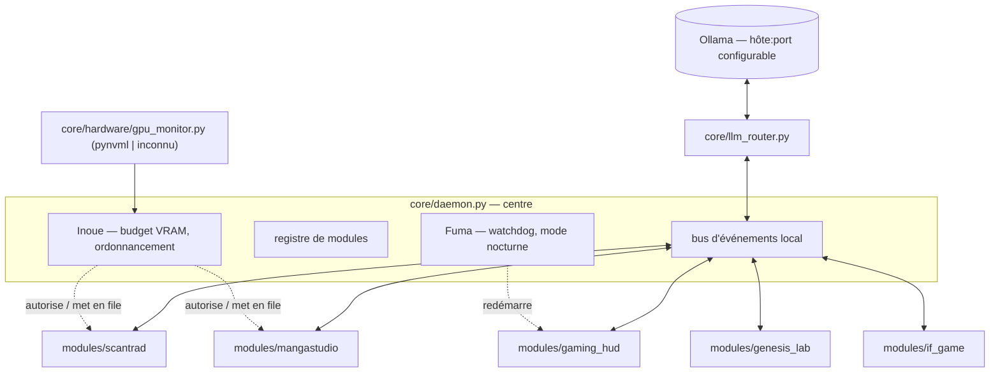
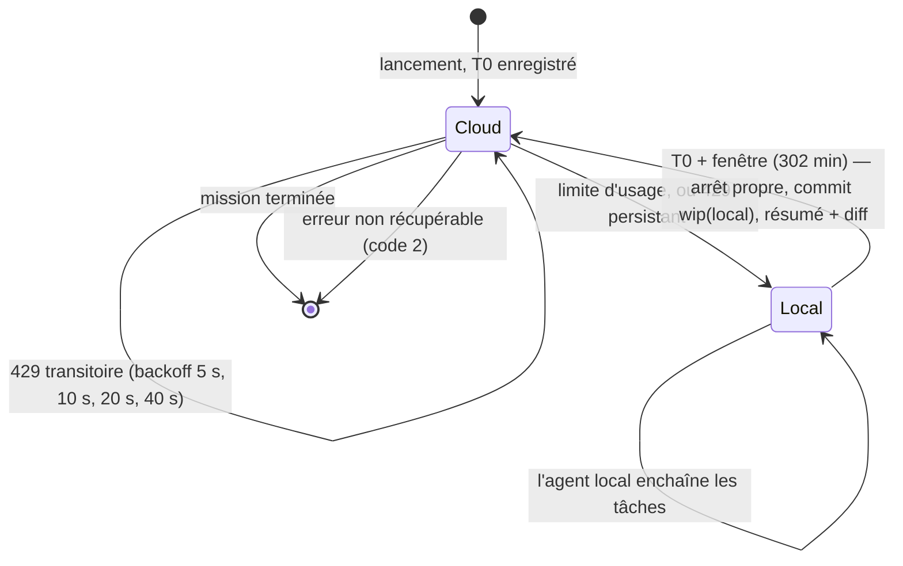
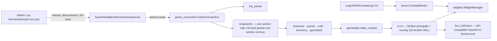

# ARCHITECTURE_MAP — AetherTwin (I&F Core)

Deux parties :

- **Flux et rôles** (ci-dessous) : rédigés à la main.
- **Arborescence et signatures publiques** (en bas) : générées par
  `scripts/gen_architecture_map.py` via `ast`. Ne les modifie pas à la main.
  Un test (`tests/test_architecture_map.py`) échoue si elles sont périmées.

État au 16/11/2026 : seuls `scripts/` et `tests/` contiennent du code. `core/` et
`modules/` sont des paquets vides (jalons J2 et J3). Les schémas marqués
« cible » décrivent ce qui est prévu, pas ce qui existe.

## Vue d'ensemble (cible)



Chaque module tourne dans un **processus séparé** et ne parle au Hub que par le bus
local (`127.0.0.1`). Statut : **À FAIRE** (J2).

## Flux du relais Cloud ⇄ Local (existant, testé en simulation)

Fichier : `scripts/relay_orchestrator.py`.



Données échangées :

| Fichier | Écrit par | Lu par | Rôle |
|---|---|---|---|
| `logs/relay_state.json` | orchestrateur (écriture atomique) | orchestrateur au redémarrage | phase, T0, heure de retour, commit de base |
| `logs/relay.lock` | orchestrateur | autre instance | un seul orchestrateur actif |
| `logs/relay.log` | orchestrateur | Jérémy | journal horodaté |
| `logs/relay_mission.md` | Jérémy (facultatif) | agent cloud | prompt de mission |
| `logs/relay_tasks.md` | agent cloud | agent local | liste de tâches courante |
| `AGENT_HANDOFF.md`, `PROJECT_STATUS.md`, `ARCHITECTURE_MAP.md` | les deux agents | agent local (`--read`) | passation |
| `logs/CHANGELOG_DEV.md` | les deux agents | agent cloud à la reprise | ce qui a été fait |

Points de conception :

- Toutes les dépendances de `RelayOrchestrator` sont injectées (`CloudBackend`,
  `LocalAgent`, Git, `Clock`) : les tests utilisent une horloge virtuelle et des
  doublures, sans réseau externe ni attente réelle.
- Le prompt de Claude Code passe par l'entrée standard, jamais par un shell.
- À la reprise, Claude reçoit le **diff seulement** (tronqué à 20 000 caractères).

## Flux de données de WoW Assistant (code d'origine, à porter en J3)

Référence figée : `_import/wow_assistant_v9/`.



Cible J3 : `GameConnection` + parseur + cache deviennent `adapters/wow_retail.py`
derrière l'interface `GameAdapter` ; `LLMClient` devient client de `core/llm_router.py`.

<!-- AUTO:BEGIN -->
## Arborescence (générée)

```
core/
  __init__.py
  api.py
  bus.py
  daemon.py
  guardians/
    __init__.py
    fuma.py
    inoue.py
  hardware/
    __init__.py
    gpu_monitor.py
  module_api.py
  module_runner.py
  scheduler.py
modules/
  __init__.py
scripts/
  __init__.py
  gen_architecture_map.py
  relay_orchestrator.py
  setup.ps1
config/
  allowlist.yaml
  hardware_profiles.yaml
  local.example.yaml
tests/
  __init__.py
  core/
    __init__.py
    test_bus_scheduler.py
    test_daemon.py
    test_gpu_monitor.py
    test_guardians.py
    test_module_api.py
  data/
    .gitkeep
  test_architecture_map.py
  test_relay_orchestrator.py
  test_repo_hygiene.py
  wow_assistant_v9/
    conftest.py
    test_ui_fixes.py
docs/
  .gitkeep
research/
  .gitkeep
assets/
  .gitkeep
logs/
  CHANGELOG_DEV.md
.github/
  workflows/
    tests.yml
```

## Signatures publiques (générées)

### `core/api.py`

API HTTP locale du démon (FastAPI). Servie sur 127.0.0.1 uniquement par `core.daemon`.

- **`class AskRequest(BaseModel)`**
- `def create_app(daemon: Daemon) -> FastAPI`

### `core/bus.py`

Bus d'événements local du Hub : publication / abonnement entre processus, sur 127.0.0.1 uniquement.

- **`class EventBus`** — Centre du bus. `publish` sert les abonnés locaux puis les clients distants abonnés au sujet.
  - `def start(self) -> tuple[str, int]`
  - `def stop(self) -> None`
  - `def child_env(self) -> dict[str, str]` — Variables à donner à un processus de module pour qu'il rejoigne le bus.
  - `def subscribe(self, pattern: str, callback: Callable[[Event], None]) -> None`
  - `def publish(self, event: Event) -> None`
  - `def clients(self) -> list[str]`
- **`class BusClient`** — Client du bus, utilisé dans le processus d'un module.
  - `def from_env(cls, name: str, env: dict[str, str] | None=None) -> BusClient`
  - `def subscribe(self, *patterns: str, timeout: float=5.0) -> None` — S'abonne et attend la confirmation du bus : aucun événement publié ensuite n'est perdu.
  - `def publish(self, event: Event) -> None`
  - `def recv(self, timeout: float | None=None) -> Event | None`
  - `def close(self) -> None`

### `core/daemon.py`

Le démon : centre de l'architecture en étoile.

- `def psutil_process_names() -> set[str] | None` — Noms (en minuscules) des processus en cours ; `None` si `psutil` est absent (mode dégradé).
- **`class ManagedModule`**
  - `def running(self) -> bool`
- **`class Daemon`** — Registre de modules + bus + gardiens. Toutes les sources externes sont injectables (tests).
  - `def start(self) -> None`
  - `def stop(self) -> None`
  - `def reload_modules(self) -> None` — (Re)lit les manifestes de `modules/`. Un manifeste invalide est signalé, pas fatal.
  - `def activate(self, name: str, auto: bool=False) -> Decision` — Demande la VRAM à Inoue puis lance le module dans son processus. Idempotent.
  - `def deactivate(self, name: str, timeout_s: float=8.0) -> None` — Arrêt propre (ordre sur le bus), puis arrêt forcé si le module ne répond pas. Rend la VRAM.
  - `def tick(self) -> dict[str, Any]` — Un tour : processus, déclencheurs, watchdog, alertes GPU, tâches de nuit. Retourne ce qui a changé.
  - `def status(self) -> dict[str, Any]`
  - `def modules_status(self) -> list[dict[str, Any]]`
- `def main(argv: list[str] | None=None) -> int`

### `core/guardians/fuma.py`

Fuma — gardien de la stabilité et du mode nocturne.

- **`class Alert`**
  - `def to_dict(self) -> dict[str, Any]`
- **`class Fuma`** — Watchdog, limites thermiques et mode nocturne du Hub.
  - `def watch(self, name: str, health: Callable[[], Health], restart: Callable[[], None]) -> None`
  - `def unwatch(self, name: str) -> None`
  - `def tick(self) -> list[str]` — Un tour de surveillance. Retourne les noms des modules redémarrés pendant ce tour.
  - `def revive(self, name: str) -> None` — Remet à zéro les essais d'un module mis au repos (action manuelle).
  - `def check_gpus(self, gpus: list[GpuInfo]) -> list[Alert]`
  - `def is_night(self) -> bool` — Vrai dans la plage de nuit. Une plage qui passe minuit (23 h → 7 h) est gérée.
  - `def schedule_night_task(self, name: str, run: Callable[[], Any]) -> None` — Planifie une tâche lourde pour la nuit (ingestion vectorielle, indexation…).
  - `def run_night_tasks(self, force: bool=False) -> list[str]` — Exécute les tâches en attente si c'est la nuit (ou si `force`). Retourne celles qui ont tourné.
  - `def state(self) -> dict[str, Any]`

### `core/guardians/inoue.py`

Inoue — gardienne de l'énergie et de la VRAM.

- **`class Verdict(StrEnum)`**
- **`class Decision`**
- **`class Inoue`** — Budget VRAM du Hub. Sans GPU détecté, le budget vaut 0 : seuls les modules sans besoin VRAM démarrent.
  - `def total_gb(self) -> float`
  - `def budget_gb(self) -> float` — VRAM attribuable : total moins la marge de sécurité.
  - `def allocated_gb(self) -> float`
  - `def available_gb(self) -> float`
  - `def request(self, name: str, min_gb: float, comfort_gb: float | None=None) -> Decision` — Demande de VRAM. Accorde le confortable s'il tient, sinon le minimum, sinon met en file.
  - `def release(self, name: str) -> list[tuple[str, Decision]]` — Libère l'attribution d'un module, puis sert la file d'attente dans l'ordre d'arrivée.
  - `def plan_llm_load(self, model: str, vram_gb: float) -> tuple[Decision, list[str]]` — Prépare le chargement d'un gros modèle de langage.
  - `def confirm_llm_unloaded(self, model: str) -> list[tuple[str, Decision]]`
  - `def state(self) -> dict[str, Any]`

### `core/hardware/gpu_monitor.py`

Moniteur GPU : mesure la topologie réelle au lieu de la présumer.

- **`class GpuInfo`** — État instantané d'un GPU. Une mesure indisponible vaut `None`, jamais une valeur inventée.
  - `def vram_free_mib(self) -> int`
  - `def to_dict(self) -> dict[str, Any]`
- **`class GpuBackend(Protocol)`**
  - `def read(self) -> list[GpuInfo]`
- `def parse_nvidia_smi_csv(output: str) -> list[GpuInfo]` — Analyse la sortie de `nvidia-smi --query-gpu=… --format=csv,noheader,nounits`.
- **`class NvidiaSmiBackend`** — Lit `nvidia-smi` (commande fixe, sans shell).
  - `def usable() -> bool`
  - `def read(self) -> list[GpuInfo]`
- **`class PynvmlBackend`** — Lit NVML via `pynvml`. L'import est différé : le paquet est optionnel.
  - `def read(self) -> list[GpuInfo]`
- **`class UnknownBackend`** — Repli : aucun GPU NVIDIA détectable. N'empêche jamais le démarrage.
  - `def read(self) -> list[GpuInfo]`
- `def detect_backend() -> GpuBackend` — Choisit le meilleur backend disponible, sans jamais lever d'exception.
- **`class GpuMonitor`** — Point d'entrée unique pour l'état des GPU (utilisé par Inoue, Fuma et l'API du daemon).
  - `def backend_name(self) -> str`
  - `def snapshot(self) -> list[GpuInfo]` — État de chaque GPU. En cas d'erreur de lecture : liste vide et `last_error` renseigné.
  - `def total_vram_mib(self) -> int`
  - `def report(self) -> dict[str, Any]` — Résumé sérialisable (API `/gpu`, overlay OBS).

### `core/module_api.py`

Contrat de module du Hub : manifeste, événements, cycle de vie.

- **`class ManifestError(ValueError)`** — Manifeste absent, illisible ou invalide.
- **`class Triggers`** — Ce qui active le module : processus (ex. « obs64.exe »), titres de fenêtres, ports.
- **`class Manifest`** — Déclaration d'un module. Les besoins VRAM sont lus par Inoue avant tout démarrage.
  - `def to_dict(self) -> dict[str, Any]`
- `def parse_manifest(raw: Any) -> Manifest` — Valide un manifeste déjà décodé. Lève `ManifestError` avec un message précis.
- `def load_manifest(module_dir: Path) -> Manifest` — Lit et valide `<module_dir>/manifest.json`.
- `def discover_manifests(modules_root: Path) -> tuple[dict[str, Manifest], dict[str, str]]` — Parcourt `modules/`. Retourne (manifestes valides, erreurs par dossier). Un module cassé n'arrête rien.
- **`class Event`** — Message du bus. `topic` est hiérarchique : « process.started », « gpu.alert », « module.gaming_hud.state ».
  - `def to_dict(self) -> dict[str, Any]`
  - `def from_dict(cls, raw: dict[str, Any]) -> Event`
  - `def matches(self, pattern: str) -> bool` — « gpu.* » ou « gpu » couvre « gpu.alert » ; « * » couvre tout.
- **`class Health`** — Santé d'un module. `degraded` = démarré sans une dépendance optionnelle (GPU, jeu, OBS, poids…).
  - `def to_dict(self) -> dict[str, Any]`
- **`class ModuleBase(ABC)`** — Classe de base de tout module. `publish` est fourni par le lanceur (bus du Hub).
  - `def name(self) -> str`
  - `def start(self) -> None` — Démarre le module. Doit réussir en mode dégradé si une dépendance optionnelle manque.
  - `def stop(self) -> None` — Arrête proprement et libère les ressources (VRAM comprise).
  - `def health(self) -> Health` — État de santé, interrogé par Fuma.
  - `def handle_event(self, event: Event) -> None` — Reçoit un événement du bus.
  - `def widget_schema(self) -> dict[str, Any]` — Schéma JSON de l'interface générée à la volée par le daemon (titre, sections, boutons).

### `core/module_runner.py`

Lanceur d'un module dans son propre processus : `python -m core.module_runner <dossier_du_module>`.

- `def load_module_class(entry: str) -> type[ModuleBase]`
- `def run(module_dir: Path, client: BusClient | None=None, health_interval_s: float=HEALTH_INTERVAL_S) -> int`

### `core/scheduler.py`

File d'attente GPU unique pour les tâches de vision et de diffusion (scantrad, mangastudio).

- **`class VramRefused(RuntimeError)`** — La tâche demande plus de VRAM que le budget, ou n'a pas obtenu de place à temps.
- **`class GpuScheduler`** — Exécute les tâches GPU une par une, dans l'ordre d'arrivée.
  - `def submit(self, name: str, vram_gb: float, fn: Callable[[], Any]) -> Future[Any]` — Met une tâche en file. Le résultat (ou l'erreur) arrive par le `Future` retourné.
  - `def state(self) -> dict[str, Any]`
  - `def shutdown(self) -> None`

### `scripts/gen_architecture_map.py`

Génère la partie automatique de ARCHITECTURE_MAP.md (arborescence + signatures publiques) via `ast`.

- `def first_line(doc: str | None) -> str`
- `def signature(node: ast.FunctionDef | ast.AsyncFunctionDef) -> str`
- `def describe_module(path: Path) -> list[str]`
- `def tree_lines() -> list[str]`
- `def generate() -> str`
- `def render(current: str) -> str`
- `def main(argv: list[str] | None=None) -> int`

### `scripts/relay_orchestrator.py`

Relais Cloud <-> Local : continuer à développer pendant les coupures de quota.

- **`class Clock`** — Horloge réelle. Remplaçable par `VirtualClock` (tests, --dry-run).
  - `def now(self) -> float`
  - `def sleep(self, seconds: float) -> None`
- **`class VirtualClock(Clock)`** — Horloge simulée : `sleep` avance le temps sans attendre.
  - `def now(self) -> float`
  - `def sleep(self, seconds: float) -> None`
- `def fmt_time(ts: float | None) -> str`
- **`class RelayState`** — État du relais, écrit de façon atomique dans `logs/relay_state.json`.
  - `def save(self, path: Path) -> None` — Écriture atomique : fichier temporaire, fsync, puis remplacement.
  - `def load(cls, path: Path) -> RelayState | None` — Charge l'état ; un fichier absent ou illisible donne `None` (le fichier abîmé est mis de côté).
- **`class LockError(RuntimeError)`** — Un autre orchestrateur est déjà actif.
- `def pid_is_alive(pid: int) -> bool` — Vrai si le processus existe. N'envoie jamais de signal sous Windows (os.kill y tuerait le processus).
- **`class SingleInstanceLock`** — Fichier verrou créé de façon exclusive. Un verrou laissé par un processus mort est repris.
  - `def acquire(self) -> None`
  - `def release(self) -> None`
- **`class Status(StrEnum)`**
- **`class CloudResult`**
- `def classify_text(text: str) -> Status | None` — Reconnaît un message de limite d'usage (QUOTA) ou une erreur de débit (TRANSIENT).
- `def parse_retry_after(value: str | None) -> float | None`
- `def resolve_command(cmd: Sequence[str]) -> list[str]` — Résout l'exécutable via le PATH (sous Windows : .cmd/.exe ; un .ps1 passe par PowerShell).
- **`class CloudBackend(Protocol)`**
  - `def run(self, prompt: str) -> CloudResult`
- **`class ClaudeCodeBackend`** — Lance Claude Code en mode non interactif. Le prompt passe par l'entrée standard (jamais par un shell).
  - `def run(self, prompt: str) -> CloudResult`
  - `def classify(returncode: int, stdout: str, stderr: str) -> CloudResult` — Une sortie réussie peut contenir « 429 » dans son texte : on ne cherche les motifs que sur un échec.
- **`class ApiBackend`** — Appel direct de l'API Anthropic via le SDK officiel (paquet `anthropic`, optionnel).
  - `def run(self, prompt: str) -> CloudResult`
- **`class LocalAgent(Protocol)`**
  - `def available(self) -> tuple[bool, str]`
  - `def start(self, prompt: str) -> None`
  - `def is_running(self) -> bool`
  - `def exit_code(self) -> int | None`
  - `def stop(self) -> None`
- `def ollama_base_url(host: str) -> str`
- `def ollama_has_model(host: str, model: str, timeout_s: float=5.0) -> tuple[bool, str]` — Interroge /api/tags du serveur Ollama configuré (machine locale ou réseau local).
- `def router_is_up(router_url: str, timeout_s: float=5.0) -> tuple[bool, str]` — Vérifie que le routeur local (OmniRoute) répond sur /models.
- **`class SubprocessLocalAgent`** — Agent local branché sur Ollama : Claude Code via un routeur local, Aider, ou OpenCode.
  - `def prompt_file(self) -> Path`
  - `def build_env(self) -> dict[str, str]` — Environnement de l'agent local. Aucune vraie clé : le routeur local n'en demande pas.
  - `def build_command(self, prompt: str) -> list[str]`
  - `def available(self) -> tuple[bool, str]`
  - `def start(self, prompt: str) -> None`
  - `def is_running(self) -> bool`
  - `def exit_code(self) -> int | None`
  - `def stop(self) -> None`
- **`class GitRepo`** — Sous-ensemble de Git utile au relais : point de reprise et diff de revue.
  - `def head(self) -> str | None`
  - `def has_changes(self) -> bool`
  - `def wip_commit(self, message: str) -> str | None` — Commit intermédiaire de tout le travail en cours. Retourne le nouveau HEAD, ou None s'il n'y a rien.
  - `def log_since(self, base: str | None, limit: int=40) -> str`
  - `def diff_stat(self, base: str | None) -> str`
  - `def diff(self, base: str | None, max_chars: int) -> str`
- `def build_local_prompt(tasks: str) -> str`
- `def tail_text(path: Path, max_chars: int) -> str`
- `def build_resume_prompt(mission: str, changelog_tail: str, git_log: str, diff_stat: str, diff: str) -> str`
- **`class RelayConfig`**
- **`class RelayOrchestrator`** — Machine à états du relais. Toutes les dépendances sont injectées (tests sans réseau ni processus).
  - `def window_s(self) -> float`
  - `def run(self) -> int` — Codes de sortie : 0 terminé · 2 erreur · 3 autre instance active · 130 interrompu.
- **`class SimulatedCloud`** — Agent cloud factice : quota atteint au premier passage, succès au second. Aucun appel de service.
  - `def run(self, prompt: str) -> CloudResult`
- **`class SimulatedLocal`** — Agent local factice : chaque passage dure `run_s` secondes d'horloge simulée.
  - `def available(self) -> tuple[bool, str]`
  - `def start(self, prompt: str) -> None`
  - `def is_running(self) -> bool`
  - `def exit_code(self) -> int | None`
  - `def stop(self) -> None`
- **`class NullGit`** — Git factice pour la simulation : ne lit ni n'écrit rien.
  - `def head(self) -> str | None`
  - `def wip_commit(self, message: str) -> str | None`
  - `def log_since(self, base: str | None, limit: int=40) -> str`
  - `def diff_stat(self, base: str | None) -> str`
  - `def diff(self, base: str | None, max_chars: int) -> str`
- `def build_parser() -> argparse.ArgumentParser`
- `def setup_logging(log_path: Path) -> None`
- `def read_optional(path: Path) -> str`
- `def main(argv: Sequence[str] | None=None) -> int`
<!-- AUTO:END -->
