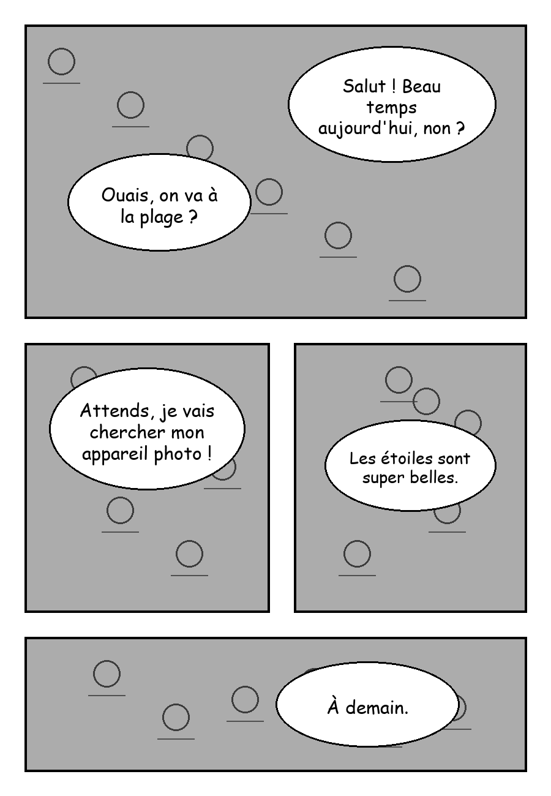
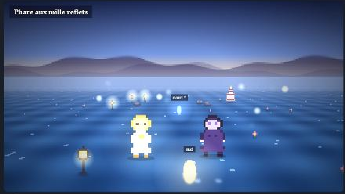
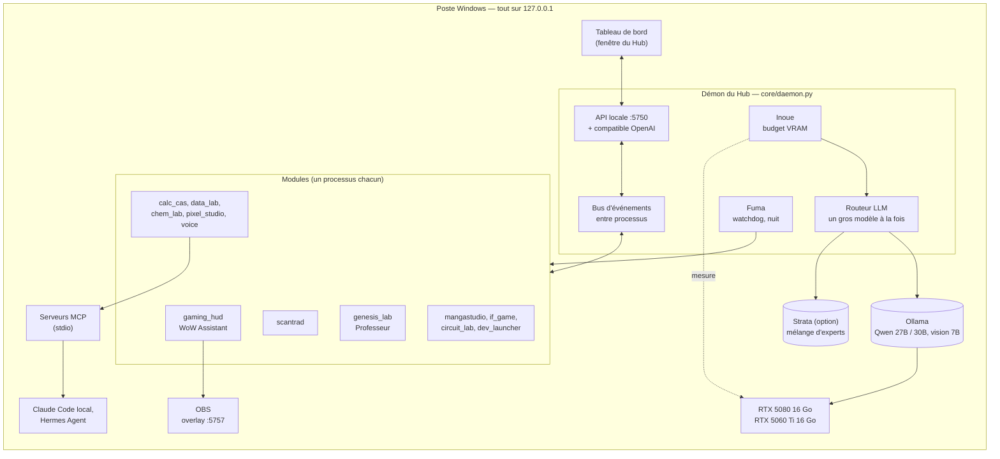
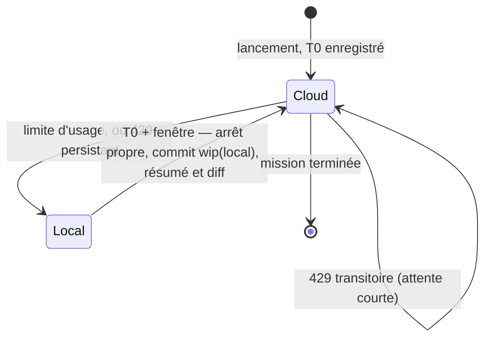

# AetherTwin (I&F Core)

**Un hub d'agents IA qui tourne entièrement en local.** Un démon central observe ce que fait la machine
(un jeu, une page de manga, un cours, un outil de création). Il active le module adapté et partage la VRAM
entre les modèles. Tout s'exécute sous Ollama, sur deux cartes NVIDIA grand public. Aucune requête de
génération ne part vers un cloud.

*À Inoue et Fuma.* Le jeu du Hub, **AetherTwin I&F Hommage**, est dédié à leur mémoire : mes deux compagnons
de vie, partis ensemble après l'été 2026.

> **Démo à télécharger :** [Release `v0.1.0-concours`](https://github.com/Ov3rLoRd-MLEngineer/AetherTwin-IF-Core/releases/tag/v0.1.0-concours)
> (archive `.zip` prête à installer, empreinte SHA-256 et étapes d'installation).

> **État évalué pour le concours ASUS Agent Computer Challenge** : le tag `v0.1.0-concours` (branche
> `concours`), figé le 25/11/2026. Le développement continue sur `main`. AetherTwin est un projet **en
> cours** : ce qui n'est pas fini est dit comme tel, ici et dans [`PROJECT_STATUS.md`](PROJECT_STATUS.md).

<p>



</p>

## En bref

- **Deux gardiens, pas une décoration.** Inoue garde la VRAM : un seul gros modèle chargé à la fois,
  10 % de réserve, budget calculé sur la mesure réelle des cartes. Fuma garde la stabilité : il relance
  un module planté, surveille les températures et lance les tâches de nuit.
- **Des modules qui sont de vrais agents outillés.** Les modèles locaux appellent des outils exacts :
  calcul formel, Python en bac à sable, tableur, chimie, pixel art, voix. Ces outils sont aussi servis en
  **MCP** à d'autres agents (Claude Code local, Hermes Agent).
- **Développé par des agents qui se relaient.** Quand le quota de l'agent cloud tombe, un agent local
  (Qwen sous Ollama) reprend avec une passation écrite. Au retour, l'agent cloud relit le diff.
- **Honnête sur ce qui marche.** Chaque brique porte un statut : `FAIT-TESTÉ`, `FAIT-NON-TESTÉ`,
  `SIMULÉ`, `EN COURS`, `À FAIRE`. Les mesures sont datées.

## Architecture



Le relais de développement Cloud ⇄ Local est décrit plus bas. Le rôle de chaque fichier et les
signatures des fonctions publiques sont dans [`ARCHITECTURE_MAP.md`](ARCHITECTURE_MAP.md), généré par
`scripts/gen_architecture_map.py`.

> **État soumis au concours** : tag `v0.1.0-concours` (25/11/2026). La branche `main` peut contenir des
> évolutions plus récentes ; `PROJECT_STATUS.md` dit lesquelles.

## Installation

Windows 10 ou 11, **Python 3.11** (`py -0p` liste les versions installées). Ollama est conseillé. Sans
lui, le Hub démarre quand même, en mode dégradé.

**Depuis l'archive de la version** (`AetherTwin-IF-Core-<version>.zip`) : décompresser, double-cliquer
sur `Installer AetherTwin.bat`, puis sur `Lancer AetherTwin.bat`. À la fin de l'installation, une fenêtre
propose de créer les raccourcis du bureau (« AetherTwin » avec son logo, et « WoW Assistant »). Les
dépendances facultatives et les poids des modèles s'installent ensuite depuis le Hub (onglets Studio image
et Développement › Dépendances), ou avec les options ci-dessous.

**Depuis le dépôt** :

```powershell
git clone https://github.com/Ov3rLoRd-MLEngineer/AetherTwin-IF-Core
cd AetherTwin-IF-Core
.\scripts\setup.ps1 -Shortcut
ollama pull qwen3-27b; ollama pull qwen2.5vl:7b; ollama pull nomic-embed-text
.\.venv\Scripts\python.exe -m pytest
.\.venv\Scripts\python.exe -m core.daemon --open
```

Si Windows refuse d'exécuter `setup.ps1`, passer par `Installer AetherTwin.bat`. Il autorise le script
pour ce lancement seulement, sans changer le réglage de Windows. Options du script :

| Option | Ajoute | Taille |
|---|---|---|
| `-Gpu` | PyTorch CUDA 12.8 et segment-anything (`mangastudio`) | environ 3 Go |
| `-Weights` | poids HandSegNet, FootSegNet (Hugging Face) et LaMa (`scantrad`) | 2 × 375 Mo + 198 Mo |
| `-Voice` | reconnaissance vocale locale (faster-whisper) | modèle de 480 Mo au premier usage |
| `-Shortcut` | raccourcis « AetherTwin » et « WoW Assistant » sur le bureau, sans poser la question | — |

Le script n'écrit que dans le dossier du projet (sauf les raccourcis acceptés). Il crée `config/local.yaml` depuis
l'exemple ; ce fichier est ignoré par Git et ne contient aucune clé.

**Construire l'archive soi-même.** Après chaque ajout, la même commande refait le paquet :

```powershell
.\.venv\Scripts\python.exe scripts\build_release.py            # archive dans dist\
.\.venv\Scripts\python.exe scripts\build_release.py --verify   # + installation à neuf et tests
```

Le détail est dans [`docs/RELEASE.md`](docs/RELEASE.md).

### Optionnel : Strata, moteur des gros modèles « mélange d'experts »

[Strata](https://github.com/Niko1221/Strata) (MIT) sert des modèles MoE au format OpenAI sur 127.0.0.1.
Il **s'ajoute** à Ollama. Installation et réglage : section `strata` de `config/local.example.yaml`.
Mesuré le 23/11 : 36 à 48 jetons par seconde sur une seule carte, mais 21 à 24 Go de RAM pris. Avec 32 Go
de RAM, il faut l'arrêter avant un traitement lourd (voir [`docs/HARDWARE_FIT.md`](docs/HARDWARE_FIT.md)).

## Démo en cinq minutes

1. `Lancer AetherTwin.bat` : le Hub s'ouvre dans sa fenêtre, sur `http://127.0.0.1:5750/`.
2. **Accueil** : les deux cartes mesurées en direct, le budget d'Inoue, les modèles chargés.
3. **Assistant** : poser une question. La réponse s'écrit mot à mot. Les sources de la base locale sont
   citées quand elles existent.
4. **Scantrad** : ouvrir une page libre de droits, lancer la traduction, corriger une zone à la main.
5. **Professeur** : choisir un niveau et un chapitre, « Préparer », puis un exercice corrigé.
6. **Outils** : la calculatrice (résultats exacts), le labo de chimie, le tableur, le studio pixel,
   l'atelier circuits (consoles à monter, banc logique, cartes RP2040 et AVR).
7. **Jeu** (avec World of Warcraft installé) : état du personnage en lecture seule ; overlay OBS sur
   `http://127.0.0.1:5757/obs-hud`.

Le scénario de la vidéo de deux minutes est dans [`docs/DEMO_SCRIPT.md`](docs/DEMO_SCRIPT.md).

## Les modules

| Module | Ce qu'il fait | État |
|---|---|---|
| `gaming_hud` | WoW Assistant porté dans le Hub : état du jeu en **lecture seule**, assistant, Hermes Agent comme coach, mode Showcase pour OBS avec filtre de confidentialité | testé en réel (jeu, OBS) ; une partie des onglets récents reste à essayer en jeu |
| `scantrad` | Traduction locale de manga (japonais, chinois, coréen, anglais vers le français) : bulles, lecture par un modèle de vision, effacement (LaMa), traduction, réincrustation, mode manuel | testé sur de vraies pages (japonais) |
| `genesis_lab` | Le Professeur : programmes du CP à la terminale, cours, schémas, exercices corrigés, simulations (dont des simulations écrites par le modèle local) ; calculs scientifiques vérifiés | testé en réel |
| `calc_cas` | Calculatrice à calcul formel (SymPy), graphes, géométrie dynamique, Python en bac à sable, outils pour les agents, serveur MCP | testé en réel |
| `data_lab`, `chem_lab` | Tableur à formules et labo de chimie (équilibrage exact, pH, titrages), avec outils MCP | testés ; plusieurs feuilles et cinétique **en cours** |
| `voice` | Voix locale : synthèse Piper, écoute Whisper, effets, studio audio ; conversion de voix kNN-VC **avec consentement** | testé ; modulateur en direct et micro NVIDIA Broadcast **en cours** |
| `mangastudio` | **Hand & Foot SegNet** (onglet Studio image) : les modèles de segmentation publiés par l'auteur, avec leurs fiches, leurs dépôts ([HandSegNet](https://github.com/Ov3rLoRd-MLEngineer/handsegnet-anime-sdxl), [FootSegNet](https://github.com/Ov3rLoRd-MLEngineer/footsegnet-anime-sdxl)), l'installation des poids en un clic et l'outil de masque ; nœuds ComfyUI | masques réels ; jamais chargé dans un vrai ComfyUI |
| `if_game` | **AetherTwin I&F Hommage** : « Fuma et Inoue : les Gardiens de l'Éther », exploration calme en vue RPG 16 bits, en hommage à Inoue et Fuma ; le modèle propose les lieux, le code valide | joué par Jérémy (démo technique) |
| `dev_launcher` | Claude Code local (Ollama), terminal du Hub, pont MCP Hermes ⇄ Claude Code, relais | testé en réel |

### Démonstrations annexes d'agents outillés

Ces modules montrent les mêmes outils d'agents sur d'autres terrains. Ils restent dans le dépôt et dans
le Hub, mais ne font pas partie du cœur (Hub, gardiens, routeur, relais).

| Module | Ce qu'il fait | État |
|---|---|---|
| `pixel_studio` | Studio de pixel art : sprites, animation, cartes en tuiles, exports ; outils pour les agents | testé en réel |
| `circuit_lab` | Atelier circuits : consoles 8 et 16 bits à monter pièce par pièce, téléviseur cathodique, assembleurs, banc logique façon FPGA, cartes RP2040 et AVR | testé ; mappeurs, DMC, périphériques des microcontrôleurs **en cours** |
| `artcraft` | Intégration **externe** des logiciels libres ArtCraft, installés depuis leurs publications officielles | testé |

Le détail brique par brique, avec les dates des essais : [`PROJECT_STATUS.md`](PROJECT_STATUS.md).

## Ce qui en fait un projet « Agentic AI » local

- Les modèles locaux **délèguent** ce qu'ils font mal. Un calcul part vers le moteur exact, un programme
  vers le bac à sable Python (`python_run`), une analyse vers le tableur. La réponse finale reprend le
  résultat réel, pas une estimation du modèle.
- Les mêmes outils sont servis en **MCP** (`aethertwin_calc`, `aethertwin_donnees`, `aethertwin_chimie`,
  `aethertwin_pixel`, `aethertwin_voice`). Claude Code local et Hermes Agent s'en servent comme d'outils
  natifs.
- **OBS se pilote aussi en MCP** (`aethertwin-obs`, `modules/gaming_hud/obs_mcp.py`, 25/11) : scènes,
  captures de fenêtre ou d'écran, logo, réglages vidéo, captures d'image et enregistrement, par le serveur
  WebSocket d'OBS sur la boucle locale. Aucune diffusion n'est possible par ces outils. Testé contre un faux
  OBS ; essai avec le vrai OBS **en cours**.
- Le Hub **orchestre la mémoire**. Inoue décide quel modèle peut se charger, d'après la VRAM mesurée, et le
  routeur décharge le gros modèle précédent avant d'en charger un autre.
- Le projet est **développé par des agents qui se relaient**, avec une passation documentée
  (`AGENT_HANDOFF.md`, `logs/CHANGELOG_DEV.md`).

## Mesures réelles et adéquation matérielle

17/11/2026, RTX 5080 16 Go + RTX 5060 Ti 16 Go, Ollama 0.40.16, contexte fixé :

| Modèle | Quantification | `num_ctx` | VRAM occupée | Première réponse |
|---|---|---|---|---|
| `qwen3-27b` | Q4_K_M | 32 768 | 16,77 Gio | 10,9 s |
| `qwen3-coder:30b` | Q4_K_M | 32 768 | 19,69 Gio | 14,0 s |
| `qwen2.5vl:7b` (vision) | — | 4 096 | 6,3 Gio | 16,7 s |

Les deux gros modèles dépassent la VRAM d'une seule carte de 16 Go : Ollama les répartit sur les deux
cartes. [`docs/HARDWARE_FIT.md`](docs/HARDWARE_FIT.md) détaille ce que coûte ce mur de la VRAM, et ce
qu'une seule carte de 32 Go simplifierait (sans l'avoir testé).

## Développement 24 h/24 : le relais Cloud ⇄ Local

Deux agents se relaient, avec une passation écrite :

- un agent **cloud** (Claude Code), limité par une fenêtre de quota ;
- un agent **local** (Qwen sous Ollama), qui reprend pendant la coupure. Par défaut, c'est Claude Code
  lui-même, branché sur Ollama par un routeur local ; Aider et OpenCode sont aussi pris en charge.



```powershell
.\.venv\Scripts\python.exe scripts\relay_orchestrator.py --dry-run   # simulation complète
.\.venv\Scripts\python.exe scripts\relay_orchestrator.py --status    # état enregistré
```

Une seule instance tourne (fichier verrou). L'état est écrit de façon atomique et relu après un
redémarrage. Ctrl+C arrête proprement. Aucune clé dans le dépôt : les identifiants viennent de
l'environnement.

## Sécurité et vie privée

- Le Hub n'écoute que sur `127.0.0.1`. Une écriture venue d'un autre site, ou d'un hôte non local, est
  refusée (contrôle de l'origine et de l'hôte).
- Les données de jeu sont lues **en lecture seule**. En mode Showcase, tout passe par le filtre de
  confidentialité : ni chemin, ni compte, ni e-mail, ni clé ; or arrondi ; noms masquables.
- Aucune commande issue d'un modèle n'est exécutée hors liste blanche. Le Python des agents tourne dans un
  bac à sable, dans un processus séparé, avec un délai.
- Aucun secret dans le dépôt : `tests/test_repo_hygiene.py` le vérifie à chaque exécution des tests.
- Aucune page de manga protégée dans le dépôt. Ni ROM ni BIOS fournis. Les machines simulées de l'atelier
  ne portent aucun nom commercial.

## Ce qui a été vérifié, et ce qui ne l'a pas été

**Vérifié** (Windows 10, Python 3.11 ; dates dans `PROJECT_STATUS.md`) :

- `pytest` le 25/11/2026 : 1 102 tests réussis, 5 sautés (dont les tests sur GPU réel, ignorés par défaut ;
  `AETHERTWIN_REAL_OLLAMA=1` pour les lancer). `ruff check .` propre.
- Installation à neuf depuis l'archive de la version (`setup.ps1`), puis toute la suite de tests dans la
  copie installée (`scripts/build_release.py --verify`, 25/11/2026).
- Bout en bout réel : démon → module `gaming_hud` → données du jeu → modèle local → réponse correcte.
- Mode Showcase avec un vrai OBS, overlay affiché dans OBS (essais de Jérémy).
- Relais face à une vraie limite de quota (Jérémy, 25/11/2026, sans capture) : l'agent local a pris le
  relais et a demandé s'il fallait poursuivre ou attendre le retour du quota, comme le voulait la consigne.
- Routeur : deux gros modèles chargés l'un après l'autre, un seul en mémoire à chaque instant.
- `scantrad`, Professeur, calculatrice, outils des agents et serveurs MCP : essais réels avec `qwen3-27b`
  et `qwen2.5vl:7b`.
- Moniteur GPU : lecture réelle des deux cartes par `pynvml`.

**Pas vérifié :**

- La CI GitHub sous Ubuntu : 10 tests propres à Windows (chemins, Piper, pywinpty), portage en cours. La CI
  tourne sous Windows, la plateforme visée.
- Les adaptateurs de jeu `log_tail` et `screen_ocr` sur un vrai jeu.
- Les nœuds `mangastudio` dans un vrai ComfyUI.
- Une carte de 32 Go, la topologie à trois cartes, toute carte autre que NVIDIA.

## Feuille de route

En cours après le concours (détail dans `PROJECT_STATUS.md`) :

- montage de la troisième carte graphique (achetée) et mesures à 48 Go ; 64 à 128 Go de RAM pour Strata ;
- relais Cloud ⇄ Local : verser au dépôt le journal d'une bascule réelle ;
- interface simplifiée pour un ComfyUI local (workflows `.json`, choix des modèles) ;
- atelier circuits : autres machines, périphériques des microcontrôleurs, jusqu'à un jeu éducatif ;
- WoW Assistant : essais en jeu des onglets récents ;
- labos : plusieurs feuilles, cinétique, titrages d'oxydoréduction.

Le laboratoire dont vient le projet est décrit dans [`research/overlord_notes.md`](research/overlord_notes.md).

## Licence

Apache 2.0 — voir [`LICENSE`](LICENSE), [`NOTICE`](NOTICE) et [`THIRD_PARTY.md`](THIRD_PARTY.md).
