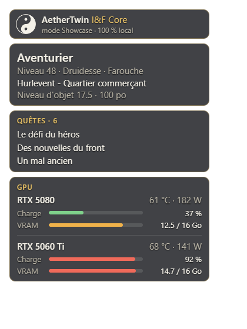

# AetherTwin (I&F Core)

> **Version provisoire du README** (écrite au J1, inexactitudes corrigées le 22/11/2026 ; la version finale
> viendra avec la soumission). L'état détaillé de chaque brique est dans [`PROJECT_STATUS.md`](PROJECT_STATUS.md).

AetherTwin est un **hub d'agents locaux** : un démon central observe ce que fait la machine
(jeu, lecteur, outil de création), active le module adapté et répartit la VRAM entre les modèles.
Tout s'exécute en local, sous Ollama, sur du matériel NVIDIA grand public.

*À Inoue et Fuma.*

## État actuel

| Élément | État |
|---|---|
| Structure du dépôt, conventions, CI, garde-fou anti-secrets | fait, testé |
| Relais de développement Cloud ⇄ Local (`scripts/relay_orchestrator.py`) | testé en simulation |
| Moniteur GPU, contrat de module | fait, testé |
| Bus d'événements entre processus, démon, API locale (`127.0.0.1`) | fait, testé |
| Gardiens Inoue (budget VRAM, VRAM mesurée comprise) et Fuma (watchdog, tâches de nuit) | branchés dans le démon, testés en réel |
| Routeur LLM : un seul gros modèle chargé à la fois, `num_ctx` fixé, réponse mot à mot, API compatible OpenAI | fait, testé en réel sur 2 GPU |
| Tableau de bord local en onglets (`http://127.0.0.1:5750/`), lanceur `Lancer AetherTwin.bat` | fait, utilisé par Jérémy |
| Module `gaming_hud` (WoW Assistant porté) : état du jeu en lecture seule, mode Showcase | fait, testé en réel avec OBS |
| Adaptateurs de jeu : WoW, journal texte, capture d'écran (expérimental) | faits ; seul WoW essayé sur un vrai jeu |
| Overlay OBS local (état du jeu filtré + monitoring des GPU) | fait, vu dans OBS |
| Base de connaissances (Wikipédia, vecteurs locaux) et `genesis_lab` (calculs, Professeur) | faits, testés en réel |
| Professeur : programmes du CP à la terminale, cours, schémas, exercices corrigés, 10 simulations, simulations créées par le modèle local ou le Claude Code local | fait, testé en réel (23/11) |
| Onglet Développement : Claude Code local (Ollama direct, OmniRoute facultatif) dans Windows Terminal ou un terminal du Hub, pont MCP Hermes ⇄ Claude Code, essai du relais | fait, testé en réel (23/11) |
| `scantrad` : traduction de manga japonais → français (automatique ou zones posées à la main) | fait, testé sur de vraies pages |
| `mangastudio` : masques de mains et de pieds (HandSegNet, FootSegNet), nœuds ComfyUI | masques réels ; ComfyUI non essayé ; réglages en cours |
| `if_game` « Éther » : exploration calme, Fuma et Inoue, lieux inventés par le modèle local | fait, joué par Jérémy (démo technique) |

## Installation

Windows 10 ou 11, Python 3.11.

```powershell
git clone <URL-du-dépôt> AetherTwin-IF-Core
cd AetherTwin-IF-Core
.\scripts\setup.ps1
.\.venv\Scripts\python.exe -m pytest
```

Sans le script :

```powershell
py -3.11 -m venv .venv
.\.venv\Scripts\python.exe -m pip install -r requirements-dev.txt
.\.venv\Scripts\python.exe -m pytest
```

### Optionnel : Strata, moteur des gros modèles « mélange d'experts »

[Strata](https://github.com/Niko1221/Strata) (licence MIT) sert des modèles MoE au format OpenAI sur 127.0.0.1.
Il **s'ajoute** à Ollama, qui garde la vision, les embeddings et les modèles denses. Sans Strata, rien ne change.

```powershell
# installation sans droits administrateur, dans le dossier choisi, sans toucher au PATH
$env:STRATA_DATA_DIR = 'D:\Strata'; $env:STRATA_NO_PATH = '1'
irm -TimeoutSec 120 https://github.com/Niko1221/Strata/releases/latest/download/install.ps1 | iex
# modèle, préréglage « AetherTwin », port 8090 (8080 est souvent pris par Open WebUI)
D:\Strata\terminal\current\bin\strata.cmd launch --family qwen36 --model UD-Q4_K_XL --data-dir D:\Strata\Models `
  --context 64k --gpu 0,1 --access local --port 8090 --save-preset AetherTwin --yes --no-tui
```

Puis, dans `config/local.yaml`, la section `strata` (`enabled: true`, `launcher`, `data_dir`, `preset`) : voir
`config/local.example.yaml`. Le tableau de bord (Accueil) montre son état et le démarre ou l'arrête ; ses modèles
s'appellent `strata/<id>` dans le Hub. Tant que Strata tourne, il tient la place du gros modèle : Inoue refuse un
gros modèle Ollama jusqu'à son arrêt. Strata arrêté : les questions `strata/…` passent sur le modèle Ollama par défaut.
Avec 32 Go de RAM, Qwen3.6-35B-A3B convient ; Qwen3.8-Flash-Next (125B) veut 48 à 64 Go de RAM.
Mesuré le 23/11 : 36 à 48 jetons/s sur une seule carte (le moteur de ce modèle n'en utilise qu'une : la RTX 5060 Ti,
pour laisser la 5080 au jeu), mais 21 à 24 Go de RAM pris : arrêtez Strata avant un traitement lourd.
Conclusion : avec 32 Go, manques de mémoire jusque dans le navigateur ; pour l'utiliser pleinement, 64 Go de RAM
(une 3e carte graphique accélère, mais ne baisse pas la RAM demandée).

## Lancer le Hub

Double-clic sur `Lancer AetherTwin.bat` à la racine (ou le raccourci créé par `setup.ps1 -Shortcut`) : le Hub
démarre et ouvre le tableau de bord sur `http://127.0.0.1:5750/`. En ligne de commande :

```powershell
.\.venv\Scripts\python.exe -m core.daemon --open
```

Points d'accès utiles : `http://127.0.0.1:5750/health` (état du Hub et des deux gardiens),
`/gpu` (mesure des cartes), `/modules`, `/events`. Le démon démarre aussi sans GPU, en mode dégradé.

Activer le HUD de jeu et poser une question au modèle local, avec le contexte du jeu :

```powershell
curl.exe -X POST http://127.0.0.1:5750/modules/gaming_hud/activate
curl.exe -X POST http://127.0.0.1:5750/ask -H "Content-Type: application/json" -d '{\"prompt\":\"Où est mon personnage ?\",\"model\":\"qwen3-27b:latest\"}'
```

L'application de jeu d'origine (fenêtre, overlay, voix) se lance seule : `python -m modules.gaming_hud`.

### Overlay pour OBS (mode Showcase)

Quand le module `gaming_hud` est actif, il sert une page à fond transparent, à ajouter dans OBS comme
source « Navigateur » : `http://127.0.0.1:5757/obs-hud`.



*Capture de la page avec des données de démonstration.*

- Ce que la page affiche passe **toujours** par le filtre de confidentialité : ni chemin de fichier, ni nom
  de compte, ni adresse e-mail, ni clé ; l'or est arrondi ou masqué ; les noms de personnages peuvent
  être remplacés (`hide_character_names`).
- Le serveur n'écoute que sur `127.0.0.1`. La page ne charge rien depuis Internet.
- Lancer OBS fait aussi basculer le module en mode Showcase : ce qu'il publie sur le bus est alors filtré.

### Mesures réelles (17/11/2026, RTX 5080 16 Go + RTX 5060 Ti 16 Go, Ollama 0.40.16)

| Modèle | Quantification | `num_ctx` | VRAM occupée | Première réponse |
|---|---|---|---|---|
| `qwen3-27b` | Q4_K_M | 32 768 | 16,77 Gio | 10,9 s |
| `qwen3-coder:30b` | Q4_K_M | 32 768 | 19,69 Gio | 14,0 s |
| `qwen2.5vl:7b` (vision) | — | 4 096 | 6,3 Gio | 16,7 s |

Les deux gros modèles dépassent la VRAM d'une seule carte de 16 Go : Ollama les répartit sur les deux
GPU, et le Hub n'en garde jamais deux en mémoire. Débit en jetons par seconde : non mesuré.

## Développement 24 h/24 : le relais Cloud ⇄ Local

Le projet est développé par deux agents qui se relaient, avec une passation documentée :

- un agent **cloud** (Claude Code), limité par une fenêtre de quota ;
- un agent **local** (Qwen sous Ollama), qui prend le relais pendant la coupure. Par défaut c'est
  Claude Code lui-même, branché sur Ollama par un routeur local (OmniRoute) ; Aider et OpenCode sont
  aussi pris en charge.


L'agent local reçoit `AGENT_HANDOFF.md`, `PROJECT_STATUS.md`, `ARCHITECTURE_MAP.md` et la liste de
tâches courante. Il consigne son travail dans `logs/CHANGELOG_DEV.md`. À la reprise, l'agent cloud
relit **le diff seulement**.

```powershell
# simulation complète, sans appeler aucun service
.\.venv\Scripts\python.exe scripts\relay_orchestrator.py --dry-run

# relais réel
.\.venv\Scripts\python.exe scripts\relay_orchestrator.py --backend claude-code --local-agent claude-code

# état enregistré
.\.venv\Scripts\python.exe scripts\relay_orchestrator.py --status
```

Options principales : `--window-minutes` (défaut 302, soit 5 h + 2 min), `--local-model`
(défaut `qwen3-coder:30b-a3b-q4_K_M`), `--num-ctx` (défaut 32768), `--ollama-host`, `--max-cycles`.

Robustesse : une seule instance (fichier verrou), état écrit de façon atomique dans
`logs/relay_state.json` et relu après un redémarrage, journal `logs/relay.log`, arrêt propre sur
Ctrl+C. Aucune clé dans le dépôt : les identifiants viennent de l'environnement.

## Ce que j'ai vérifié / ce que je n'ai pas pu vérifier

**Vérifié (Windows 10, Python 3.11 ; détail et dates dans `PROJECT_STATUS.md`) :**

- `pytest` (22/11) : 400 tests réussis, 4 tests réels sur GPU ignorés par défaut ; `ruff check .` propre.
- Installation sur un clone vierge avec `scripts/setup.ps1` (avec et sans `-Gpu`).
- Mode Showcase avec OBS réel et overlay affiché dans OBS (essais de Jérémy, 17/11).
- Bout en bout réel (17/11) : démon → module `gaming_hud` → données du jeu → modèle local → réponse correcte.
- Routeur LLM : deux gros modèles chargés l'un après l'autre, un seul en mémoire à chaque instant.
- Filtre de confidentialité : aucune donnée privée de test, ni des données réelles, dans la sortie Showcase.
- Moniteur GPU : lecture réelle de deux GPU NVIDIA (RTX 5080, RTX 5060 Ti) via `pynvml`.
- Démon : lancé pour de vrai, API joignable sur `127.0.0.1:5750` uniquement ; un module de test tourne
  dans un processus séparé, s'arrête proprement, et est relancé par Fuma après un plantage.
- Relais : tous les scénarios en simulation (horloge virtuelle, serveur HTTP factice renvoyant des 429).
- `relay_orchestrator.py --dry-run` : un cycle complet, code de sortie 0.

**Non vérifié :**

- Le relais face à une vraie limite de quota de Claude Code.
- Le lancement réel de l'agent local (Claude Code via OmniRoute ; Aider et OpenCode ne sont pas installés).
- Le backend API face au vrai service Anthropic.
- La CI GitHub (le dépôt n'est pas encore poussé).
- Les adaptateurs `log_tail` et `screen_ocr` sur un vrai jeu (testés sur un journal et une image de test).
- Les nœuds et le workflow `mangastudio` dans un vrai ComfyUI.

## Feuille de route

Voir [`PROJECT_STATUS.md`](PROJECT_STATUS.md) : hub et gardiens (J2), HUD de jeu (J3), mode Showcase
OBS (J4), base vectorielle et laboratoire scientifique (J5), traduction de manga (J6), studio de
retouche et mini-jeu (J7), vérification de l'installation et améliorations (J8), gel (J9).

## Licence

Apache 2.0 — voir [`LICENSE`](LICENSE) et [`THIRD_PARTY.md`](THIRD_PARTY.md).
